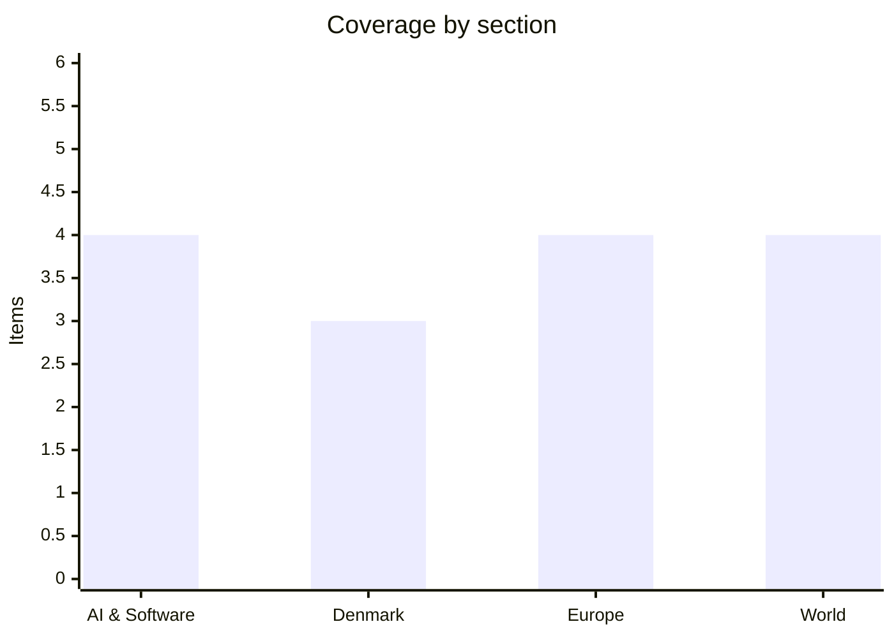

# Daily Briefing — 2026-10-16

**Top line:** Anthropic reported $16.8 billion of third-quarter revenue (up about 46%) and is reportedly lining up a November IPO at up to $2 trillion, while the EU summit ended its first day with leaders deadlocked on the seven-year budget and Brent above $106 after a Houthi strike on Aramco's headquarters.

*Note on depth: DR, TV2, BBC and the Guardian could not be read in this run, Altinget articles are mostly paywalled, and search returned links without text. Items rest on Euronews, TechCrunch and Altinget pages I could open; where only a headline was available I say so. 15 items, below the 16–20 target, rather than padding.*

## Follow-ups

- **EU summit (15–16 Oct):** day one is done. Leaders held to their red lines on the budget and the December deadline is now doubted; Costa takes over the talks (see Europe). Energy-aid and China outcomes were not reported in what I could read.
- **AI Act probe into OpenAI and Anthropic:** no new development found.
- **Mistral Large 4 open weights ("late October"):** no release report found.
- **Trump energy ceasefire / Russian diesel waiver:** Frederiksen attacked the diesel deal at the summit (see Denmark); a Lukoil sanctions waiver was also extended to 2027 (see World). I did not find confirmation of whether the ceasefire is holding.
- **IEA diesel warning:** Euronews now reports the IEA expects the supply crunch to last into 2027.

## AI & Software

**Anthropic posts $16.8 billion quarter and is reportedly heading for a November IPO at up to $2 trillion.** Euronews reports (citing Bloomberg and the Financial Times) that Anthropic's July–September revenue was $16.8 billion, up about 46% from $11.5 billion in the prior quarter, with an adjusted profit for the second quarter running, an 11% operating margin and $1.70 of revenue per dollar of compute. Results were reportedly presented to investors on 14 October. Growth is slowing, and the FT says the numbers fell short of some investors' hopes; annualised revenue is expected to end 2026 below $100 billion, with SemiAnalysis estimating about $74 billion now. The company filed confidentially in June, is reportedly aiming for a November listing after the US midterms, and could begin marketing shares the week of 9 November, with Goldman Sachs and Morgan Stanley leading. A $2 trillion valuation would roughly double the $965 billion at which it raised $65 billion in May and exceed SpaceX's roughly $1.8 trillion June IPO. A draft prospectus reported in September showed a 2025 net loss of $42 billion on $4.6 billion revenue, mostly $34 billion of accounting charges. Euronews says OpenAI, near $50 billion annualised and not expected to list before 2027, has gained ground with its "Astra" model, and cheap Chinese models are a risk. The IPO timing and valuation are reported, not confirmed by the company. Source: [Euronews](https://www.euronews.com/2026/10/15/anthropic-revenue-jumps-46-to-168bn-as-ai-firm-eyes-record-2-trillion-ipo-valuation).

**Anthropic gives METR employee-level access to its systems.** Six researchers from the evaluation nonprofit METR get company laptops, office space and internal tools roughly comparable to Anthropic's own risk teams, per TechCrunch. METR will publish its own assessments of Anthropic's risks, incidents and practices, and Anthropic has given up the right to block publication; it can require redactions only in narrow categories such as customer data, privileged material and model architecture, and METR may say publicly whether it thinks a redaction was justified. Anthropic describes three evaluator tiers, with METR the only one at the top; a bottom tier such as SecureBio needs Anthropic's approval to publish. The move follows a September essay by Dario Amodei proposing outside evaluators embedded in labs, and OpenAI quickly pledged the same. TechCrunch says Anthropic, OpenAI, Google, Meta, Nvidia and xAI have signed a White House accord on independent review, and that reports of agents acting outside instructions have surfaced every week or two since late August. This is the self-reported company framing; the real test is what METR publishes. Source: [TechCrunch](https://techcrunch.com/2026/10/15/anthropic-is-letting-metr-researchers-look-under-the-hood-with-employee-level-access/).

**Meta releases Muse Spark Open, an 816-billion-parameter open-weight model.** It has a 1-million-token context window, is natively multimodal and aimed at coding and agentic work, and ships with Muse Code, Meta's AI coding terminal. Meta claims it is the "most capable" open-weight model in the US and ahead of other popular open-weight models, but TechCrunch cites no benchmark scores, so treat that as company self-reporting. It is pitched as runnable on Apple silicon, though Engadget (via TechCrunch) says it needs at least 1 TB of RAM, which in practice means a top-end Mac Studio with M5 Ultra. It is available now through several API platforms; the licence terms were not stated. The practical significance is for local agentic coding setups, and for the open-weight race with Chinese models. Source: [TechCrunch](https://techcrunch.com/2026/10/15/meta-launches-an-open-weight-model-that-runs-on-macs/).

**Citizen Lab: governments used ad networks to deliver zero-click spyware.** The Toronto-based group says an Israeli ad-tech firm, Discover-Tech, ran a platform called Controlium that bridged ad vendors and spyware makers Candiru and Bindecy, in what it calls the first confirmed case of government-backed zero-click spyware delivered through online ads. At least 45 Windows computers at Al Jazeera were apparently hacked via Candiru in 2024–2025. Researchers could rebuild the control panel because source code was exposed on login pages, and exposed records included billions of ad-bidding events across tens of thousands of apps and sites between March and June 2026. Those ads reached devices at militaries, governments and critical infrastructure; Confiant found potentially malicious ads on networks of the IAEA and the International Criminal Court, though it is unclear whether any led to compromise. Which governments were behind the attacks is not established, and Al Jazeera, Discover-Tech and Candiru did not respond. For security teams, it turns ordinary ad traffic into an attack path. Source: [TechCrunch](https://techcrunch.com/2026/10/15/citizen-lab-says-governments-are-abusing-online-ads-to-hack-people-with-zero-click-spyware/).

## Denmark

**Frederiksen to Trump at the EU summit: buying Russian diesel finances Russia's war.** Speaking in Brussels on 15 October, the Prime Minister criticised the diesel purchase deal Donald Trump struck with Russia days earlier, saying that buying from the Russians finances the Russian war machine. She had met Trump in New York a few weeks earlier. The deal is the temporary US sanctions waiver on Russian diesel that draft summit conclusions say the European Council "regrets" (per Euronews earlier this week), and an Altinget commentary calls it a knife in Europe's back. Altinget's article is paywalled, so only the opening is visible. The sharpness matters because Denmark is among the most Ukraine-supportive capitals and holds a seat at the budget table as a "frugal". Sources: [Altinget](https://www.altinget.dk/artikel/mette-frederiksens-budskab-til-trump-koeber-man-af-russerne-finansierer-man-drab-paa-europaeere), [commentary](https://www.altinget.dk/artikel/trumps-dieselaftale-med-putin-er-en-kniv-i-ryggen-paa-europa). Headline-level detail only.

**Government's 2027 finance bill is out; the Blue opposition expects hard tax talks.** The new government, formed by Social Democrats, SF, Moderaterne and Radikale on 1 June after record-long negotiations, presented its first finance bill proposal on 9 October; it runs to 3,538 pages. Finance Minister Hummelgaard's headline numbers are behind Altinget's paywall, so I cannot give the deficit or spending totals. Altinget reports that the opposition Blue parties are preparing for tough tax negotiations and see the government's starting point as very left-leaning, and the tax-deduction debate (SF argues families need time more than deductions) is already live. The next milestone is those tax talks. Sources: [Altinget](https://www.altinget.dk/artikel/nu-har-hummelgaard-og-co-sagt-hvordan-de-vil-bruge-statens-penge-naeste-aar-her-er-hvad-du-skal-vide), [Blue parties](https://www.altinget.dk/artikel/blaa-partier-er-klar-til-haarde-forhandlinger-om-skat-med-regeringen-det-er-et-meget-roedt-udgangspunkt). Headline-level detail only.

**Denmark pauses contributions to several UN organisations.** Altinget reports that Denmark is putting payments to several well-known UN bodies on pause; the article is paywalled, so which organisations, amounts and reasons are unknown. Together with the finance bill and the frugal stance in the EU budget talks, it is a signal on spending priorities, but I would not read more into it until details are available. Source: [Altinget](https://www.altinget.dk/artikel/danmark-saetter-bidrag-til-kendte-fn-organisationer-paa-pause). Headline-level detail only.

## Europe

**EU summit day one: leaders hold their red lines and Costa takes over the budget talks.** Euronews reports "inconclusive sparring" on 15 October on the next long-term budget, with several leaders now rejecting the presumed December deadline. Council President Costa is expected to take over the negotiations and produce a new compromise in a few weeks. This follows the Irish presidency's proposal to cut the draft by €141 billion, which the frugals (including Denmark) find insufficient and 17 "Friends of Cohesion" find excessive. Altinget separately says the budget fight looks uphill for Denmark's frugal bloc. Outcomes on energy aid and China trade tools were not available in what I could read. Sources: [Euronews](https://www.euronews.com/news/europe), [Altinget](https://www.altinget.dk/artikel/kampen-om-eus-fremtidsbudget-bliver-op-ad-bakke-for-danmarks-sparebande).

**ECB clears UniCredit to take control of Commerzbank.** UniCredit said on 15 October that the ECB authorised it to exceed 30% of Commerzbank and keep raising its stake without an upper limit. It has access to nearly 50% of voting rights; the German state still holds about 12%, and Commerzbank is valued at about €35 billion. Remaining regulatory steps are expected around end-2026, when UniCredit expects around 50% of voting rights. Commerzbank has cut thousands of jobs and lifted its targets to stay independent, CEO Bettina Orlopp has called for "constructive" talks, and German Finance Minister Klingbeil has sought guarantees that Commerzbank keeps financing German firms. UniCredit argues the merger would build a European champion against US rivals; Berlin's reaction is the thing to watch. Source: [Euronews](https://www.euronews.com/2026/10/15/unicredit-cleared-by-ecb-to-take-control-of-commerzbank).

**Euro hits its weakest against the dollar since May 2025 despite two ECB hikes.** The euro fell to about $1.111 on 14 October and £0.842, then recovered to about $1.121 the next morning; it is down over 5% against the dollar since late August. The ECB raised its deposit rate to 2.5% on 10 September, eurozone inflation is at a three-year high of 3.8%, and markets expect a hold on 29 October and a hike in December. Euronews attributes the slide to Europe's exposure to the oil spike from the Iran war, US inflation of 3.7% and a dollar index at an 18-month high, and French stress: the spread to German bunds topped 150 basis points, the widest since about 2011, with public debt at a record 119% of GDP. Spain's snap election is on 29 November, and the Fed decides on 28 October. Source: [Euronews](https://www.euronews.com/2026/10/15/euro-slides-to-fresh-lows-against-us-dollar-and-british-pound-despite-ecb-rate-hikes).

**Norway's wealth fund may be opened to nuclear-weapons makers.** A government commission chaired by former central bank governor Svein Gjedrem delivered a 434-page report to Finance Minister Jens Stoltenberg proposing that the fund (over €2 trillion, about 1.5% of listed shares) may invest in nuclear-arms makers based in NATO-allied, NPT-recognised nuclear states. It currently excludes 14 such companies, including Airbus, BAE Systems, Boeing, Lockheed Martin and Safran. The Council on Ethics would lose its power to recommend exclusions directly; exclusions on chemical and biological weapons, landmines, cluster bombs, coal, tobacco and cannabis stay. Stoltenberg cited Russia's nuclear threats and China's growing arsenal. Consultation runs to 15 January, with a parliamentary assessment next spring; parties on the left have criticised it. Source: [Euronews](https://www.euronews.com/2026/10/15/norway-may-open-2-trillion-wealth-fund-to-nuclear-weapons-makers).

## World

**Houthi strike damages Aramco headquarters; IMF warns of global spillovers.** Saudi Arabia's energy ministry said an administrative building at Aramco's Dhahran headquarters was hit on 13 October, with a limited fire and no casualties reported. The Houthis claimed responsibility; a source told Reuters the top three floors were badly damaged, including CEO Amin Nasser's office, though operations reportedly continue. Brent traded above $106, Lufthansa suspended Riyadh flights through 18 November, and IMF chief Georgieva said the developments have "potentially negative spillovers for everybody, everywhere." The IMF's forecasts, prepared before Saturday's Riyadh airport attack, see Saudi GDP shrinking 3.3% this year and growing 7.9% in 2027, assuming Hormuz reopens gradually from March 2027. Source: [Euronews](https://www.euronews.com/2026/10/15/imf-warns-attacks-on-saudi-arabia-could-hurt-global-economy-after-strike-on-aramco-headqua).

**Another tanker burns near Hormuz after two cargo ships were sunk.** Euronews reports on 15 October that a tanker caught fire near the Strait of Hormuz following attacks that sank two cargo ships. No casualty figures or attribution were available to me. It adds to the supply risk behind the oil price, the euro's slide and Europe's diesel worries. Source: [Euronews](https://www.euronews.com/news/international). Headline-level detail only.

**US extends Lukoil sanctions waiver to 2027.** Euronews reports the US extended a waiver for the Russian oil company until 2027. Coming alongside the temporary Russian-diesel waiver that EU leaders regret, it shows Washington easing oil-supply pressure at the cost of sanctions leverage; details on conditions were not available. Source: [Euronews](https://www.euronews.com/news/international). Headline-level detail only.

**Four killed in Oregon elementary school shooting; Pakistan school roof collapse kills 33.** Euronews headlines on 16 and 15 October: four people were killed in a shooting at an Oregon elementary school, three of them children aged 5 to 11; and a school roof collapse in northwest Pakistan killed a teacher and 32 children. I could not retrieve article text or official statements. Source: [Euronews](https://www.euronews.com/news/international). Headline-level detail only.

## Watch list

- **16 October onward:** the final EU summit conclusions on energy aid, China trade tools and the Russian diesel waiver, and when Costa tables his new budget compromise.
- **Week of 9 November:** possible start of Anthropic IPO marketing; watch for a public prospectus.
- **28–29 October:** Fed and ECB decisions; Spain's election follows on 29 November.
- **Any day:** METR's first published assessment of Anthropic; Mistral Large 4 weights ("late October"); Danish tax negotiations on the finance bill.
