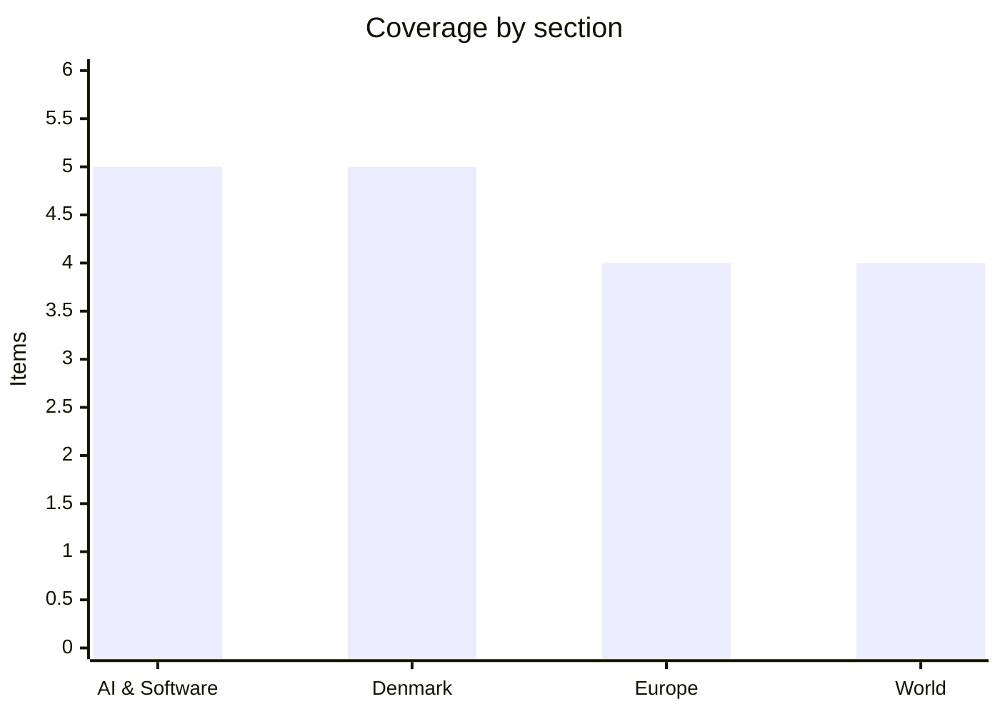

# Daily Briefing — 2026-10-18

**Top line:** Trump signed an executive order suspending the sanctions and tariffs that the new Russia–Iran sanctions act would have imposed within days, the day after EU leaders ended their summit with no budget deal and a €70 billion Ukraine funding gap still open.

*Note on depth: DR, TV2, Politiken, Berlingske and Børsen could not be read in this run (blocked or paywalled), so Danish items rest on The Copenhagen Post's Ritzau-based roundups. Several items below are secondary or aggregator coverage and are marked as such. I could not find a figure for Brent or the DKK/EUR markets.*

## Follow-ups

- **EU summit:** concluded 16 October with no budget deal. Costa will lead a compromise effort and a special budget summit is set for 26 November (details under Europe). No sign yet of Frederiksen's request for Commission scrutiny of Spain's regularisation going anywhere.
- **Russian diesel waiver:** now formalised by executive order (see World); the Moscow airport closures reported yesterday were confirmed by Euronews as 160+ cancelled flights.
- **Replit / Anthropic:** new detail: OpenAI is now the default model in Replit Agent, though Claude stays selectable, and a person familiar says the Anthropic partnership is still in place. Still the CEO's account only.
- **CERT-In rogue AI agents, Anthropic IPO, Mistral Large 4 weights, AI Act probe:** no new development found.
- **Greenland:** 21 October UTC-3 vote still ahead; the deep-sea mining resolution passed unanimously on 15 October (see Denmark).

## AI & Software

**OpenCode breach exposes users' stored OpenAI, Anthropic and Google API keys.** Anomaly Innovations (formerly SST), maker of the terminal coding agent OpenCode, says an intruder got in through a legacy console system it was shutting down, and that third-party provider keys stored in user workspaces "may have been exposed". The earliest exposure was about 00:30 UTC on 17 October; the first notification email went out around 22:51 UTC that day and a second, naming affected keys, just before 01:00 UTC on 18 October. One user reported unauthorised Claude API usage before any warning arrived, and another told a developer they were charged roughly $100. The company says it cannot confirm malicious use and has found no evidence other data leaked. Criticism centres on disclosure: the notice went only by email to accounts already known to be affected, with nothing on the status page or changelog, per a Hacker News thread. Users should revoke and reissue keys at each provider, check billing back to 17 October and set spending caps. OpenCode's own docs say it does not sandbox the agent. Source (secondary): [Startup Fortune](https://startupfortune.com/opencode-breach-exposes-stored-openai-and-anthropic-keys-prompts-urgent-key-rotation/).

**Reflection releases Beam, a 501B open-weights model, under Apache 2.0.** Released on Friday, eleven days after a preview, Beam is a sparse mixture-of-experts model with 501B total and 23B active parameters per token, a 1M-token context and 23.8T pretraining tokens. Reflection reports 81.6% on SWE-bench Verified, 80.1% on Terminal-Bench 2.1, 90.6% on GPQA Diamond and 97.7% on AIME 2026. Artificial Analysis scored it 30 on its Intelligence Index, against 45 for GLM-5.3, so independent evaluation is well below the lab's own coding numbers. The permissive licence makes it one of the largest fully open-weights releases, which matters for teams that need to self-host. Watch for third-party SWE-bench reproductions. Sources: [Reflection blog](http://reflection.ai/blog/beam-is-available), [Hugging Face](https://huggingface.co/blog/reflection-beam) (as linked by a DEV Community digest; I did not open the primary pages).

**Anthropic says it replaced git with an in-house system called Scion.** Anthropic Engineering writes that daily merged changes in its monorepo grew from about 2,500 in May 2026 to over 30,000 in September, with almost 100GB of main-branch history and about 25 million CI checkouts a day. A seven-person team built Scion in five months; Anthropic claims 200x less CPU and memory than the old git mirror fleet and 25% of CI CPU capacity reclaimed. Scion will not be released publicly. The numbers are Anthropic's own, and the post is a useful data point on how much agent-generated code is landing in large repositories. Source: [Anthropic Engineering](https://www.anthropic.com/engineering/redesigning-source-control) (via DEV Community digest; not opened directly).

**Perplexity open-sources SPACE, the sandbox behind its Computer agent.** Released under Apache 2.0, SPACE runs agent code in Firecracker microVMs and replaced a commercial sandbox provider in July. Perplexity reports 118 escape attempts by nine frontier models, none of which succeeded; that is the company's own test, not an independent audit. It is distributed via CoreWeave, Akamai and Crusoe. Given this week's rogue-agent incidents, a production-tested open sandbox is the relevant piece of tooling. Sources: [Perplexity](https://www.perplexity.ai/hub/blog/open-sourcing-space), [GitHub](https://github.com/perplexityai/SPACE) (via digest).

**TSMC raises 2026 capex to as much as $64 billion after a 69% profit jump.** The digest reports Q3 net profit up 69% year on year to $23.6 billion on revenue up 51% to $47 billion, with capex guidance raised to a record. Figures are from the aggregator's summary of TSMC's results; I did not open TSMC's release. It is the clearest signal that AI datacentre demand has not slowed. Source (secondary): [DEV Community digest](https://dev.to/hiroki-ii-ai/ai-daily-digest-october-18-2026-reflection-opens-beam-501b-anthropic-replaces-git-tsmc-rides-4d7l).

## Denmark

**Cyberattack disrupts the Fehmarn Belt tunnel site.** An attack in the night into Monday hit IT systems at Femern Link Contractors, the consortium building the Rødbyhavn tunnel, according to state company Sund & Bælt. Work has partly resumed: earthworks continue, some concrete work can proceed and reinforcement steel production kept running, while the main production facility is expected back "soon" with no date. Lolland-Falsters Folketidende reports workers were told not to use Wi-Fi or open contractor emails, and security guards lost digital access systems. The National Special Crime Unit is investigating and homeland security minister Lisbeth Bech-Nielsen says it is too early for conclusions. Source: [The Copenhagen Post](https://cphpost.dk/2026-10-16/news/round-up/work-partially-resumes-at-fehmarn-belt-site-after-cyberattack/).

**Fallout continues from the CPR register breach.** Unauthorised parties used a small private company's legitimate access to the CPR register to pull about 8.8 million records (names, addresses, CPR numbers) over roughly ten days in September; a CPR employee spotted it on 2 October. Digitalization Minister Christina Egelund said the company's security was inadequate and alerts should have fired sooner; the company's access is closed and it has not been named. The figure exceeds Denmark's population because the register includes deceased people and emigrants. On 15 October Justice Minister Nicolai Wammen urged people not to share passwords or confidential details by phone or email, and Bech-Nielsen has summoned the parliamentary parties to discuss cyber protection. This is an ongoing story, not new today; the political follow-up is the new part. Source: [The Copenhagen Post](https://cphpost.dk/2026-10-05/news/round-up/danish-minister-says-security-was-inadequate-after-access-to-8-8-million-personal-records/).

**Trump calls the Greenland defence deal "the biggest real estate deal ever".** At a rally in Dalton, Georgia, Trump said "we got it for nothing". The agreement, signed in late September at the UN in New York by the US, Denmark and Greenland, allows two additional US bases and opens the door to parts of the Golden Dome missile defence system, alongside the existing Pituffik Space Base. It does not transfer ownership. The Ritzau report carried no Danish or Greenlandic official reaction; separately Greenland's government denied Trump's claim that oil, gas and mineral exploration was beginning. Midterms are on 3 November, and Trump's framing is campaign rhetoric that Copenhagen will have to keep correcting. Source: [The Copenhagen Post](https://cphpost.dk/2026-10-17/news/round-up/trump-greenland-deal-biggest-real-estate-deal-ever/).

**Frederiksen refuses to tell Zelenskyy to soften his criticism of Trump.** After Zelenskyy called Trump's diesel deal with Putin a "weak decision", some partners urged restraint, fearing it could jeopardise US intelligence sharing. Frederiksen said she will not restrict what a democratically elected leader can say. I only had the headline and a brief summary, plus the EU summit account that notes the same tension. Source: [The Copenhagen Post](https://cphpost.dk/2026-10-16/news/round-up/frederiksen-rejects-calls-for-zelenskyy-to-soften-criticism-of-trump/).

**Greenland's parliament unanimously backs a temporary deep-sea mining ban.** The 15 October resolution directs the government to draft a ban running to 31 December 2029, extendable in two-year steps. The government supports it and plans a bill in the spring 2027 session; it takes effect only once passed. WWF Greenland called it "an important step". It came a day after Trump's exploration claim, which Greenland denied. Source: [The Copenhagen Post](https://cphpost.dk/2026-10-16/news/round-up/greenland-parliament-backs-temporary-ban-on-deep-sea-mining/).

## Europe

**EU summit ends with no budget deal and an open €70 billion Ukraine gap.** The 2028–2034 budget negotiating box from the Irish presidency, which proposed substantial cuts, was effectively shelved; Costa will seek a compromise and a special budget summit is set for 26 November. Leaders restated an end-2026 target, but net contributors and the "Friends of Cohesion" remain split. Zelenskyy asked for an extra €70 billion for 2027, saying the war would cost about €155 billion, beyond the existing €90 billion EU loan; the Commission was only tasked with a proposal. Conclusions blamed Russia for attacks on Ukrainian ports and Black Sea shipping and expressed regret at the US easing of Russian diesel sanctions. Source (secondary): [EU Alive](https://eualive.net/eu-leaders-end-inconclusive-summit-with-no-budget-deal-and-deferred-decisions-on-ukraine-funding/).

**Frederiksen v Sánchez over Spain's regularisation of about 600,000 migrants.** Frederiksen asked the Commission to examine Spain's divergence from other states; Sánchez said the facts did not match the rhetoric and other countries grant comparable work permits. Denmark, Italy and Poland pushed tougher migration language but the conclusions stayed mild, noting irregular crossings at their lowest since 2021 and welcoming Commission work on an emergency framework for instrumentalisation. Macron called the debate excessively politicised. Source (secondary): [EU Alive](https://eualive.net/eu-leaders-end-inconclusive-summit-with-no-budget-deal-and-deferred-decisions-on-ukraine-funding/).

**Ukrainian drones close all four Moscow airports; the pace is rising.** Overnight on 16 October, Vnukovo, Domodedovo, Zhukovsky and Sheremetyevo suspended operations for up to seven hours and over 160 flights were cancelled; Pulkovo in St Petersburg halted twice. Moscow mayor Sobyanin said 94 drones were shot down. Agentstvo reports the airports were closed 101 hours in the first 14 days of October against 46 hours in all of September; Euronews could not verify that. Ukraine has not confirmed an organised airport campaign. Trump called strikes on Russian refineries "a disgrace". Source: [Euronews](https://www.euronews.com/2026/10/16/ukrainian-drones-force-closure-of-all-four-moscow-airports-overnight-cancelling-dozens-of-).

**Moldova condemns Russia after five drones crash in under 24 hours.** The drones, identified by Moldovan authorities as Russian, entered over about 17 hours on Thursday and Friday, mainly in northern and eastern districts; one person was slightly injured. A drone landed 35 km from Chisinau a week earlier, and Moldova has closed its airspace several times this year. President Sandu still refuses to let Russian ambassador Oleg Ozerov formally take up his post. AFP notes more drone incidents on NATO's eastern flank. Source: [The Copenhagen Post](https://cphpost.dk/2026-10-17/global/moldova-condemns-russia-after-five-drone-incursions/).

## World

**Trump suspends Russia sanctions and tariffs by executive order.** The order pauses measures due within days under the "Lindsey O. Graham Sanctioning Russia and Iran Act of 2026", signed in mid-September, which would have imposed tariffs of up to 100% on goods from the five largest buyers of Russian oil and gas and others helping evasion. Trump wrote that an exception is "in the US's national interest". Russia is to deliver just under five million tonnes of diesel to the US in coming months. India, a large buyer, had voiced concern about the bill. Europe's reaction is already sharp (see Europe). Sources: [The Copenhagen Post](https://cphpost.dk/2026-10-17/global/trump-suspends-some-sanctions-and-tariffs-on-russia/), Reuters/AP as cited there.

**CENTCOM says the Hormuz blockade has blocked about $25 billion in Iranian oil.** Per Times of Israel's liveblog, Adm. Brad Cooper says US forces escorted 400 merchant ships through Hormuz in the past week and helped freeze $350 million in Iranian crypto, and claims Iran-aligned militias are withholding pay to funnel money to the IRGC. Iran's Revolutionary Guards say a tanker carrying over 2 million barrels hit a mine on an unauthorised route; UKMTO reports a separate tanker hit by a projectile 68 nautical miles northeast of Jubail, crew safe. Saudi Arabia says it downed four drones, one over Riyadh, and Britain advises against non-essential travel to Saudi Arabia. All of these are claims by the parties. Source (liveblog): [Times of Israel](https://www.timesofisrael.com/liveblog-october-17-2026/).

**Israel's 27 October election: Lapid warns of a pre-vote Iran strike.** Yair Lapid said he does not trust Netanyahu not to launch a strike that could disrupt the vote, an opposition claim without evidence offered. Avigdor Liberman urged opposition voters to back only one of four "serving bloc" parties. Source (liveblog headlines): [Times of Israel](https://www.timesofisrael.com/liveblog-october-17-2026/).

**US deficit hits a five-year high near $2 trillion.** Treasury figures released Friday show the FY2026 deficit at nearly $2 trillion, with debt above $40 trillion, driven by interest, defence and social programmes, and by repayment of tariffs the Supreme Court struck down in February. Maya MacGuineas warned the US would be "more indebted than ever" when the next crisis hits. Trump has promised payments to adults if Republicans win both chambers on 3 November. Source (secondary): [The Copenhagen Post](https://cphpost.dk/2026-10-17/global/us-budget-deficit-hits-five-year-high/).

## Watch list

- **21 October:** Greenland parliament's final vote on returning to UTC-3; Naleraq's referendum push on the US defence agreement.
- **27 October / 3 November:** Israeli election; US midterms.
- **28–29 October:** Fed and ECB decisions; Spain's snap election on 29 November.
- **26 November:** special EU budget summit; Commission proposal on Ukraine's 2027 financing.
- **Any day:** OpenCode breach follow-up and abuse reports; Danish police findings on the Fehmarn and CPR incidents.
