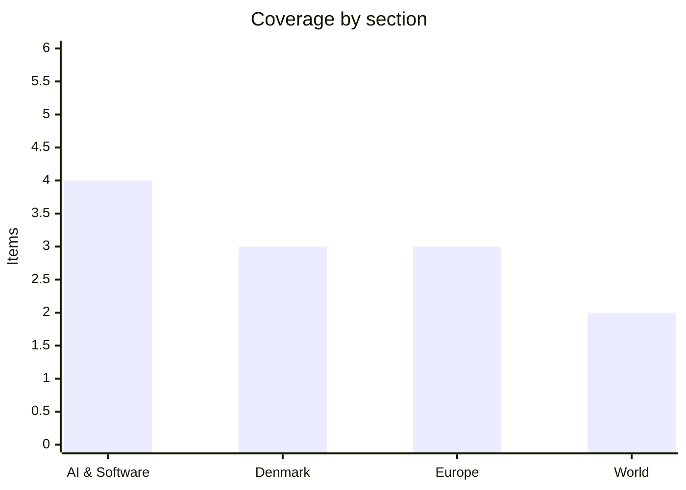

# Daily Briefing — 2026-10-26

**Top line:** Serbian President Aleksandar Vučić has conceded that his Serbian Progressive Party lost Sunday's snap parliamentary election to the student-led "Student List", a political earthquake that ends more than a decade of dominance.

*Note on depth and sourcing: the window since the last briefing (24 October) is only about two days, over a weekend, and my search tools surfaced little dated 25–26 October. Danish outlets (DR, TV2, Politiken, Berlingske, JP, Børsen) were not read directly; Danish items rest on The Copenhagen Post and The Local. Several AI items come from a secondary aggregator. The briefing therefore runs 12 items rather than 16–20, and I have not padded it. Serbian figures are preliminary and come from Vučić's own statement as relayed by Euronews.*

## Follow-ups

- **Serbia vote (Watch list):** resolved — Vučić conceded; see Europe.
- **PHP flaws:** new fact — Amazon says it saw an exploit attempt on a honeypot on 17 October, four days before disclosure, and that the flaws are being "broadly exploited in the wild" (see AI & Software).
- **Copenhagen Airport queues:** the extra security checks ordered by Trafikstyrelsen were expected to last through the weekend "as a minimum"; I found no update on whether they have ended.
- **Anthropic public S-1, Israel's election (27 October), Sofia defence ministers (28 October), Fed/ECB decisions (28–29 October):** not yet occurred or no new reporting found.

## AI & Software

**Amazon says the PHP flaws were exploited before disclosure and are now "broadly exploited in the wild".** The critical vulnerabilities, patched on Wednesday 21 October, sit in code more than a decade old. Calif says it found them with a large language model on 1 August; Wiz says it used its Wiz Atlas tool together with Google's Gemini and OpenAI's GPT-5.6 Sol, and the companies coordinated with the PHP team and OpenAI. Amazon says it detected an exploit attempt against a honeypot on 17 October, four days before public disclosure, which means attackers may have had the bugs before most defenders did. Censys data cited by the report puts about 1.5 million of 2.6 million identifiable PHP hosts on versions with no fix, and PHP runs roughly 75% of websites whose language can be identified. Government sites in several European countries, including the Netherlands, were taken offline as a precaution. The practical consequence for anyone running PHP is that patching is no longer a scheduled task: unpatched, internet-facing hosts should be treated as potentially compromised. The story is also an early, concrete example of AI-assisted vulnerability discovery cutting both ways. Source (secondary, relayed by The Star): [The Star](https://www.thestar.com.my/tech/tech-news/2026/10/21/eu-agency-warns-websites-may-need-to-be-taken-offline-as-php-prepares-patches-for-vulnerabilities).

**The Agentic AI Foundation adds four projects, including Anthropic's Agent Skills and OpenAI's Open Responses.** The foundation now hosts 10 projects after adding Agent Skills (Anthropic), Open Responses (OpenAI), OpenEnv (Hugging Face) and OpenSandbox (Alibaba). Having rival labs place their agent specifications under one neutral roof is a signal that the industry wants shared interfaces for skills, model APIs, training environments and sandboxes rather than four incompatible stacks. The caveat is that hosting a project is not the same as adopting it: providers differ on which features they actually support, so teams should test before relying on portability. This item is from an aggregator digest; I did not open the foundation's own announcement. Source (secondary): [AI Agent Store roundup](https://aiagentstore.ai/ai-agent-news/2026-october).

**Daytona raises a $60 million Series B at a $1 billion valuation for agent infrastructure.** The round was led by FirstMark Growth and brings total funding to $91 million. Daytona builds infrastructure for agents that run many short-lived, stateful jobs, which is the sandbox layer that coding and computer-use agents depend on. Its valuation, together with Alibaba's OpenSandbox joining the Agentic AI Foundation the same day, suggests sandboxing is becoming a distinct product category rather than a feature of each agent. The aggregator's advice is to model workspace creation, persistence and idle time, not only token costs, when budgeting. Source (secondary): [AI Agent Store roundup](https://aiagentstore.ai/ai-agent-news/2026-october).

**Block releases Dessa, a local speech-to-speech model for consumer GPUs *(reported, secondary)*.** Dessa is pitched for on-device voice agents, meaning no audio has to leave the machine. The aggregator flags that a convincingly human voice raises social-engineering risk and suggests constraining early pilots to surfacing information or handing off to a person. I could not find Block's own announcement, so benchmark and licence details are unverified. Source (secondary): [AI Agent Store roundup](https://aiagentstore.ai/ai-agent-news/2026-october).

## Denmark

**University of Copenhagen says hackers accessed data on about 525,000 people.** KU found the intrusion on Tuesday 20 October, says it was "subsequently brought under control", and announced it on Friday evening 23 October after notifying Datatilsynet. The exposed data includes full names, CPR numbers, work and private phone numbers and private email addresses; CPR numbers are the key to identity fraud in Denmark, which is what makes this serious. KU is still analysing the scope and has promised updates. Minister for public security Lisbeth Bech-Nielsen (SF) said the case shows the cyber threat is serious, and her ministry is monitoring KU and Aarhus University. At Aarhus, a hacker reached a server and tried to change passwords for about 1,700 current and former staff and students, but the attempt failed because the intrusion was detected. Nothing public says who was behind either attack or whether data has been misused. Source: [The Copenhagen Post](https://cphpost.dk/2026-10-24/news/round-up/data-on-525000-people-compromised-in-ku-cyberattack/).

**Denmark's citizenship screening model slips to mid-March 2027.** The expert group examining a test for anti-democratic views among applicants will not report around New Year as planned; chairman Henrik Thomassen now expects to finish in mid-March, citing the "scope and complexity of the work". The group was set up in 2025 with a ten-month deadline. In the meantime the government will bring a bill granting citizenship to 2,055 people before the model exists; it was first debated on 5 February and lapsed when Prime Minister Mette Frederiksen called a general election three weeks later. The bill is already contested: the Danish People's Party wants a Pakistani man removed over a 2016 Facebook post, which he denies amounted to support for violence, and Liberal Alliance wants a woman who allegedly praised Hamas leaders questioned by the Naturalisation Committee. Expect the committee stage to be the real fight. Source: [The Copenhagen Post](https://cphpost.dk/2026-10-24/news/round-up/denmark-delays-new-citizenship-screening-model-what-it-means-for-applicants/).

**Denmark will end mink farming by August 2029 and has bought long-range missiles *(both from 23 October; I could not confirm whether the previous briefing covered them)*.** Denmark will not seek an EU exemption, so the ban takes effect on 7 August 2027 with a two-year transition; minister Christian Rabjerg Madsen said an industry should not continue merely because it has existed a long time. About 15 million mink were culled during the pandemic, and mink were added to the EU invasive species list last summer. Separately, Defence Minister Jeppe Bruus announced purchases of Kongsberg strike missiles that can be fired from F-35s and Covenant's Anthem land-launched missiles, without disclosing numbers, cost or delivery dates; Russia's ambassador condemned the purchase, and Denmark signed a US agreement on maritime cooperation, especially shipbuilding. Source: [The Local](https://www.thelocal.dk/20261023/today-in-denmark-a-roundup-of-the-latest-news-on-friday-67).

## Europe

**Vučić concedes as the Student List wins Serbia's snap election.** In a brief statement Vučić said "based on the stratified sample, it is clear that we have lost the election". He projected the Student List at about 2.2 million votes and 135–140 seats, a majority, against about 1.72 million votes and roughly 105 seats for his SNS, with the Hungarian minority party SVM on three seats and one seat each for an Albanian party and the SDA. The 3% threshold means small-party outcomes are not final, though Vučić said this would not change the result. Turnout was not reported in my source, though France 24's headline calls it record turnout, which I could not open. These are preliminary figures from the losing side, not official results. The vote followed a student-led protest movement and a campaign in which Vučić alleged a foreign conspiracy; now the Student List must govern, with open questions on EU accession, Kosovo, energy and relations with Russia and China, plus high expectations of judicial and media reform. Sources: [Euronews](https://www.euronews.com/2026/10/25/vucic-concedes-defeat-in-pivotal-serbian-elections-says-student-movement-has-won), [EUalive pre-vote](https://eualive.net/vucic-alleges-foreign-conspiracy-as-serbia-heads-to-crucial-sunday-vote/).

**A drone strike sinks the merchant ship Khoryv off Romania's coast.** The Comoros-flagged ore carrier was hit on Friday 23 October about 13 nautical miles east of Constanța, inside Romania's exclusive economic zone, while sailing from Ereğli in Turkey to Sulina with ferrous metals. It capsized and sank during rescue; of 13 crew (10 Ukrainian, 3 Azerbaijani), nine were rescued, one body was recovered and three are missing. Authorities are investigating and the attacker is unconfirmed; suspicion falls on Russia, which has not claimed responsibility. Romania, Bulgaria and the EU condemned the attack, Romania's Supreme Council of National Defence met, and NATO discussed enhanced counter-drone measures. Turkish, Bulgarian and Romanian defence ministers meet in Sofia on 28 October, and insurance costs for Constanța and the Sulina corridor are rising. This is the first fatal strike on a merchant ship in Romania's own economic zone that I could find, which is why it matters for NATO. Source: [EUalive](https://eualive.net/commercial-ship-hit-by-drone-attack-sinks-off-romanian-coast-one-dead-and-three-missing/).

**The EU recasts its Arctic policy around security (20 October; not covered earlier).** Presented in Strasbourg by Ursula von der Leyen and Kaja Kallas, it is the first major update since 2021 and puts security and resilience ahead of climate. It proposes a Maritime Security Hub, an Arctic Cable Hub to protect undersea cables and track shadow-fleet vessels, dual-use upgrades to transport corridors, IRIS² secure connectivity and a planned Pan-Arctic Cable linking Greenland to Europe. The Commission says Arctic warming is nearly four times the global average, more than €1 billion of cohesion funding is committed for 2021–27, and €200 million for Greenland was announced last month; there is no overall price tag. Von der Leyen said territorial integrity "can no longer be taken for granted". Read alongside Denmark's Greenland-US defence agreement debate in November, it shows Brussels trying to claim a role there. My source reports no member-state reactions. Source: [EUalive](https://eualive.net/eu-recasts-arctic-policy-around-defence-and-critical-infrastructure/).

## World

**Trump endorses Netanyahu as Israel votes on Tuesday.** Trump urged Israelis on Truth Social to vote for Netanyahu so they can "finish the job" against Iran, after Axios reported Netanyahu asked for a public show of support while polls had his coalition short of a majority. Netanyahu posted an AI-generated image of a nuclear strike on Tel Aviv and warned of a "2nd Holocaust" if he loses, which opposition leader Gadi Eisenkot called "hysterical". Channel 12 reported that IDF Chief of Staff Eyal Zamir resisted an Iran-related order and demanded signed legal authorisation; Netanyahu called it "nonsense". The IDF will lock down the West Bank during the vote and Shin Bet is protecting three opposition leaders. Trump's claims that Iran lacks a navy or air force and has 301% inflation are his own and unverified. Source (live blog, headline-level): [Times of Israel](https://www.timesofisrael.com/liveblog-october-26-2026/).

**Saudi Arabia, Turkey and Pakistan, the "Mecca Pact", were set to meet Iranian officials in Tehran *(reported by Reuters via Times of Israel)*.** It would be the first high-level contact between Iran and all three since Houthi attacks on Saudi Arabia escalated, and aims at regional coordination. I found no detail on agenda or outcome, and nothing in my sources updates the Hormuz situation or the IRGC's claimed ship attacks from the last briefing. The meeting matters mainly as a sign that regional powers are hedging while the US blockade and the pre-midterm lull in strikes continue. Source (secondary): [Times of Israel liveblog](https://www.timesofisrael.com/liveblog-october-26-2026/).

## Watch list

- **27 October:** Israel's election; polls show no bloc with a majority.
- **28 October:** Turkey–Bulgaria–Romania defence ministers meet in Sofia on Black Sea security after the Khoryv sinking; 28–29 October Fed and ECB decisions.
- **Coming days:** Official Serbian results and coalition moves; a public Anthropic S-1; further KU/Aarhus breach updates from Datatilsynet.
- **3 November:** US midterms; 12/19 November Folketing readings of the Greenland agreement; 26 November special EU budget summit.
