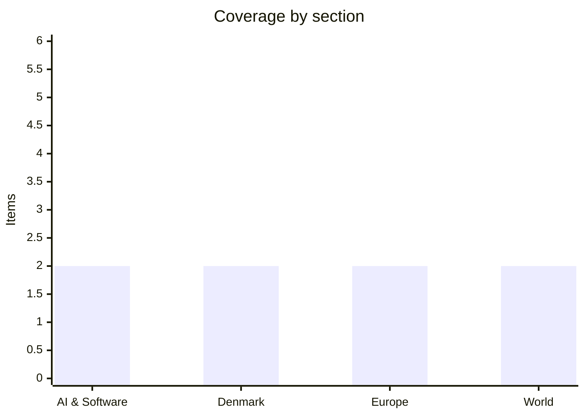

# Daily Briefing — 2026-10-29

**Top line:** Israel's election has produced a near-deadlock — Netanyahu's bloc was projected at 54 seats with 84% counted, short of 61, yet he is already claiming a mandate to form a government.

*Note on depth and sourcing: this briefing is much thinner than the 16–20 item target (about 8 items). The search tools returned mostly link lists and headline-only archive pages; DR, TV2, Politiken, Berlingske, JP and Børsen could not be read, Reuters/Bloomberg pages were not retrievable, and the Fed and Spain items rest on a single Euronews headline each. I have not padded or invented detail. Items below are marked where they are not primary-confirmed.*

## Follow-ups

- **Fed decision (watch list):** resolved — the Fed held rates on 28 October, with two officials dissenting in favour of a hike (Euronews headline; statement text not retrieved). ECB decision on 29 October not yet found.
- **Israel's election (watch list):** votes counted overnight; see World. Official results still expected 4 November.
- **EU–Canada summit, Anthropic roadshow, Serbia, Bolsonaro, Zelenskyy talks:** no new reporting found.

## AI & Software

**GitHub makes Copilot Fusion generally available.** A 28 October AI-news archive lists GitHub moving Copilot Fusion to general availability. My follow-up search surfaced only older Fusion/HydraFusion preview coverage (a multi-model coding workflow preview), not GitHub's own GA announcement, so pricing, tiers and model support could not be confirmed. The relevance for developers is that multi-model routing inside Copilot is leaving preview; check GitHub's changelog for specifics. *(reported via aggregator, primary source not found)* Source: [Silicon Report archive, October 2026](https://www.siliconreport.com/ai/archive/2026-10).

**OpenAI tightens election safeguards and expands ChatGPT integrations.** The same archive lists OpenAI convening an "election center" on 28 October to spot model misuse ahead of the 3 November US midterms, adding a safeguard against political deepfakes on 26 October, and adding Apple email and calendar support to ChatGPT on 27 October. Apple separately shipped system updates with a new Siri and AI tools, and an AI assistant in Keynote, Pages and Numbers. Details such as the mechanics of the deepfake safeguard were not retrievable; treat these as headline-level. *(aggregator only)* Source: [Silicon Report archive](https://www.siliconreport.com/ai/archive/2026-10).

## Denmark

**Broad parliamentary majority backs a ban on "turbo chickens".** Nature and Animal Welfare Minister Christian Rabjerg Madsen says chickens bred to grow so fast that they can no longer walk should be banned, and The Local reports a broad majority in the Folketing behind the idea. The birds are reportedly kept with as little as three hours of darkness a day. No bill text or timetable was retrievable, so when a ban would take effect is unknown. Source: [The Local Denmark](https://www.thelocal.dk/).

**A senior Venstre MP has been expelled from the party for rejecting the party line.** The Local reports the removal on 28 October; the MP's name and the issue at stake could not be read from the page I had access to. Also on The Local: preliminary tax assessments will open two weeks late in November, and Danish People's Party is disputing one applicant on a citizenship bill. Read the original DR/Politiken coverage for the name and context. *(thin, single secondary source)* Source: [The Local Denmark](https://www.thelocal.dk/).

## Europe

**Spain: reports of a train crash in the Madrid area, with mourners demanding a minister's resignation.** Euronews' 29 October top-stories page carries a headline that Madrid is mourning victims of a train crash while rescuers work through the night, with banners reading "corruption kills". I could not confirm a new crash: searches only returned coverage of the January 2026 high-speed collision in southern Spain (about 40 dead), so this may be a continuation of that story or a separate new event. Casualty numbers and cause are unknown to me. *(unconfirmed, single headline)* Source: [Euronews top stories](https://www.euronews.com/top-news-stories-today).

**Belgium's federal finance service hit by a cyberattack.** Euronews reports that the Federal Public Service Finance was hit on 28 October by an attack that disrupted digital services, including filing deadlines. Earlier searches show a pattern of attacks on Belgian public-sector sites, some attributed to pro-Russian hacktivists, but I found no attribution for this incident. *(single headline; no primary notice found)* Source: [Euronews top stories](https://www.euronews.com/top-news-stories-today).

## World

**Israel's election leaves Netanyahu short of a majority.** With 84% of votes counted, Netanyahu's bloc was projected at 54 of 120 seats, below the 61 needed, according to Yeni Şafak's election-night headlines; exit polls had shown both blocs short. Netanyahu has nonetheless claimed a mandate to form a right-wing government, while Gadi Eisenkot urged him to step down. A pre-election Channel 13 poll had put the blocs level at 53 seats each with Arab parties on 14, so Arab-party support and coalition arithmetic will decide who can govern; otherwise Israel faces another election cycle with a caretaker government. Official results are expected 4 November. Source: [Yeni Şafak](https://en.yenisafak.com/world/eisenkot-leads-netanyahu-as-israeli-blocs-deadlock-at-53-seats-3722732).

**The Fed holds rates, with two dissenters wanting a hike.** Euronews reports the Fed left rates unchanged on 28 October, days before the US midterms, with two officials dissenting in favour of another increase. That a hike is on the table at all signals the inflation concern flagged in yesterday's briefing (3.7% per Euronews). I could not retrieve the statement or the vote breakdown, so names of the dissenters and forward guidance are missing. *(single headline)* Source: [Euronews top stories](https://www.euronews.com/top-news-stories-today).

## Watch list

- **29 October:** ECB rate decision; EU–Canada summit in Montreal (29–30 October).
- **3 November:** US midterm elections; OpenAI's election-misuse monitoring will be tested.
- **4 November:** Israel's official election results; EU enlargement package.
- **9 November onward:** reported Anthropic IPO roadshow; clarity on whether the Spain train-crash report is a new event.
