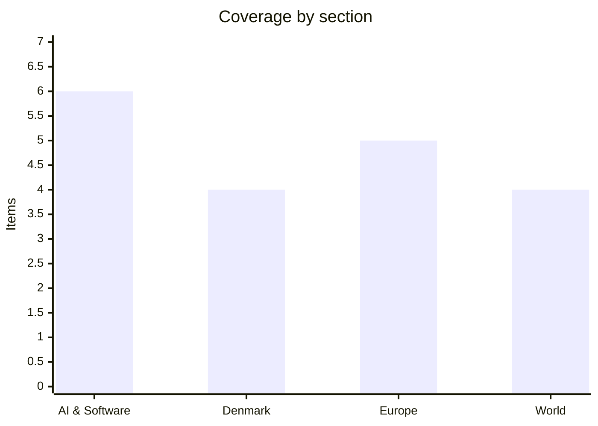

# Daily Briefing — 2026-10-30

**Top line:** Christine Lagarde will leave the ECB on 7 February 2027, nine months early, the same day the bank held its deposit rate at 2.5% with eurozone inflation at 3.8% and French bond yields near 5%, which opens a leadership race at the worst possible moment.

*Note on sourcing: DR, TV2, Berlingske, BBC, the Guardian, NPR and CNBC could not be fetched today (robots.txt or site blocks). Danish coverage rests on Altinget and The Local, AI coverage largely on aggregators (AI Weekly, GitHub-hosted digests) that link to primary sources I could not open, and the Israel and Spain items on secondary outlets. Items are flagged where they are not primary-confirmed. This is shorter than the usual item count in places; I did not pad.*

## Follow-ups

- **ECB decision (watch list):** resolved — held at 2.5% on 29 October; Lagarde announced her early exit (see Europe).
- **Israel's election:** final count is in: Netanyahu's bloc 53 seats, no majority; fraud and "foreign interference" claims now dominate (see World). Certification is due 4 November.
- **Spain "train crash" (flagged unconfirmed yesterday):** confirmed as a new event, a high-speed collision on 28 October near Urda, Toledo province, not the January crash (see Europe).
- **Fed:** held on 28 October with two dissenters favouring a hike (from yesterday); no new detail found.
- **Anthropic IPO roadshow:** secondary sources now say Anthropic has filed for an IPO (see AI & Software); roadshow timing still unconfirmed.
- **Belgium finance-service cyberattack, EU–Canada summit:** no fresh reporting found; The Local carries a 29 October piece on easier Europe–Canada mobility, possibly summit-related, unconfirmed.
- **Venstre MP expelled (Denmark):** Altinget now provides context (see Denmark).

## AI & Software

**Google unveils Gemini 4 Carbon, shipping first to cyber defenders.** Google announced Gemini 4 Carbon on 28 October, priced at $2 per million input tokens and $10 per million output tokens. Google's own figures put it first on the Artificial Analysis Intelligence Index v5 with a score of 59, and show 88.2% on SEC-bench Pro, 71.0% on CWE-bench patching and 54.8% on ExploitGym. Those are company-reported benchmarks and have not been independently reproduced. The notable choice is distribution: the model goes first to defenders through a programme called Fairwind, which fits a pattern this week of labs treating offensive-security capability as the gating factor for release. It arrives the same week Alphabet's shares fell sharply after earnings (below), so the launch is also a signal to investors. Source: [Google announcement, as cited by AI Weekly](https://aiweekly.co/ai-news-today) *(primary page not opened; via aggregator)*.

**Mistral releases Large 4 as a trillion-parameter open-weights model.** Mistral's "Le Chonk" is a multimodal mixture-of-experts model of about one trillion parameters, with weights on Hugging Face under a modified MIT licence that includes a carve-out limiting model-as-a-service resale. Mistral reports 19.7% on FrontierCode and 41% on Terminal-Bench, says it uses 47% fewer tokens than the top open models on the Artificial Analysis Coding Agent Index, and says it resists 97.1% of attacks on the B3 agent security benchmark. API pricing is $0.70 per million input and $2.10 per million output tokens. The licence terms matter for European companies hoping to host it commercially, and the token-efficiency claim is the one to test, since it is self-reported. Source: [Mistral](https://mistral.ai/news/mistral-large-4-oss/) *(as cited by AI Weekly; page not opened)*.

**Alphabet and Microsoft report huge AI spend; Alphabet shares drop about 12%.** Alphabet's Q3 revenue was $127.6B, up 25%, with Google Cloud up 103% to $30.7B and quarterly capex of $51.4B; it raised its 2026 capex guide to $195–205B and said 2027 will top $300B. Shares fell about 12% on 28 October, which AI Weekly describes as roughly $460–500B of market value, with the two cited figures differing. Alphabet's 10-Q also lists $924.4B in purchase commitments and warns of "autonomous agents taking actions outside of their intended scope" seen in testing. Microsoft's fiscal Q1 revenue was $92.3B, up 19%, with Azure up 48% and calendar-2026 capex guided to about $175B, and its filing shows $10B of revenue from OpenAI arrangements, nearly 11% of the total. The read-through is that investors are now punishing capex growth that outruns visible returns, even at 100%+ cloud growth. Sources: [AI Weekly summary of SEC filings](https://aiweekly.co/ai-news-today) *(aggregator; filings themselves not opened)*.

**Anthropic reportedly files for an IPO.** A Chinese-language digest and an NPR headline of 26 October ("AI giant Anthropic files for an IPO that could break records") indicate Anthropic has filed publicly; the digest cites an expected valuation of "2 trillion US dollars", which I could not verify and treat with caution. I could not read the NPR piece or the S-1, so exchange, raise size and timing are unknown. One concrete detail from a Bloomberg item cited by AI Weekly: SpaceX's filing names Anthropic as "Customer B", 34.5% of its Q3 revenue, which suggests the S-1 era is surfacing large customer concentrations on both sides. Yesterday's briefing flagged a reported roadshow from 9 November; that remains unconfirmed. *(reported, unconfirmed on details)* Sources: [NPR](https://www.npr.org/2026/10/26/nx-s1-6014772/anthropic-ai-ipo-could-break-records) (headline only), [AI Weekly](https://aiweekly.co/ai-news-today).

**OpenAI ships GPT-6.1 Terra and rewrites its Model Spec.** GPT-6.1 Terra, released 26 October as `gpt-6.1-terra`, costs $1 per million input tokens and $5 per million output tokens, which OpenAI's community post says is 50% below GPT-5.6 Terra, and targets fast computer use; it is API-only, not in ChatGPT. The accompanying system-card addendum rates it Critical for cybersecurity and High for biological and chemical capability. Codex 0.165.0 (27 October) adds GPT-6.1 Terra, a built-in Vertex AI provider and memory v2 by default, and ChatGPT gained iCloud Mail and Calendar plugins. On 29–30 October OpenAI also published an updated Model Spec, reorganised around five values and referring to the model as "GPT" rather than "the assistant", while saying current models "do not yet fully reflect" it. The Model Spec details are from AI Weekly and metadata only. Sources: [Releasebot OpenAI log](https://releasebot.io/updates/openai), [AI Weekly](https://aiweekly.co/ai-news-today).

**AI-driven exploitation and a new attack on coding agents.** Per The Hacker News as cited by AI Weekly, Anthropic's Frontier Red Team says an unreleased model built working exploit chains across five platforms, including CVE-2026-98432 (CVSS 9.8, Linux zero-click remote root) and a Chrome sandbox escape patched in Chrome 156. Separately, Help Net Security reports "EMBRACE", an attack by Forever Security that bypasses browser security rules in Cursor, GitHub Copilot, OpenAI Codex, VS Code and Claude Desktop; Cursor and Copilot shipped fixes in October, while Codex and VS Code were unpatched at publication. If you run any of these tools, check for updates now. Both are company or researcher claims relayed by an aggregator. *(reported, not primary-confirmed)* Source: [AI Weekly](https://aiweekly.co/ai-news-today).

## Denmark

**Venstre expels a long-serving MP amid a party crisis.** Altinget reports that Venstre has excluded a "mangeårigt folketingsmedlem" (long-serving MP), and a separate piece says "Venstres krise fylder alt". I could not open the articles, so the MP's name and the trigger are not confirmed here. Altinget's framing suggests the expulsion is a symptom of deeper trouble in the party following this year's election. Watch for whether the MP sits as independent and what it does to the opposition bloc's arithmetic. Sources: [Altinget: Venstre ekskluderer](https://www.altinget.dk/artikel/venstre-ekskluderer-mangeaarigt-folketingsmedlem), [Venstres krise](https://www.altinget.dk/artikel/venstres-krise-fylder-alt-partiets-staerke-kvinde-har-en-trumf-der-skal-vinde-vaelgerne-tilbage).

**The government's first finance bill hits turbulence over senior pensions and a new tax demand.** Altinget says the government suffered an expected defeat on the *seniorpension* proposal and did not get closer to its goal of more workers. A separate piece says Enhedslisten's new tax demand splits the government ahead of talks with Finance Minister Hummelgaard, quoting a Moderate voice calling the idea bad. I could not read the articles, so the specific vote and the tax proposal are not detailed. This is the early bargaining over the 2027 budget and the first test of the new government's majority. Sources: [Altinget: nederlag om seniorpension](https://www.altinget.dk/artikel/regeringen-led-et-forudsigeligt-nederlag-om-seniorpension-og-kom-ikke-taettere-paa-at-skaffe-flere-haender), [Enhedslisten-krav](https://www.altinget.dk/artikel/dragsteds-krav-om-ny-skat-splitter-regeringen-inden-armlaegning-hos-hummelgaard-en-daarlig-ide-siger-m).

**An SF minister steps down for stress; a new minister takes over rural-urban balance.** Altinget reports an SF minister leaving the government because of stress, and profiles a new minister, described as a former lawyer-turned-justice-spokesperson and tech fan, who takes responsibility for the balance between rural areas and cities. Names are in the linked pieces but I could not open them. Reshuffles this early in a government's life are rare and tend to draw attention to coalition strain. Sources: [Altinget: SF-minister stopper](https://www.altinget.dk/artikel/sf-minister-stopper-paa-grund-af-stress), [ny minister](https://www.altinget.dk/artikel/hun-er-campist-technofan-og-dreven-retspolitiker-nu-faar-hun-ansvaret-for-balancen-mellem-land-og-by).

**Leaked emergency plan: buses and ferries to keep Denmark moving if bridges fail.** Altinget reports a leaked contingency plan under which buses and ferries would substitute for collapsed bridges. No detail on which bridges, who drafted it, or why it surfaced now was available. It lands alongside a Confederation of Danish Industry survey (The Local, 29 October) finding about eight in ten Danish companies want to help in a crisis but two-thirds do not know whom to contact, so resilience planning is clearly on the agenda. Sources: [Altinget](https://www.altinget.dk/artikel/laekket-noedplan-busser-og-faerger-skal-holde-landet-i-gang-hvis-broer-kollapser), [The Local](https://www.thelocal.dk/20261029/many-danish-companies-want-to-help-in-a-crisis-but-dont-know-how).

## Europe

**ECB holds at 2.5%; Lagarde announces she will leave on 7 February 2027.** The ECB kept its deposit rate at 2.5% (main refinancing 2.65%, marginal lending 2.90%) on 29 October after two hikes this year, the latest in September, driven by energy prices linked to the Iran war. Eurozone inflation rose to 3.8% in September from 3.2% in August, and the ECB said it is "not pre-committing to a particular rate path" and that financing conditions have tightened. Lagarde, whose term ends about nine months later, said she leaves "with a sense of a good work done"; Euronews notes reports since February linking the timing to France's April 2027 presidential election and names Spain's Pablo Hernández de Cos and the Netherlands' Klaas Knot as frontrunners. Two more Executive Board seats, including chief economist Philip Lane's, open in the first half of 2027. No vote breakdown was published in the report I read. Source: [Euronews](https://www.euronews.com/2026/10/29/ecb-holds-rates-at-25-as-lagarde-announces-early-exit-with-inflation-near-double-the-targe).

**France's bond market is doing the ECB's tightening.** French 10-year yields rose above 5% last week for the first time since 2002 and were around 5% on Thursday, about 155 basis points over Germany. Moody's kept France at Aa3 with a negative outlook on 24 October while a divided parliament struggles to pass next year's budget. ING estimates the rise in yields since September is equivalent to a 25bp hike in Germany and nearer 50bp in France, saying "the bond market has taken over the ECB's job." The ECB said its never-used Transmission Protection Instrument is available against "disorderly" moves, and Lagarde has said the "first solution lies at home in France" in fiscal policy. Source: [Euronews](https://www.euronews.com/2026/10/29/ecb-holds-rates-at-25-as-lagarde-announces-early-exit-with-inflation-near-double-the-targe).

**Spain: high-speed train collision near Toledo leaves dozens dead.** On 28 October a Renfe AVE and an Iryo train collided near Urda in Toledo province, about 150 km south of Madrid. Al Jazeera's headline said at least 68 dead while its photo gallery cited at least 30, quoting Castilla-La Mancha president Emiliano García-Page, so the death toll is unsettled. On 29 October Euronews showed a minute of silence and the king visiting survivors in hospital, and yesterday's reports of "corruption kills" banners suggest the political fallout is already live. Cause is not established in what I could read. *(toll conflicting between sources)* Sources: [Al Jazeera](https://www.aljazeera.com/news/2026/10/28/injuries-reported-after-two-trains-collide-in-spain), [Euronews video](https://www.euronews.com/video/2026/10/29/spain-minute-of-silence-for-train-crash-victims-as-king-visits-hospital).

**Russian strike kills two teenage girls in Chernihiv.** Euronews dated the strike 30 October. No further detail, such as weapon type or the wider overnight attack, was available. It is a reminder that strikes on northern Ukrainian cities continue as energy-driven inflation weighs on European support budgets. Source: [Euronews video](https://www.euronews.com/video/2026/10/30/ukraine-russian-strike-kills-two-teenage-girls-in-chernihiv). *(headline-level)*

**Romania extends Călin Georgescu's pre-trial detention; UN experts criticise French police.** Al Jazeera reports Romania extended the pre-trial detention of far-right politician Călin Georgescu on 28 October, with no details of length or charges in my source. Separately, UN experts warned on 28 October about excessive use of force against French student protests, which have seen school blockades and, per a photo caption, Gilets Jaunes joining in Paris on 17 October. Both items sit against a backdrop of France's budget crisis. Sources: [Al Jazeera: Georgescu](https://www.aljazeera.com/news/2026/10/28/romania-extends-pre-trial-detention-of-far-right-politician-calin-georgescu), [Al Jazeera: French protests](https://www.aljazeera.com/news/2026/10/28/un-experts-sound-alarm-at-excessive-use-of-force-in-french-student-protests). *(headline-level)*

## World

**Israel's election ends in deadlock, and Netanyahu alleges fraud and foreign interference.** The final count gives Netanyahu's bloc 53 of 120 seats (Likud 27, United Torah Judaism 7, Otzma 7, Religious Zionists 6, Shas 6), Gadi Eisenkot's camp 48 (his Yashar 21, B'Yachad 12, Democrats 8, Yisrael Beytenu 7) and Arab-led parties 19 (Joint List 11, Ra'am 8); 61 is needed, so neither side can govern alone. Netanyahu alleged without evidence that Arab turnout was partly fraudulent, and Likud claimed the election was "stolen" and pointed to foreign interference; Qatar called this "ridiculous and dangerous", the Central Elections Committee called allegations of systematic violations "baseless", and its chair, Justice Noam Sohlberg, asked the Shin Bet to look into the claims while saying he could not verify them. President Herzog urged a full probe and warned against tarnishing "an entire community". Results must be certified by 4 November; the 26th Knesset is due to be sworn in on 10 November. Outcomes range from an opposition minority government backed from outside by Arab parties to a unity government or another election. Sources: [Outlook India](https://www.outlookindia.com/international/israel-election-results-100-counting-done-netanyahu-bloc-wins-53-seats-arab-parties-hold-balance), [Channel IAM](https://en.channeliam.com/2026/10/30/israel-election-results/) *(secondary outlets; turnout figures conflict)*.

**Iran war: Tehran presses a 7-day Hormuz plan as Trump denies peace talks.** Al Jazeera's 29 October live blog headline says Tehran is pressing a seven-day Hormuz plan, Trump denies peace talks, and Trump says he approved Vice President Vance's outreach to Iran over "medical supplies". I could not read the body, so the plan's terms are unknown. The Hormuz situation is the energy-price driver behind today's ECB and inflation story, so any de-escalation would feed straight into European rate expectations. Source: [Al Jazeera live blog](https://www.aljazeera.com/news/liveblog/2026/10/29/iran-war-live-tehran-presses-7-day-hormuz-plan-trump-denies-peace-talks). *(headline-level)*

**Brazil: Flávio Bolsonaro lost the presidential runoff and has flown to Miami.** Al Jazeera reports that after the 25 October runoff Flávio Bolsonaro left Brazil, with the US saying it would grant him a visa, landing in Miami on 28 October. The winner is not named in the headlines I could read. The departure echoes his father Jair Bolsonaro's post-defeat travel in 2022 and raises questions about US–Brazil relations. Sources: [Al Jazeera, 28 Oct](https://www.aljazeera.com/news/2026/10/28/flavio-bolsonaro-lands-in-miami-after-losing-brazils-presidential-election), [27 Oct](https://www.aljazeera.com/news/2026/10/27/flavio-bolsonaro-flees-brazil-after-election-loss-us-says-will-grant-visa). *(headline-level)*

**US: judge rejects Trump bid to block California ballots ahead of the 3 November midterms.** Al Jazeera reports a judge on 29 October rejected a Trump effort to block California "noncitizen" ballots; the article body was not available, so the legal basis is unknown. Separately, a US man received a 30-year sentence in the Minnesota "Feeding Our Future" fraud case. With midterms on Tuesday, expect more litigation over ballot rules. Sources: [Al Jazeera: California ballots](https://www.aljazeera.com/news/2026/10/29/judge-rejects-trump-effort-to-block-california-noncitizen-ballots), [Minnesota sentence](https://www.aljazeera.com/news/2026/10/29/30-year-sentence-in-minnesota-fraud-that-drew-trump-backlash). *(headline-level)*

## Watch list

- **3 November:** US midterm elections; further court fights over ballots likely beforehand.
- **4 November:** Israel's official certification of results; Herzog then begins consultations. Knesset sworn in 10 November.
- **Coming days:** cause and final death toll from the Spain train collision; whether Hernández de Cos or Knot emerge as the lead candidate for the ECB.
- **Reported, unconfirmed:** Anthropic IPO terms (exchange, size, roadshow from about 9 November); outcome of Danish finance-bill talks with Hummelgaard.
