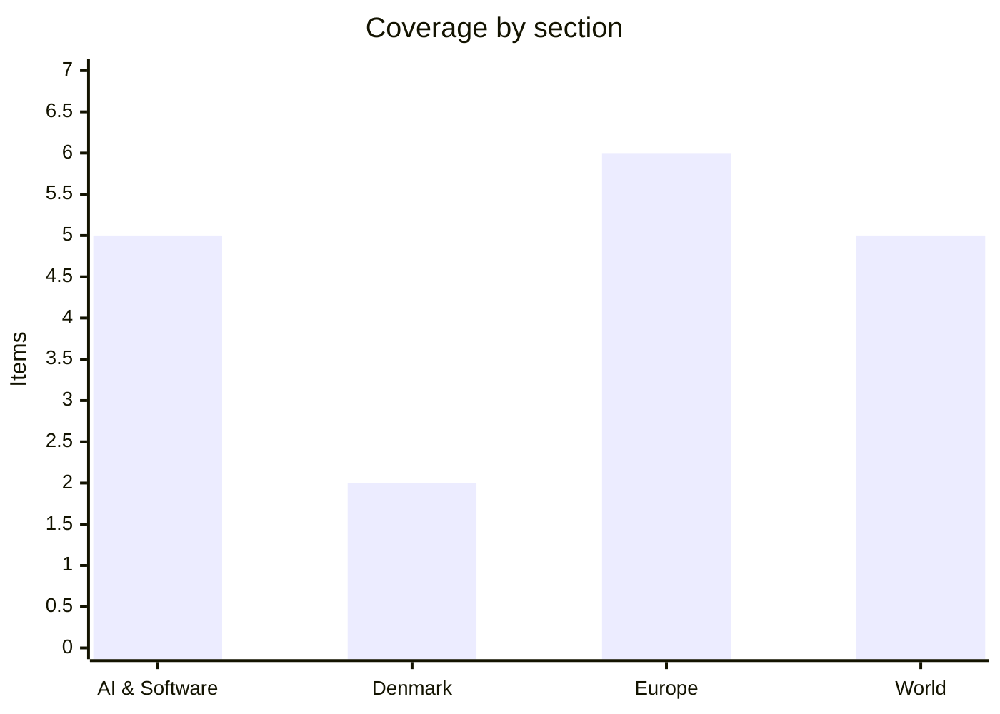

# Daily Briefing — 2026-11-01

**Top line:** Iran's foreign minister says Tehran has agreed a plan with Qatari mediators to reopen the Strait of Hormuz within two days if the US meets Iran's conditions, even as tankers keep burning in the strait and European gas has topped €100/MWh for the first time since 2022.

*Note on sourcing: DR, TV2, Berlingske and Politico Europe could not be fetched, and the Council's press page was stale. Denmark is therefore thin and rests on Altinget headlines and The Local; I have kept it short rather than padding it. Several items rely on aggregators (aiweekly.co, RadarCell, Euronews summaries) and are marked.*

## Follow-ups

- **Anthropic IPO:** CoinDesk (30 Oct, citing other reporting) says Anthropic plans to list in November and reportedly aims to raise up to $100B at a $1.5T valuation *(reported, unconfirmed)*. Pricing in the week of 16 November is still unconfirmed.
- **ECB / Lagarde:** Altinget, citing an ECB press release dated 29 October, confirms she leaves on 7 February 2027, nine months before her term ends. No successor named in anything I could read.
- **Spain train collision:** Euronews' latest figure I could read is 68 dead and 100+ injured (29 Oct); I found no newer toll and nothing on the 3 November appearance by Minister Puente.
- **Israel election:** results are reported inconsistently (see World); certification still due 4 November.
- **Iran / Hormuz:** the mediation track advanced: Araghchi now describes a two-day reopening plan (see World).
- **Binance hack:** roughly half of the ~$6.3B is reported frozen; the 48-hour withdrawal restart had not been confirmed in what I read.
- **Denmark finance bill:** no new development beyond Altinget's headlines (see Denmark).
- **Kimi K3.1 Pro weights (4 Nov deadline):** nothing found; Moonshot closed Kimi K2 models to new API users on 31 October and retires them at the end of December, pointing users to kimi-k3.1-pro.
- **Fed, Belgium cyberattack, EU–Canada statement:** no fresh reporting found.

## AI & Software

**A trojanized "Claude Code" extension on the Cursor Marketplace installed an SSH backdoor.** The Hacker News reports that version 2.1.313 of an extension posing as anthropic.claude-code was served as a legitimate update on 29 October, between about 2:27 a.m. and 1:35 p.m. PT. Cursor says at most 5,000 users installed it and that the version "was not developed by Anthropic". Researcher Jenn Gile of OpenSourceMalware describes a 66-line loader inserted before the legitimate code that adds an attacker key labelled "svc-telemetry" to ~/.ssh/authorized_keys, opens a reverse tunnel to 134.209.82[.]225, installs persistence and sends host data over unencrypted HTTP to port 8099. Anthropic says its systems were not compromised and David Dworken says the official VS Code and Open VSX versions are unaffected; Microsoft says the build never reached the VS Code Marketplace or npm. Anthropic's current release is 2.1.314. Advice for anyone who installed it: isolate the host, remove the key and persistence, and rotate credentials. The lesson is that third-party marketplaces for AI coding tools are now an attractive supply-chain target, and brand trust does not carry over between registries. Source: [The Hacker News](https://www.thehackernews.com/2026/10/official-claude-code-vs-code-extension.html).

**Apple will put Alibaba's Qwen inside Apple Intelligence in China.** Announced by Alibaba on Saturday 31 October (via Xinhua/CGTN), Qwen will power Siri, Writing Tools and Visual Intelligence for Chinese users. It reaches the iOS developer beta on 4 November and ships to the public with iOS 27.3 in December. Alibaba says users can choose whether to enable it and what data to share, and that requests and responses will not be used for model training. Alibaba CEO Eddie Wu said the two companies will deliver new AI services to Chinese users. An academic quoted by CGTN calls it the first time a top global hardware maker has used a Chinese large model as its main system-level AI backbone in China. Context: China's cyberspace authority completed filings for seven on-device generative AI services in July, including Apple Intelligence. The reading to watch is regulatory: this puts a Chinese model at the centre of a flagship Western consumer device, which will draw attention in Washington. The source is Chinese state-linked media relaying Alibaba's own announcement, so the framing is favourable. Source: [CGTN](https://news.cgtn.com/news/2026-10-31/Alibaba-s-Qwen-to-integrate-into-Apple-Intelligence-in-landmark-deal-1RHilSeJsbK/p.html).

**Google, Microsoft, Anthropic and OpenAI back a one-line robots.txt opt-out from AI training.** SiliconANGLE reports that the four announced on 30 October that they will support an upcoming crawling standard letting sites block generative-AI training scrapers with a single entry. A draft has been submitted to the IETF; per aiweekly.co (its own reporting, not checked against the draft) the token is "__usage_ai-training" and the document is an individual Internet-Draft by Anthropic's Kevin Kelley. Timing differs: Anthropic says it has begun implementing, OpenAI and Microsoft say "in the coming months" (Microsoft reportedly targeting 1 February 2027), Google says next year. Microsoft adds a separate "AI Grounding" setting. Meta voiced support without committing. OpenAI itself calls it "a coordination mechanism rather than a security control", and it does not remove data already in training sets. It matters because it is a signal, not enforcement, and a compliance baseline for the EU and UK publisher fights described below. Sources: [SiliconANGLE](https://siliconangle.com/2026/10/30/google-anthropic-and-others-to-support-new-ai-crawling-opt-out-standard), [aiweekly.co](https://aiweekly.co/alerts/openai-google-microsoft-anthropic-back-one-ai-opt-out-token) *(aggregator)*.

**OpenAI reportedly trims its funding round to about $20B at a $1.25T valuation.** CoinDesk, summarising an FT report, says the target was cut from $30B at $1.4T. It adds that OpenAI has already pushed IPO plans to 2027, that the Nasdaq 100 is about 10% below its 6 October record, including a 4.5% fall on Friday, and that Anthropic is aiming to list in November. This is a single-source report without company comment *(reported, unconfirmed)*. The contrast with Anthropic's IPO push is the story: the two labs are now being priced against each other in a nervous market, and a weak Anthropic debut would colour everything else. Source: [CoinDesk](https://www.coindesk.com/business/2026/10/30/openai-reportedly-cuts-fundraising-target-amid-ai-jitters).

**OpenAI ships GPT-Rosalind-6, a biology model, under trusted access only.** The system card addendum dated 30 October says it uses the same weights as GPT-6 Astra. Against Rosalind-5.5, OpenAI reports MedChemBench 49.6% (from 28.9%), GeneBench Pro 37.7% (from 16.7%) and LifeSciBench Gold 61.3% (from 44.0%); these are the company's own benchmarks. OpenAI rates it High, not Critical, in biological and chemical capability, and cites the GPT-6 Astra card for a Critical cybersecurity rating. None of four Critical-capability evaluations met its indicative threshold. On historical cyber jailbreaks with blocking disabled the success rate was 14.3%, versus 15.7% for Astra. Partners per an aggregator include Amgen, Moderna and Thermo Fisher. Restricting access to approved customers is the mechanism OpenAI is relying on for the risk. Sources: [OpenAI](https://deploymentsafety.openai.com/gpt-rosalind-6), [aiweekly.co](https://aiweekly.co/ai-news-today) *(partners via aggregator)*.

## Denmark

**Finance bill talks: the government expected to lose the senior-pension vote, and Enhedslisten's tax demands split the coalition.** I could only read Altinget's headlines, which are paywalled and undated, so the details are thin. Altinget's analysis says the government knew in advance it would lose on the senior pension (seniorpension). A second piece says Enhedslisten must be part of any deal but that its new tax demands divide the government, naming Dragsted and Hummelgaard. A third lists the people who will negotiate the government's first finance bill. The practical point is that a government that is already losing votes it anticipated needs the red-green flank, and the price of that flank is tax policy. I could not confirm dates or numbers from DR or TV2. Source: [Altinget](https://www.altinget.dk/) *(headlines only)*.

**Danish party politics: several internal fights are running at once.** Altinget's front page carries pieces on a crisis in Venstre, Inger Støjberg and Morten Messerschmidt at the Danmarksdemokraterne party congress, a controversy over the Enhedslisten chair, and an SF cabinet reshuffle. I could not read any of the articles, so this is a pointer rather than a report, and nothing here is confirmed beyond the headlines. Source: [Altinget](https://www.altinget.dk/) *(headlines only)*.

## Europe

**From today the EU charges a €2 fee per item category on parcels from outside Europe.** AFP via The Local reports it applies from Sunday 1 November to parcels from non-EU and non-EFTA countries regardless of value, on top of the €3 tax on parcels under €150 in force since July 2026. A parcel with caps, T-shirts and belts would owe €6. Platforms or sellers are legally liable, and BEUC says the cost must not be passed on by postal firms. Nearly 5.9 billion small parcels entered the EU in 2025, four times the 2022 level, 93% from China, mostly via Shein, Temu and AliExpress; the article says small-parcel flows have fallen about 64% since July. The €2 fee is permanent with a review every two years, while the €3 tax ends in July 2028. Danish online shoppers will see this first in prices. Source: [The Local](https://www.thelocal.dk/20261030/eu-to-slap-new-e2-fee-on-online-shopping-orders-from-outside-europe).

**The second EU–UK summit is set for 20 November, with a new UK prime minister.** The Local reports the summit in Brussels was delayed from July after Keir Starmer resigned; the new PM, Andy Burnham, has talked of a national debate on the EU relationship, including possibly rejoining. Maroš Šefčovič wants agri-food trade, linking carbon markets and a youth experience scheme closed "as a package". The youth scheme (ages 18–30, up to three years) is the hardest point: the UK wants an annual cap, the EU wants freer job-switching between member states. The EU also wants EU students to pay home fees in UK universities, currently £9,790. Ian Bond of the Centre for European Reform calls the agenda "quite modest" with "quite a lot of arguing to be done". Media reports say the youth scheme may slip six months. The article is paywalled after its first sections. Source: [The Local](https://www.thelocal.dk/20261031/a-lot-of-arguing-to-be-done-whats-at-stake-in-the-upcoming-eu-uk-summit).

**Poland's Constitutional Tribunal crisis escalated on 30 October.** Euronews' explainer says judge Anna Korwin-Piotrowska ordered a one-month suspension of Tribunal president Święczkowski and vice-president Sochański and took over management. President Karol Nawrocki called it an attempted takeover, and a General Assembly is set for 3 November. The background: the dispute dates from 2015; in March 2026 the Sejm elected six judges, Nawrocki accepted two oaths and refused four, and the four took oaths before a notary on 9 April. On 12 May the Tribunal ruled in case K 3/26 that the president need not accept every appointment. Each side now claims legitimacy over the same institution, and the 3 November meeting is the next test. Source: [Euronews](https://www.euronews.com/2026/10/31/polands-constitutional-tribunal-crisis-explained-a-decade-long-dispute-over-legitimacy-of-).

**The US approves 500 Patriot PAC-3 interceptors for Ukraine, but deliveries may be years away.** The State Department announced the roughly $2.1B package on Friday 30 October. Zelenskyy called it a "strong decision" but wrote that deliveries "may begin ONLY IN A FEW YEARS" and said the interceptors could be effective this winter if supplied from existing stocks. He added that Kyiv had waited almost a month for Defence Secretary Pete Hegseth to sign off on Patriot and NASAMS batches. RadarCell, citing two briefed people, says the missiles are not yet built and deliveries come in the 2030s; Kyiv Post reports the Pentagon says Ukraine's own Patriot production request needs "further review". Most Ukrainian Patriots come via NATO's PURL initiative, to which allies had committed over $6B by June 2026. The headline number is real, but it does little for this winter's air defence. Sources: [Euronews](https://www.euronews.com/2026/10/31/zelenskyy-thanks-us-over-deal-for-500-patriot-missiles-but-warns-delivery-could-take-years), [RadarCell](https://radarcell.substack.com/p/perspective-31-october-2026-hormuz) *(single-analyst Substack)*.

**Novaya Gazeta says it will close on 9 November.** The paper announced that "the Russian authorities and the Russian security services have forced our editorial team to cease its operations". Its media licence was revoked in 2022 and journalists have been detained; it says it is being evicted from its Moscow headquarters, its reader-donation platform has closed and banks have cut it off, which it blames on FSB-set rules. One final issue will still appear, and the Anna Politkovskaya museum is closing too. Founded in 1993, its co-founder Dmitry Muratov won the Nobel Peace Prize. Some journalists left to form Novaya Gazeta Europe in Latvia, which now carries the brand's work. The closure is the claim of the paper itself, and Moscow has not been quoted in what I read. Source: [Euronews](https://www.euronews.com/2026/10/30/russian-independent-newspaper-novaya-gazeta-says-it-will-shut-down-following-pressure-from).

**The UK competition regulator opens a probe into Meta's terms for publishers.** The CMA is investigating whether Meta's commercial terms for news publishers and advertisers are "exploitative" and breach the Competition Act 1998, because they could let Meta use content from publishers' websites to build products including AI features without a choice for businesses. Meta had planned revisions for next month and has put them on hold. CMA chief Sarah Cardell said the regulator moved quickly after hearing concerns. A Meta spokesman said "There are no grounds for a competition investigation." The probe will first assess whether Meta is dominant. It sits alongside the crawler opt-out standard above: the fight over who may use publisher content for AI is moving from voluntary signals to competition law. Source: [Brit Brief](https://britbrief.co.uk/tech/regulation/cma-investigates-meta-terms-for-publishers-and-businesses.html) *(secondary)*.

## World

**Iran says a two-day Hormuz reopening plan exists, while tankers burn and gas prices spike.** Al Jazeera's 1 November live blog quotes Foreign Minister Abbas Araghchi saying Tehran has a plan with Qatari mediators to reopen the strait within two days if the US meets its conditions, and calling the US dialogue offer "a positive step" as an Iranian delegation visits Doha. Trump said talks are "going fine" but he is "not in that much of a hurry". Critical Threats reports Alhadath says Iran demands a full ceasefire first and guarantees of a permanent one in exchange for reopening, and that Tasnim says Iran will not meet US officials in Doha; both rest on unnamed sources. The IRGC Navy says four tankers caught fire using "unauthorised routes" and one hit a mine; Reuters could not verify. UKMTO reported a crude tanker hit by an "unknown projectile". Supreme Leader Mojtaba Khamenei ordered "maximum deterrence", and RadarCell reports the Dutch TTF gas price passed €101/MWh, the first time since 2022. Statements from the two sides conflict, so treat "two days" as Tehran's offer, not an agreement. Sources: [Al Jazeera](https://www.aljazeera.com/news/liveblog/2026/11/1/iran-war-live-araghchi-says-talks-under-way-on-2-day-plan-to-reopen-hormuz), [Critical Threats](https://www.criticalthreats.org/analysis/iran-update-october-31-2026), [RadarCell](https://radarcell.substack.com/p/perspective-31-october-2026-hormuz) *(gas price via aggregator)*.

**Binance theft: about $6.3B left wallets, roughly half reportedly frozen, North Korea suspected.** RadarCell, citing CNA, says most of it left within about 20 minutes after 8 p.m. GMT on 29 October. TRM Labs says attackers compromised signing infrastructure and attributes it to North Korea's TraderTraitor group, per Foreign Policy. Binance first blamed a DevOps laptop, then cited "additional points of breach", and says there is no evidence private keys leaked. Co-CEO Richard Teng says losses will be covered from the SAFU fund and company resources. Withdrawals are suspended while deposits work, with a restart promised within 48 hours. Trump on attribution: "We don't know. We're looking at that." I did not read Binance's own statement, and "stolen" and "frozen" figures differ by source. Source: [RadarCell](https://radarcell.substack.com/p/perspective-31-october-2026-hormuz) *(secondary; single analyst)*.

**Yemen: Saudi air power backs government forces against a Houthi push toward Aden.** Critical Threats reports government-aligned forces repelled Houthi advances in Maqatirah district, Lahij, with Saudi close air support on 30 and 31 October, and took Jabal Huwayshiyan overlooking al-Hazm in Jawf. Houthi ballistic missiles reportedly targeted Aden airport and the presidential palace on 31 October. Saudi spokesman Turki al-Maliki says air defences intercepted four drones over Medina, Riyadh and the south and east; the Houthis denied targeting Medina. Much of the material comes from Telegram and regional outlets, so battlefield claims are unverified. Source: [Critical Threats](https://www.criticalthreats.org/analysis/iran-update-october-31-2026).

**Israel's election aftermath: sources disagree on the seat count.** Times of Israel's blog cites 67 seats for the opposition against 53 for the coalition, including 48 Zionist and 19 Arab non-Zionist seats, while Euronews says the Netanyahu bloc emerged ahead but short of a majority, with record Arab-party seats. Those cannot both be right, and I could not resolve it from the pages I could read. Standing Together held rallies in Tel Aviv, Jerusalem, Beersheba, Haifa and Tayibe demanding a Jewish-Arab government. RadarCell, citing Africanews, says the prime minister accused Arab-led parties of fraud. Certification is due 4 November, which should settle the numbers. Sources: [Times of Israel](https://www.timesofisrael.com/liveblog-october-31-2026/), [Euronews](https://www.euronews.com/2026/10/30/netanyahu-bloc-emerges-ahead-in-israeli-election-but-fails-to-secure-majority) *(headline only)*.

**Markets: chip stocks slide, Apple edges past Nvidia.** CoinDesk says the Nasdaq 100 fell 4.5% on Friday and is about 10% below its 6 October record. An aggregator, FourWeekMBA, reports Apple closing at $5.03T market value against Nvidia's $4.93T, with the semiconductor index down 7.2% and Intel down 28.6%; I could not verify those figures against an exchange or primary source *(secondary, unconfirmed)*. This is the backdrop for the AI-funding stories above. Sources: [CoinDesk](https://www.coindesk.com/business/2026/10/30/openai-reportedly-cuts-fundraising-target-amid-ai-jitters), [FourWeekMBA](https://fourweekmba.com/ai-apple-passes-nvidia-at-5-03-trillion-as-chip-stocks-slide/).

## Watch list

- **3 November:** US midterms; Poland's Constitutional Tribunal General Assembly; Spanish transport minister Puente's expected appearance before the Diputación Permanente.
- **4 November:** Israel's certification of results; Apple Intelligence with Qwen enters the iOS developer beta.
- **Within days:** whether Hormuz actually reopens under the Qatari-mediated plan, and whether Binance restarts withdrawals.
- **November:** Anthropic IPO pricing *(reported, unconfirmed)*; EU–UK summit on 20 November.
