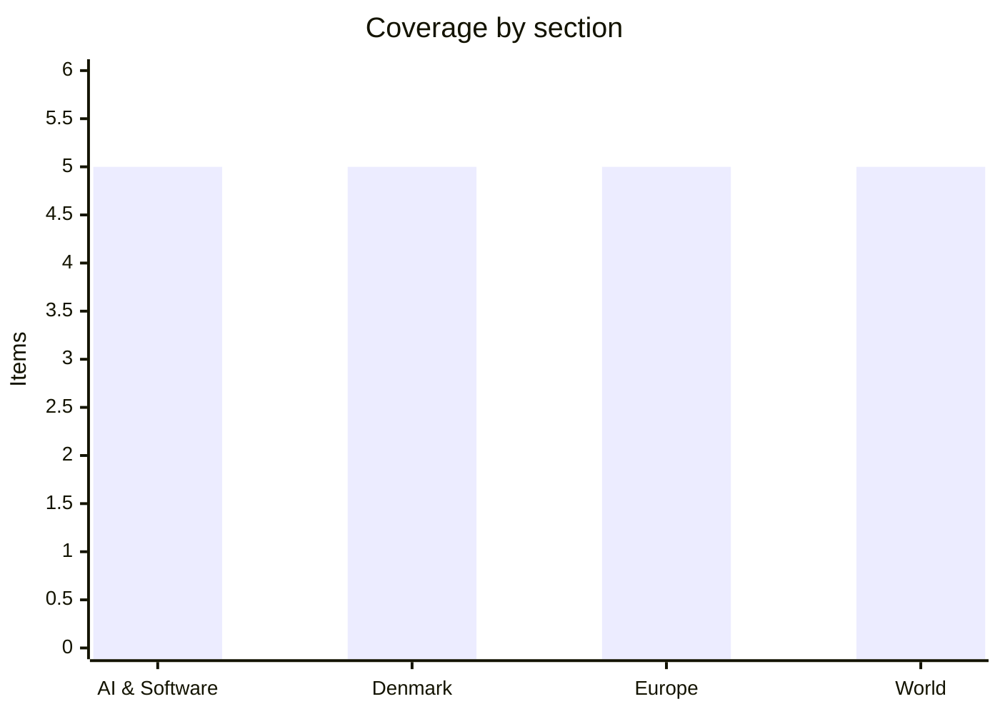

# Daily Briefing — 2026-11-03

**Top line:** Anthropic's amended IPO filing shows Q3 revenue of $17B but a $536M operating loss, as the company seeks a $1.5T–$2T valuation, while the Strait of Hormuz is still shut and US strikes near Iran's Qeshm Island are being reported.

*Note on sourcing and timing: this run fired late (scheduled 06:00 UTC, started 17:04 UTC), and there was no briefing for 2 November, so this covers everything since 1 November. Politico, Reuters, the FT, DR, Berlingske, Politiken, JP and Børsen could not be read; TV2 live pages are blocked to automated readers; Altinget is paywalled. Anthropic.com, openai.com and the SEC filing were not opened. Most items rest on secondary outlets and are marked. US midterm results were not available at the time of writing.*

## Follow-ups

- **Cursor / fake "Claude Code" extension:** Cursor's own notice (29 Oct, updated 30 Oct) covers malicious versions 2.1.312 and 2.1.313, exposed about 2:27am–1:35pm PT on 29 Oct. It says the SSH-key and reverse-tunnel code usually fails without admin rights, and that macOS and Windows persistence retried about every 60 seconds. Cursor rebuilt its marketplace, rotated keys and advises credential rotation; no new development on 2–3 Nov. The "5,000 users" figure remains unconfirmed by Cursor's notice.
- **Lagarde:** the succession process has now started (see Europe). Nomination deadline 6 Nov.
- **Spain train collision:** the toll rose from 68 to 69, all victims reported identified (Euronews headline only). I still found no date for Minister Puente's appearance.
- **Israel election:** the seat count is now settled by the Elections Committee numbers (see World); the Times of Israel/Euronews conflict in the last briefing is resolved in favour of 53 for the Netanyahu bloc.
- **Iran / Hormuz:** the "two-day plan" is confirmed by AP as Iran's offer; the strait has not reopened (see World).
- **Binance:** withdrawals have resumed in phases and the FBI has attributed the hack to North Korea (see World).
- **Anthropic IPO:** now backed by an amended S-1 (see AI).
- **Kimi K3.1 Pro weights:** still due by 4 Nov; nothing confirmed yet.
- **Denmark finance bill:** no deal or collapse found as of 3 Nov.

## AI & Software

**Anthropic's amended S-1 shows $17B in quarterly revenue and an operating loss.** The updated filing of 2 November adds Q3 figures that the 26 October original lacked. SiliconANGLE reports Q3 revenue of $17B, 11.27 times a year earlier and up 47% on the prior quarter (the prior quarter grew 144%). The company swung to a $536M operating loss from $974M of operating income, after a $5B charge for short-notice, premium-priced hardware and a $2B non-cash employee-donation matching charge; adjusted operating income was $2.5B. Fortune adds that compute and infrastructure expense rose about 77% to $9.9B, adjusted operating margin fell to 15% from 19%, cash stands at about $131.8B, and trailing four-quarter revenue is about $35.3B. Infrastructure commitments were $895.4B at 30 September, and purchase commitments about $314B versus about $55B at end-2025. Anthropic is reportedly seeking a $1.5T–$2T valuation and has not disclosed the raise size; Bloomberg reportedly says it hopes to at least match the $86.2B SpaceX raised, and Fortune says institutions want pricing at the low end. Jay Ritter of the University of Florida notes only 14 of 4,110 IPOs from 1980 to 2024 reached a similar price-to-sales level. An aggregator summary of CNBC cites a $23.29B net loss, which I could not verify and SiliconANGLE does not mention. Neither outlet is the SEC filing itself. Sources: [SiliconANGLE](https://siliconangle.com/2026/11/02/anthropics-quarterly-revenue-jumps-to-17b-losses-grow-ahead-of-ipo/), [Fortune](https://fortune.com/2026/11/03/anthropics-third-quarter-results-mean-ipo-math-and-history-are-not-on-its-side-analysts-say/).

**Mistral releases open weights for the trillion-parameter Large 4.** The AI Insider reports weights are on Hugging Face and the model is on Mistral's API. Mistral claims it matches GLM-5.3 on cyber tasks, uses 47% fewer tokens per task, and leads open models on Artificial Analysis' Coding Agent Index; these are company claims with no figures given. It is positioned for on-premises "sovereign cyber defence". The article gives no licence, active-parameter count or architecture, so how open it really is remains unclear. Moonshot's Kimi K3.1 Pro (about 2.8T parameters, weights promised by 4 Nov) is the competing open-weight release to watch. Source: [The AI Insider](https://theaiinsider.tech/2026/11/02/mistral-releases-weights-for-trillion-parameter-large-4-model-targeting-sovereign-cyber-defense/) *(secondary)*.

**IBM discloses critical Langflow flaws, including two unauthenticated 9.8s.** The Hacker News reports flaws in versions 1.0.0 through 1.12.8 of the open-source agent and workflow builder, fixed in 1.13.0 (released 22 October) with no workaround. CVE-2026-93680 is an authentication bypass and CVE-2026-110186 allows unauthenticated code execution, both scored 9.8; two more (8.8 and 6.5) cover command execution via generated component code and credential exposure. A public Metasploit module exists for the auth bypass, though it only enumerates MCP tools. LANGFLOW_AUTO_LOGIN is on by default through 1.12.8, logging users in as superusers; 1.13.0 turns it off. Neither critical flaw was in CISA's KEV list as of 30 October, though six other Langflow flaws are. Anyone running an exposed instance should upgrade now. Source: [The Hacker News](https://thehackernews.com/2026/11/critical-langflow-flaws-could-let.html) *(secondary reporting of IBM's bulletin)*.

**Big AI infrastructure and deal flow: Marvell–Lumentum, Oracle's raise, Palantir.** Per the aiweekly.co tracker (aggregator, primaries not opened) Marvell will acquire Lumentum in an all-stock deal at a $115B enterprise value, Palantir reported Q3 revenue of $2.31B (up 96%), and Oracle filed to raise $20B ($10B stock, $10B notes) with shares falling over 6%. Also reported: Putin ordered private data centres to reserve 10% of capacity for state IT, and Drax, Brookfield and Radiant announced a £20B-plus, 1GW data centre in North Yorkshire. A reported Nvidia rule would require cloud customers in Singapore, Malaysia and Japan to serve at least 51% non-Chinese customers *(reported, unconfirmed)*. Treat all of these as unverified until primary sources are checked. Source: [aiweekly.co](https://aiweekly.co/ai-news-today) *(aggregator)*.

**OpenAI raises bug-bounty payouts and lands Abu Dhabi deals.** The same tracker says OpenAI raised bug-bounty midpoints more than 4x, with critical findings paying up to $30,000, as part of a security sprint with Cathedral Systems, and that it hired former Army Secretary Dan Driscoll as Senior Counselor for National Security Modernization. On 2 November it reportedly signed four deals at ADIPEC, with ADNOC the first energy company to deploy "OpenAI Frontier"; no contract values were disclosed. This sits against the funding-round trim reported last week (about $20B at $1.25T). I did not open OpenAI's own page. Source: [aiweekly.co](https://aiweekly.co/ai-news-today) *(aggregator; primary at [openai.com](https://openai.com/index/preparing-our-next-security-sprint-to-harden-openai) not read)*.

## Denmark

**Cyberattacks hit cooling systems at five Danish food companies.** Morten Bro of the Danish Resilience Agency told TV2 on Monday evening that it knows of five Danish food companies whose refrigeration was attacked; they removed the intruders quickly and there were no major crashes. DI consultant Jeppe Engell had earlier told Ritzau three companies were hit. The same day supermarkets in Belgium, Estonia, Finland, Ireland, Italy, Luxembourg, the Netherlands, Portugal and Sweden reported refrigeration problems, and a cyberattack about three weeks earlier disrupted French grocery stores. No one has claimed responsibility, and EU food commissioner Christophe Hansen says Brussels takes it "very seriously". The Danish angle is that damage was contained; the wider European picture is in the Europe section. Source: [The Local](https://www.thelocal.dk/20261103/today-in-denmark-a-roundup-of-the-latest-news-on-tuesday-71) *(secondary, citing TV2 and Ritzau)*.

**Students plan a mass walkout on 4 November against SU cuts in the finance bill.** Danske Gymnasieelevers Sammenslutning has called a demonstration for Wednesday: about 10,000 students are expected at Rådhuspladsen at 12:30 and then march to Christiansborg, with about 30,000 students at 40 schools expected to walk out. The Local reports the plan would end SU for students living at home whose parents' combined income exceeds 710,077 kr, phasing it down from 419,589 kr. PoV International says about 81,000 home-living students would lose all SU from 2028 and that SF minister Pia Olsen Dyhr faces criticism over it. SU is a flashpoint inside the SF-led government and with its support parties. Sources: [The Local](https://www.thelocal.dk/20261103/today-in-denmark-a-roundup-of-the-latest-news-on-tuesday-71), [PoV International](https://pov.international/finanslov-skattelettelser-hoejere-pension-og-haarde-besparelser-paa-su/) *(both secondary)*.

**Finance bill 2027: spending is set, but the tax fight inside the coalition is open.** The government's own release of 9 October lists defence funding rising to 3.5% of GDP by 2030, 1.2bn kr for schools and daycare in 2027, 0.6bn kr for dental care (0.9bn from 2028), 650m kr for energy and electrification, 800m kr for public transport, and about 1,600 kr more a month for the lowest-income state pensioners. Per PoV International (secondary) it also abolishes the mellemskat and toptopskat, cuts corporate tax from 22% to 19% by 2030, and totals 10.1bn kr of tax cuts funded partly by an interest-deduction cap, higher inheritance tax on large estates and a tech-company tax. Altinget (paywalled, lede only, 21 October) says Enhedslisten's Pelle Dragsted wants a tax on "overnormale profitter" from the oil and gas windfall, which SF supports and the Moderates call "en dårlig ide". The government is the Social Democrats, SF, Moderates and Radikale, relying on Enhedslisten and Alternativet. I found no deal or collapse as of 3 November. Sources: [regeringen.dk](https://regeringen.dk/aktuelt/nyheder/2026/finanslovforslag-med-fokus-paa-tryghed-og-sikkerhed-loeft-af-velfaerden-og-groen-omstilling/) (primary), [Altinget](https://www.altinget.dk/artikel/dragsteds-krav-om-ny-skat-splitter-regeringen-inden-armlaegning-hos-hummelgaard-en-daarlig-ide-siger-m) *(paywalled)*.

**Electric cars hit 88.4% of October registrations ahead of a fee rise.** Of 18,875 new cars registered in October, 16,679 were electric, against 70.6% a year earlier; for private buyers the share was about 97.6–97.7% (the article gives both). Buyers are rushing ahead of a registration-fee increase on 1 January 2027: FDM estimates a 400,000 kr car will cost 424,334 kr, a 500,000 kr car 544,261 kr and a 750,000 kr car 813,011 kr. This pull-forward effect means early-2027 sales may drop. Source: [The Local](https://www.thelocal.dk/20261102/today-in-denmark-a-roundup-of-the-latest-news-on-monday-68) *(secondary, citing bilstatistik.dk, Mobility Denmark and FDM)*.

**The US–Greenland–Denmark defence agreement reaches Greenland's parliament.** The Local reports final approval is expected in Inatsisartut on 3 November, with the Folketing considering it on 19 November. Foreign minister Lars Løkke Rasmussen said Trump's remarks about the deal were probably tied to the US midterms and that he travelled to the US on Monday evening to sign another agreement. I could not confirm what that second agreement is. Source: [The Local](https://www.thelocal.dk/20261103/today-in-denmark-a-roundup-of-the-latest-news-on-tuesday-71) *(secondary)*.

## Europe

**The race to succeed Lagarde at the ECB opens, with nominations due 6 November.** Euronews says eurozone governments must nominate by Friday 6 November and finance ministers take stock at the Eurogroup on 9 November. Lagarde leaves on 7 February 2027 and will chair the December and February rate meetings. A candidate needs at least 16 of 21 eurozone states representing at least 65% of the population, and EU leaders decide after opinions from the European Parliament and the ECB Governing Council. Frontrunners are Pablo Hernández de Cos (BIS general manager, backed by Sánchez and by opposition leader Feijóo) and Klaas Knot (ex-Dutch central bank head, praised by Dutch PM Rob Jetten); prediction markets on 3 November put them at 34% and 31% on Kalshi and 41% and 30% on Polymarket. The deposit rate stays at 2.5%, Schnabel leaves for the IMF on 3 January and Lane's term ends in May 2027, so the posts are expected to be negotiated as a package. Source: [Euronews](https://www.euronews.com/2026/11/03/who-will-replace-lagarde-eurozone-picks-nominees-as-race-for-ecb-top-job-begins) *(secondary; the ECB release was not read)*.

**Poland's Constitutional Tribunal standoff escalates; the Commission sides with the Sejm.** On the night of 30 October police surrounded the Tribunal building and President Karol Nawrocki tried to enter. On 1 November a Commission spokesperson said appointing the eight new members "lies within the constitutional power of the Sejm" and cited a European Court of Human Rights interim measure of 5 May. On 2 November Tusk urged Nawrocki to recognise the judges and accused him of "opting for a forceful confrontation"; the opposition calls it a "coup d'etat". One Polish outlet, xyz.pl, reports that judge Anna Korwin-Piotrowska convened a General Assembly for 3 November to adopt the Tribunal's 2027 budget, which she calls the last chance. Its outcome and legal validity are unverified. Sources: [Euronews](https://www.euronews.com/2026/11/01/eu-commission-polish-parliament-has-right-to-appoint-judges-to-the-constitutional-court), [Euronews](https://www.euronews.com/2026/11/02/donald-tusk-calls-on-polish-president-to-confirm-judges-as-constitutional-court-crisis-rum), [xyz.pl](https://xyz.pl/dzieje-sie/sedzia-korwin-piotrowska-zarzadzila-zgromadzenie-ogolne-sedziow-tk-na-3-listopada-3202).

**A coordinated attack on supermarket refrigeration spreads across Europe.** Euronews reports fridges and freezers in Belgian stores were turned up overnight on 1–2 November (reportedly to 17°C), forcing food to be thrown away. Per Le Soir it hit about 40 Delhaize Proxy stores, 15 Carrefour Shop & Go, 15 Intermarché, 5 Spar Q8 stations, a butchery group and IKEA Mons; Euronews says 75 stores, though the counts don't clearly reconcile. Sabcobel's CEO says units were hit when switching to defrost mode, and Danfoss, which supplied the software, blames mainly outdated software. Belgium's federal prosecutor has opened an investigation and no culprit is identified. Similar problems hit Sweden (ICA and Coop), Estonia, Ireland (13 SuperValu stores), the Netherlands (at least 17 companies per Danfoss), Finland and Luxembourg, and hundreds of French Intermarché and Coopérative U stores on 12 October. Belgium's CCB logged 588 incident reports in January–September 2026 versus 556 in all of 2025. Sources: [Euronews](https://www.euronews.com/2026/11/02/cyberattack-hits-belgian-supermarket-fridges-and-freezers), [Brussels Times](https://www.brusselstimes.com/2364134/belgian-businesses-report-more-cyber-incidents-in-nine-months-than-in-all-of-2025) *(secondary)*.

**Russia pounds Ukraine after a Kherson truce lapses; talks and a force exercise are planned.** A local truce in Kherson region ran 27 October to 1 November, the longest of the war, and Kyiv says Russia refused to extend it. Euronews (3 Nov) cites Zelenskyy reporting 289 drones and 17 ballistic missiles overnight; those figures appear only in the headline. A Zaporizhzhia village was hit hours after the truce ended with at least 26, later 29, dead, a Kharkiv medical facility strike wounded 25, and Moscow's mayor said nearly 500 drones were destroyed. Witkoff said the US will mediate working-level talks on 10–11 November in Abu Dhabi. About 2,800 troops from 10 countries will take part in "Koalicja", the first Multinational Force – Ukraine exercise, 9–22 November near Nowa Dęba in Poland (about 1,100 French, 300 British); it is not a NATO operation and the force would deploy only after a ceasefire. Sources: [Euronews](https://www.euronews.com/2026/11/03/russia-pounds-ukraine-with-289-drones-and-17-ballistic-missiles-in-overnight-strikes-zelen), [Euronews](https://www.euronews.com/2026/11/03/thousands-of-troops-from-europe-to-rehearse-post-war-ukraine-deployment-in-poland) *(secondary)*.

**Spain's Toledo train crash toll rises to 69, a month before the election.** The collision on the morning of 28 October between Urda and Los Yébenes, on the Madrid–Seville line, saw a Renfe high-speed train hit the back of a stationary Iryo train. Transport Minister Óscar Puente said an automatic control system failed on 69 km of track and the control centre then let traffic resume in "inexplicable circumstances". Euronews headlines say all victims are identified and include a Czech national and four US citizens, though I read only headlines for that. Sánchez faces a general election on 29 November, making the investigation politically live. Source: [EWN](https://www.ewn.co.za/2026/10/29/spain-mourns-after-latest-train-tragedy-kills-68) *(secondary; 69 figure from Euronews headline)*.

## World

**Iran says its Hormuz plan is now two days, but the strait is still shut and US strikes are reported.** AP says Iran's plan to reopen Hormuz and resume nuclear talks was cut from seven days to two, conditional on the US lifting its port blockade and oil sanctions and agreeing a ceasefire that includes Lebanon; ships would use a route agreed by Iran and Oman under Iranian supervision. Spokesman Esmail Baghaei called it "Iran's good-faith approach", and mediators are working on a framework trading an end to Iranian attacks in the strait for the lifting of the blockade. AP says Netanyahu is pushing for a new wave of strikes after the midterms, and China will send a special envoy to Iran, Oman and Saudi Arabia in early to mid-November. Al Jazeera headlines on 3 November report "defensive" US strikes on Iranian targets and explosions on Qeshm Island, with Iran warning of a "harder and broader" response; I read only those headlines and TheStreet's note that oil rose on the reports. Diplomacy and force are running in parallel. Sources: [AP via CP24](https://www.cp24.com/news/world/2026/11/02/iran-has-a-2-day-plan-to-reopen-strait-resume-nuclear-talks-with-us-and-other-mideast-news/), [Al Jazeera](https://www.aljazeera.com/) *(strikes: headlines only, unconfirmed)*.

**Israel's final results leave nobody at 61; Herzog gets them on 4 November.** Per the Central Elections Committee numbers in the Times of Israel liveblog, Likud won 27 seats, Yashar 21, B'Yachad 12, Joint List 11, Democrats 8, Ra'am 8, Yisrael Beytenu 7, UTJ 7, Otzma Yehudit 7, Shas 6 and Religious Zionism 6. The pro-Netanyahu bloc has 53, the Jewish opposition 48 and the Arab parties 19; turnout was 77.9%. The Knesset is sworn in on 10 November, Herzog tasks an MK on 11 November, and that candidate then has 28 days, extendable by 14. Netanyahu and Gadi Eisenkot are the likely candidates, Yedioth Ahronoth reportedly gives Eisenkot an edge, and Herzog favours a unity government. A sidebar headline says Likud sought to delay certification and the committee chair rejected it; I did not read the details. Sources: [Times of Israel](https://www.timesofisrael.com/liveblog_entry/central-elections-committee-publishes-final-election-results-knesset-to-be-sworn-in-nov-10/), [Al Jazeera](https://www.aljazeera.com/news/2026/11/1/israel-election-when-will-government-be-formed-who-will-lead-it).

**Binance hack: US agencies name North Korea, and about $2.85B is frozen.** Forbes cites TRM Labs at about $6.3B stolen across 10 chains in about 20 minutes (Elliptic says $6.43B), roughly four times the February 2025 Bybit hack. By Sunday the FBI, Secret Service and IRS-CI attributed it to North Korea's TraderTraitor group, per Forbes, and the FBI published wallet addresses. Tether froze more than $1.567B and Circle about $823M, and Elliptic verified about $2.84B frozen against the FBI's $2.85B, while about $3.33B was beyond issuer reach as of Friday. Binance says about 95% of affected assets are replaced via its SAFU fund and company resources, and has restored withdrawals in phases; CNBC's headline of $3.64B net outflows is unverified. The preliminary access route is a compromised DevOps laptop, and Binance says no private key leaked. There is no post-mortem yet. Source: [Forbes](https://www.forbes.com/sites/digital-assets/2026/11/02/binance-lost-63-billion-in-20-minutes-who-holds-the-keys/) *(secondary; the 95% figure is Binance's own claim)*.

**US midterms are underway with record early voting; no results yet.** AP via Fox reports more than 54M early votes, nearly 9M more than 2022. Polls begin closing at 6pm ET, and Republicans are defending slim majorities while Trump predicts they hold both chambers. Key Senate races include Michigan (Mike Rogers vs Abdul El-Sayed) and Texas (Ken Paxton vs James Talarico), and Florida's governor race pits Byron Donalds against David Jolly. The Fox page's South Carolina line, which refers to a vacancy after Sen. Lindsey Graham's death, comes from a summariser and I could not verify it, so I have left it out as unconfirmed. Results will matter for Iran policy, tariffs and the AI-regulation debate. Source: [Fox News live page](https://www.foxnews.com/live-news/2026-midterm-elections-news-analysis-races-11-3-2026) *(early-morning snapshot)*.

**Oil jumps on the Qeshm reports while stocks open higher.** TheStreet says that in early trading on 3 November the Nasdaq was up 0.81%, the S&P 500 up 0.28% and the Dow down 0.49%; WTI was up 2.13% at $98.51 and Brent up 1.66% at $106.50 after a sharp drop on Monday. In Europe, Trading Economics shows TTF gas about €90–98/MWh (its page gives inconsistent figures), down about 10% on 2 November on talks hopes then rebounding on the strike reports, with EU storage about 74.6% and Germany at 61% against a 70% target. These are early-session snapshots from secondary pages, and an Investing.com headline conflicts on oil direction, probably due to timing. I found nothing on the Fed. Sources: [TheStreet](https://www.thestreet.com/stock-market-today/stock-market-today-dow-jones-sp-500-nasdaq-updates-nov-03-2026), [Trading Economics](https://tradingeconomics.com/commodity/eu-natural-gas) *(secondary)*.

## Watch list

- **3–4 Nov:** US midterm results; Poland Tribunal General Assembly outcome; Commission's enlargement package (4 Nov); Danish student walkout (4 Nov); Israel's results go to Herzog (4 Nov).
- **By 4 Nov:** Moonshot's promised Kimi K3.1 Pro open weights.
- **6 and 9 Nov:** ECB nomination deadline, then Eurogroup stocktake.
- **Mid-Nov:** Anthropic IPO marketing and pricing; Venstre landsmøde 14–15 Nov; EU–UK summit 20 Nov; Ukraine talks in Abu Dhabi 10–11 Nov.
