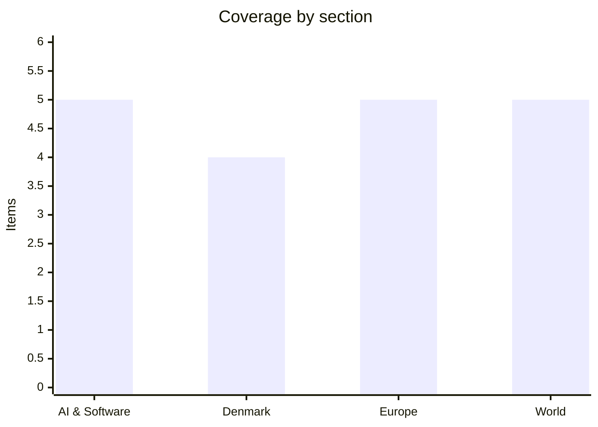

# Daily Briefing — 2026-11-04

**Top line:** Democrats have flipped the US Senate, according to Associated Press projections cited by Al Jazeera, while Trump has confirmed US strikes on Iran's Qeshm Island and CENTCOM is reportedly preparing more as early as Wednesday.

*Note on sourcing: this covers 3–4 November. Reading was done through a fetch tool with many blocks: AP, BBC, Politico, The Verge, DR, TV2, Berlingske, Børsen, Reuters and the FT could not be read, and Altinget showed headlines only. Most items therefore rest on secondary outlets (Al Jazeera, Euronews, The Local, The Hacker News, aggregators) and are marked. I found no readable oil, market or Fed data for 3–4 November, so there is no markets item today. Treat figures as the cited outlet's, not independently checked.*

## Follow-ups

- **US midterms:** Senate control is now projected (see World). House control was not found in anything I could read.
- **Spain train crash:** Transport Minister Óscar Puente has resigned (Euronews, 3 Nov, headline only); all 69 victims are reported identified. Sánchez's election is on 29 November.
- **Greenland defence deal:** Al Jazeera's headline says Greenland's parliament approved the US–Denmark security deal on 3 November. The Folketing takes it up on 19 November.
- **Iran / Hormuz:** Trump has now confirmed the Qeshm strike, and Iran has called the US reply to its two-day plan "not convincing" (see World).
- **Israel:** opposition leaders have backed Gadi Eisenkot against Netanyahu (Al Jazeera headline, 3 Nov). Herzog receives the final results today.
- **Binance:** North Korea denies the US attribution; Binance's own account of the intrusion route is now out (see AI & Software).
- **Nvidia 51% rule:** still only reported by a crypto outlet, not by Nvidia or a regulator *(reported, unconfirmed)*.
- **Kimi K3.1 Pro weights:** promised for today; nothing I read confirms they are published. Moonshot's page and Hugging Face were not checked.
- **Anthropic S-1 net loss:** an aggregator still cites a $23.29B Q3 net loss via CNBC. I could not confirm it against CNBC or the filing, and last briefing's SiliconANGLE and Fortune accounts do not mention it.
- **Poland's Constitutional Tribunal:** the outcome of the 3 November General Assembly was not found.
- **Danish finance bill:** no deal or collapse found.
- **Cursor fake extension, Lagarde succession:** no new development found; nominations still close 6 November.

## AI & Software

**Binance says the $6.43B theft began with a tampered Homebrew installer and fake job interviews.** The Hacker News reports Binance describes a "sophisticated, multi-stage campaign" combining a tampered Homebrew installer, fake recruitment interviews and compromised internal AI tooling. That fits the preliminary account of a compromised DevOps laptop reported earlier and the US attribution to North Korea's TraderTraitor group; Pyongyang now denies the US claims, per an Al Jazeera headline. The same outlet reports a separate breach at blockchain-infrastructure firm Chainstack, with the dev environment accessed on 26 October, production later, and the intruders cut off on 31 October, described as part of an AI-powered campaign. The common thread is the developer's own machine and tooling as the way in, not the exchange's cryptography. Neither the company's post-mortem nor the THN pages were opened beyond summaries. Source: [The Hacker News](https://thehackernews.com/2026/11/binance-reveals-how-fake-job-interviews.html), [Chainstack](https://thehackernews.com/2026/11/chainstack-reports-production-systems.html) *(secondary, relaying company statements)*.

**A cluster of critical vulnerabilities: Linux TCP, Barracuda, Siemens, and a hijacked cPGuard update channel.** Per The Hacker News, CVE-2026-98432 is a use-after-free in the Linux IPv4 TCP stack that the kernel CNA rates 9.8; Red Hat raised its own rating to Critical 9.8 and shipped fixes for RHEL 8, 9 and 10, while Ubuntu's fixes are still in testing. Barracuda's Email Security Gateway has two chainable flaws, CVE-2026-116606 (CVSS 9.3, pre-authentication authorisation bypass) and CVE-2026-111560 (CVSS 8.6, command injection). Siemens SIMATIC IoT2050 Advanced, CVE-2026-58115 (CVSS 10.0, missing authentication on the Node-RED interface), is reported as actively exploited by VulnCheck. On the supply-chain side, the cPGuard update channel was hijacked at 02:06 UTC on 2 November; versions 5.88.12–5.88.19 carried a script that installed a backdoor and collected password hashes, fixed in 5.88.25. The aggregator aiweekly also flags a GitHub issue claiming Postman desktop 12.33.4 writes plugins and a startup hook into Codex and Claude Code config files without consent; I did not read the issue. The kernel flaw is the one most likely to affect Martin's own estate. Sources: [Red Hat TCP flaw](https://thehackernews.com/2026/11/red-hat-patches-98-rated-linux-tcp-rce.html), [Barracuda](https://thehackernews.com/2026/11/barracuda-flaws-could-be-chained-to.html), [Siemens](https://thehackernews.com/2026/11/attackers-exploit-critical-siemens.html), [cPGuard](https://thehackernews.com/2026/11/cpguard-update-channel-hijacked-to.html), [Postman issue](https://github.com/postmanlabs/postman-app-support/issues/14370) *(secondary; Postman item via aggregator, unverified)*.

**Anthropic publishes FlashProve, an open-source proof that a reply came from specific model weights.** The research page, as linked by aiweekly, describes a zkSNARK scheme for "provable inference": about 110 tokens per second on a 400B mixture-of-experts model, with proofs of about 19MB per 1,024-token request. If those figures hold, it lets a customer verify that a provider served the model it claimed rather than a cheaper substitute, a live question for hosted and sovereign deployments. The same aggregator reports that Cat Wu, head of product for Claude Code and Cowork, announced her departure on X on 3 November, citing unite.ai. I read neither primary page, so treat the performance numbers as Anthropic's own claims relayed second-hand. Source: [Anthropic research](https://www.anthropic.com/research/provable-inference) *(not opened; via [aiweekly.co](https://aiweekly.co/ai-news-today), aggregator)*.

**Revolut reportedly cuts AI coding costs about 90% by self-hosting Z.ai's open-weight GLM-5.3.** Per aiweekly, citing The Register, the fintech made GLM-5.3 its default coding model over Claude Code and Gemini, serving it on 56 Nvidia B200 GPUs for roughly 2,000 engineers. This is the kind of switch that open-weight vendors, including Mistral with Large 4 and Moonshot with Kimi K3.1 Pro, are courting. It is also a one-company, self-reported cost figure, with no detail on quality trade-offs or on whether the baseline was list price. Moonshot's Kimi K3.1 Pro (reported 2.8T parameters, 104B active, $2/$10 per million tokens, Artificial Analysis Intelligence Index 55 against 58 for Opus 5.5) remains the other open-weight story to watch, with its weights due today. Source: [The Register](https://www.theregister.com/ai-and-ml/2026/11/03/british-fintech-revolut-slashes-ai-coding-costs-10x-by-cutting-out-claude-and-going-self-hosted/5307345) *(not read; via aggregator)*.

**AI hardware earnings stay strong; Nvidia is reportedly tightening China exposure for Asian clouds.** AMD's own release for Q3 2026 shows revenue of $13.4B (up 45%), data centre $8.5B (up 97%) and a Q4 guide of about $17B. Super Micro reported fiscal Q1 revenue of $19.95B (up 298%) with an FY27 outlook raised to $72–82B, per Reuters as summarised by aiweekly. CrowdStrike reportedly agreed to buy Fiddler AI (about $400M) and Dreadnode (about $95M), expected to close by 31 January 2027. A crypto-news site reports Nvidia is telling cloud customers in Singapore, Malaysia and Japan to keep at least 51% of services non-Chinese or risk losing chip supply *(reported, unconfirmed)*. Sources: [AMD release](https://www.globenewswire.com/news-release/2026/11/03/3394824/0/en/amd-reports-third-quarter-2026-financial-results.html) (primary), [Reuters on Super Micro](https://www.reuters.com/business/super-micro-forecasts-quarterly-revenue-above-estimates-strong-ai-server-demand-2026-11-03/) *(not opened)*, [Cryptobriefing on Nvidia](https://cryptobriefing.com/nvidia-cloud-clients-51-percent-non-chinese/) *(secondary)*.

## Denmark

**Students stage a mass walkout today against the SU cuts in the finance bill.** The Local reports the Danske Gymnasieelevers Sammenslutning, chaired by Oscar Tønsberg Hoffmann, expects 10,000 pupils at Rådhuspladsen at 12:30 before a march to Christiansborg, with about 30,000 upper-secondary students at 40 schools walking out. Under the plan, SU would be phased down for students whose parents' combined income lies between 419,589 and 710,077 kroner and removed above that, which TV 2 Kosmopol says hits 81,000 students living at home. The budget also reportedly requires graduates to have worked 18 of the last 24 months of study to qualify for dimittenddagpenge. The association says its requests for dialogue went unanswered, and student representatives call it a broken promise by SF and Radikale Venstre, who are part of the government. The money is meant to help fund free dental care and tax cuts, so the cut is the visible trade-off for the bill's biggest items. Sources: [The Local](https://www.thelocal.dk/20261103/thousands-of-danish-students-to-strike-in-protest-against-plans-to-cut-student-grants), [TV 2 Kosmopol](https://www.tv2kosmopol.dk/metropolen/tusindvis-af-unge-kan-miste-deres-su-urimeligt-og-irriterende-mener-gymnasieelever-43a83) *(both secondary; TV 2 piece carries an older-than-30-days note, so treat its dates with caution)*.

**The financing side of the finance bill: an interest-deduction cap and pricier electric cars.** The Local reports an Economic Council of the Labour Movement analysis that the new cap on rentefradrag would leave only 1.2 percent of taxpayers paying more. A Berlingske headline, which I could not open, lists dearer electric cars, the interest cap and the abolition of SU for home-living students as the way the government funds its "expensive ceilings". This matches the registration-fee rise on 1 January 2027 covered in the last briefing. Altinget's front page also headlines "Venstres krise fylder alt" and "Uro i Venstre" with a piece on Preben Bang and Troels Lund Poulsen; the items are undated, so I cannot place them in the last 24 hours. No coalition deal or collapse has been reported. Sources: [The Local](https://www.thelocal.dk/20261103/new-tax-ceiling-to-impact-just-1-2-percent-of-danish-taxpayers) *(headline only)*, [Berlingske](https://www.berlingske.dk/politik/dyrere-elbiler-loft-over-rentefradrag-og-afskaffelse-af-su-saadan-vil-regeringen-finansiere-dyre-loefter) *(not readable)*.

**Greenland's parliament approves the US–Greenland–Denmark security agreement.** Al Jazeera's headline of 3 November reports approval by Inatsisartut, which The Local had expected on the day. The Folketing considers the deal on 19 November, which lets it enter into force. Foreign minister Lars Løkke Rasmussen dismissed Trump's claims that Denmark had handed Greenland to the US as midterm-campaign rhetoric. Separately, the CPH Post reports Greenland's parliament has reported the opposition party Naleraq to police over an alleged leak; I read only the headline. The agreement is the main near-term step in the Greenland issue, and the Folketing vote is the date to watch. Sources: [Al Jazeera](https://www.aljazeera.com/news/2026/11/3/greenland-parliament-approves-security-deal-with-us-denmark) *(headline only)*, [The Local](https://www.thelocal.dk/20261103/today-in-denmark-a-roundup-of-the-latest-news-on-tuesday-71).

**The Danish prime minister tells everyone to prepare for cyberattacks as the fridge attacks reach nine-plus countries.** The CPH Post headlines that the PM urges everyone in Denmark to prepare for cyberattacks after data breaches (headline only). The Danish Resilience Agency's Morten Bro told TV 2 that five Danish food companies had their cooling systems attacked and removed the intruders quickly. AFP, via The Local, reports grocers in at least nine countries were hit on 2 November, and EU commissioner Christophe Hansen called it "a deliberate attempt to disrupt our food supply chain". ICA said its affected stores used an external refrigeration control system from Danish maker Danfoss, which did not comment; earlier Danfoss was reported to blame outdated software. No one has claimed responsibility. Sources: [The Local, AFP](https://www.thelocal.dk/20261103/fridge-cyberattack-on-supermarkets-across-europe-prompts-eu-warning), [CPH Post](https://cphpost.dk/2026-11-03/news/round-up/danish-prime-minsister-urges-everyone-in-denmark-to-prepare-for-cyberattacks-after-data-breaches/) *(headline only)*.

## Europe

**Enlargement day: the Commission presents its 2026 package as accession candidates jostle in Brussels.** Marta Kos presents the package today, 4 November, per a 30 October preview from European Western Balkans; no coverage of its content was readable. At Euronews' enlargement summit on 3 November, Montenegro rejected "second-class" membership and said it is eyeing 2028 accession, with the free-movement-of-goods chapter due to close on 6 November. Armenia's PM said Armenia would apply in 2027 or 2028, Georgia's PM offered no way out of the deadlock and blamed Brussels, North Macedonia's president hit back at Bulgaria's demands for constitutional change, and Ukraine's PM said it cannot be permanently shut out of the EU market over farm curbs. Croatia's PM warned that French elections could derail enlargement. Together these set up the question of whether the package offers gradual integration or firm dates. Sources: [Euronews takeaways](https://www.euronews.com/2026/11/03/progress-and-pitfalls-on-the-path-to-a-bigger-eu-five-takeaways-from-the-euronews-enlargem), [European Western Balkans](https://europeanwesternbalkans.com/2026/10/30/marta-kos-to-present-2026-enlargement-package-on-4-november/) *(secondary; package itself not yet read)*.

**Poland's Constitutional Tribunal crisis keeps widening; the outcome of the 3 November assembly is unknown.** Notes from Poland reports that on 30 October riot police stopped the chief justice entering the court, and on 31 October President Karol Nawrocki was in a "physical confrontation" with judges at its doors. On 2 November Poland's UN ambassador became the third envoy to resign over the crisis, all three having worked with former president Andrzej Duda, and Tusk urged Nawrocki to confirm the judges. Also on 2 November Poland launched an operation along the Russian border after reports of planned sabotage, and on 3 November a Polish journalist, Łukasz Warzecha, was held at the Ukrainian border and given a three-year entry ban. I found no report of the assembly's result or any court ruling. The standoff is now a constitutional dispute with the government, president and a faction of judges all claiming authority. Sources: [Notes from Poland, 31 Oct](https://notesfrompoland.com/2026/10/31/polish-president-in-physical-confrontation-with-judges-amid-power-struggle-at-constitutional-court/), [Notes from Poland, 2 Nov](https://notesfrompoland.com/2026/11/02/polish-ambassador-to-un-becomes-third-envoy-to-resign-amid-crisis-over-constitutional-court/), [Euronews](https://www.euronews.com/2026/11/02/donald-tusk-calls-on-polish-president-to-confirm-judges-as-constitutional-court-crisis-rum) *(secondary)*.

**The supermarket-fridge attack spreads to Germany, Romania and the UK, and hoax bomb threats hit flights.** Al Jazeera's headline says the EU is urging action as Germany, Romania and the UK report supermarket cyberattacks, adding to the nine countries named on 2 November. Italy held emergency talks, per a Euronews headline, and the EU's Hansen called it a deliberate attempt to disrupt food supply. Separately, hoax bomb threats targeted four European flights, including an SAS flight from Copenhagen to Warsaw whose passengers left the aircraft; SAS's Alexandra Lindgren Kaoukji confirmed a threat had been received, and Al Jazeera says no explosive devices were found. There is no evidence linking the two events, and nobody has been named for either. Moldova's PM separately says a state actor is suspected behind a major cyberattack there. Sources: [Al Jazeera](https://www.aljazeera.com/news/2026/11/4/eu-urges-action-as-germany-romania-and-uk-report-supermarket-cyberattacks), [Euronews](https://www.euronews.com/2026/11/03/italy-holds-emergency-talks-as-supermarket-fridge-attacks-spread-across-europe), [CPH Post](https://cphpost.dk/2026-11-03/life-in-denmark/bomb-threat-targets-sas-flight-from-copenhagen-to-warsaw/) *(headline-level for Germany, Romania, UK and Italy)*.

**Russia's heavy overnight strikes continue; Ukraine says Hungary is not blocking its EU talks.** Euronews, citing Zelenskyy, reports 289 drones and 17 ballistic missiles in the overnight attack. Kyiv's EU ambassador Taras Kachka insists Hungary is not blocking Ukraine's accession talks, a notable line after the change of government in Budapest; I saw only the headline and a short video summary. Euronews also reports the "Koalicja" exercise, a multinational force rehearsal of a post-war deployment in Poland starting 9 November, which is not a NATO operation. US-mediated working-level talks are due in Abu Dhabi on 10–11 November. Sources: [Euronews on strikes](https://www.euronews.com/2026/11/03/russia-pounds-ukraine-with-289-drones-and-17-ballistic-missiles-in-overnight-strikes-zelen), [Euronews on Hungary](https://www.euronews.com/2026/11/03/hungary-is-not-blocking-ukraines-eu-accession-talks-kyivs-ambassador-insists) *(headline-level)*.

**Spain's transport minister resigns over the Urda train crash that killed 69.** Euronews reported on the evening of 3 November that Óscar Puente has resigned. Earlier he had said an automatic control system failed on 69 km of track and traffic then resumed in "inexplicable circumstances". Euronews also reports all 69 victims are identified. Sánchez faces a general election on 29 November, so a resignation of a senior minister a month before is politically significant, and the crash investigation will shape the campaign. I read only headlines, so I have no detail on Puente's reasons or a successor. Source: [Euronews](https://www.euronews.com/2026/11/03/spains-transport-minister-oscar-puente-resigns-over-urda-train-crash-that-killed-69) *(headline only)*.

## World

**Democrats flip the US Senate, per AP projections cited by Al Jazeera.** Al Jazeera (4 November) says Democrats have at least 51 seats with a handful of races still being counted; they needed a net gain of four from a 53–47 starting position. It names flips in South Carolina (Annie Andrews), North Carolina (Roy Cooper over Michael Whatley), Texas (James Talarico over Ken Paxton), Ohio (Sherrod Brown over Sen. Jon Husted) and Kansas (Adam Hamilton over Sen. Roger Marshall). Ossoff in Georgia and Warner in Virginia held. Al Jazeera's live blog also carries a headline that Trump acknowledges the Iran war's role in Republican midterm losses. I could not find House control, the Michigan Senate race or the Florida governor's race, and AP itself was blocked. A Senate flip changes confirmations, oversight and any war-powers votes on Iran. Source: [Al Jazeera](https://www.aljazeera.com/news/2026/11/4/democratic-party-flips-us-senate-in-2026-midterm-elections) *(secondary, relaying AP; count still moving)*.

**Trump confirms the Qeshm strike; Iran calls the US reply "not convincing."** Al Jazeera, citing Reuters, says Trump told Fox News the strike hit an anti-aircraft facility on the island, calling it a "minor attack" that "wasn't war"; US officials called it defensive after Iranian fire at an American aircraft. Iran's Supreme National Security Council secretary Mohsen Rezaei said on X that the US response to its plan was not convincing. That plan would reopen Hormuz over two days if the US meets seven conditions, including lifting sanctions and the naval blockade. Qatar's Majed al-Ansari says talks continue with "real-time exchange of proposals". Al Jazeera's live blog also reports (without verification) that CENTCOM plans strikes that could start as early as Wednesday with three US carriers in the region, and that Iran has a "maximum deterrence" plan with expanded target lists. Diplomacy and force are running in parallel, and either could break the other. Sources: [Al Jazeera](https://www.aljazeera.com/news/2026/11/4/iran-says-us-reply-to-hormuz-plan-unconvincing-trump-confirms-strikes), [live blog](https://www.aljazeera.com/news/liveblog/2026/11/4/iran-war-live-tehran-prepares-maximum-deterrence-plan-for-any-new-attack) *(secondary; strike plans reported, unconfirmed)*.

**Tanker hit near Oman as the IRGC claims mines and seizures.** UKMTO said two unidentified projectiles struck a tanker's engine room about 14 nautical miles north-east of Limah, Oman, with no casualties. Separately the IRGC claimed four tankers hit mines and caught fire, two vessels seized, and two US LUCAS drones destroyed over Bandar Khamir; Al Jazeera says these claims could not be verified. Only the UKMTO report counts as confirmed here. It underlines that the strait is not just closed but contested, which is why an agreed route "under Iranian supervision" is the sticking point. Source: [Al Jazeera live blog](https://www.aljazeera.com/news/liveblog/2026/11/4/iran-war-live-tehran-prepares-maximum-deterrence-plan-for-any-new-attack) *(UKMTO report confirmed; IRGC claims unverified)*.

**Israel's deadlock: the opposition backs Eisenkot, and Trump says US military aid to Israel will end.** Al Jazeera's 3 November headlines say the political deadlock leaves Netanyahu's future "hanging in the balance" and that opposition leaders back Gadi Eisenkot to oust him. Per the previous briefing's election-committee figures no bloc has 61 seats, the Knesset is sworn in on 10 November and Herzog tasks an MK on 11 November. Euronews' headline reports Trump saying the US will end military aid to Israel as Americans vote; I read no detail, and it is a significant claim to verify before it is repeated. Sources: [Al Jazeera](https://www.aljazeera.com/news/2026/11/3/israeli-opposition-leaders-back-eisenkot-to-oust-netanyahu), [Euronews](https://www.euronews.com/2026/11/03/trump-says-us-will-end-military-aid-to-israel-as-americans-vote-in-midterms) *(both headline-only; Trump claim unconfirmed)*.

**North Korea fires missiles and denies US claims on the Binance hack.** Al Jazeera's headline of 4 November says North Korea fired multiple missiles while denying US attribution of the Binance hack to it. I did not fetch the article, so I have no launch details, range or figures. The pairing matters because Washington has publicly tied the roughly $6.3B theft to TraderTraitor, and sanctions or further indictments would be the next step. Source: [Al Jazeera](https://www.aljazeera.com/news/2026/11/4/n-korea-fires-multiple-missiles-denies-us-claims-on-binance-hack) *(headline only)*.

## Watch list

- **4–5 Nov:** Remaining US Senate and House calls (including House control); reported CENTCOM strikes "as early as Wednesday"; Commission enlargement package contents.
- **4 Nov:** Kimi K3.1 Pro weights deadline; Danish student walkout; Herzog receives Israel's final results.
- **6 and 9 Nov:** ECB nomination deadline, then Eurogroup stocktake; Montenegro closes its goods chapter on 6 Nov.
- **10–11 Nov and 19 Nov:** Ukraine talks in Abu Dhabi and Knesset swearing-in (10 Nov); Folketing vote on the Greenland deal (19 Nov).
