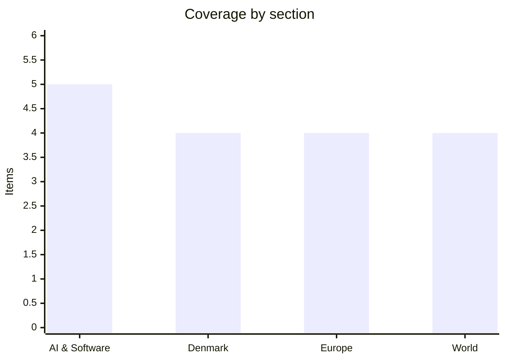

# Daily Briefing — 2026-11-05

**Top line:** Democrats have taken the US Senate and are projected to win the House, and Trump now concedes the Iran war "largely" caused the Republican losses while saying "we had to do it" (Euronews, Al Jazeera).

*Sourcing note: this covers 4–5 November. Reading went through a fetch tool: The Verge, DR and TV2 could not be read, and several Euronews items come from page summaries or headlines only. Those items are marked. Figures are the cited outlet's own.*

## Follow-ups

- **US midterms:** Senate flip now stated by Euronews ("already taken"); House: Democrats "projected to win a majority" (Euronews). Alaska (Peltola ahead by 626 votes) and Mississippi (Colom ahead by 43) were still undecided per Al Jazeera on 4 Nov.
- **Greenland defence deal:** Inatsisartut approved it on 3 Nov, 16 for, 0 against, 7 abstentions (CPH Post/Ritzau). The Folketing votes on 19 Nov.
- **Iran / Qeshm:** the "CENTCOM strikes as early as Wednesday" report is not confirmed in anything I read; what is new is Trump's admission and Khamenei's reply (see World).
- **Israel:** the election commission rejected Likud's fraud claims and confirmed the results; Herzog has begun talks on who forms a government.
- **Cat Wu:** she is going to OpenAI (Business Insider, via AI Weekly); last day at Anthropic was 30 Oct.
- **Anthropic IPO filing:** The Register (2 Nov) says Q3 revenue is near $17B; the $23.29B net-loss figure from last briefing is still unconfirmed.
- **Kimi K3.1 Pro weights:** Moonshot's Hugging Face page lists no K3.1 Pro; newest is Kimi-K3. Not confirmed published.
- **Enlargement package:** I could not find a published 4 Nov package; Euronews says a Commission report is due this week.
- **Finance bill:** still no deal; Alternativet is heading into talks with Hummelgaard.
- **Poland tribunal (3 Nov assembly outcome), Nvidia 51% rule, Binance, Cursor fake extension, Lagarde succession:** nothing new found.

## AI & Software

**OpenAI says an agentic pipeline produced 948 Linux privilege-escalation exploits for about $1.2M.** The Hacker News reports, citing OpenAI's post "A thousand fewer paths to root", that a prototype pipeline built on an upcoming cyber-focused model produced 2,308 candidate findings, of which 1,724 reproduced, yielding 948 local privilege escalation exploits. The API cost was about $1.2M, roughly $1,300 per exploit. OpenAI says disclosure and patching are being coordinated with Linux maintainers. In June, OpenAI reported 24 such exploits from GPT-5.5-Cyber, so the output has grown about forty-fold in five months. The reading that matters for defenders is that exploit discovery is becoming a purchasable commodity, and the patch queue for kernel maintainers is the bottleneck. The numbers are OpenAI's own and the pipeline is not public. Sources: [The Hacker News](https://thehackernews.com/2026/11/openai-ai-pipeline-generates-948-linux.html), [OpenAI](https://openai.com/index/a-thousand-fewer-paths-to-root/).

**A batch of fixes for developer and server infrastructure: APT, Rails, Xen, WordPress.** A Debian/Ubuntu APT flaw (CVE-2026-109518) lets a man-in-the-middle who can alter package downloads run code as root through the retry logic; it is fixed in Debian APT and Ubuntu Pro updates are rolling out, while Debian testing was still on vulnerable 3.3.5 at writing. Ruby on Rails Active Storage has an unauthenticated arbitrary file write via a crafted ImageMagick upload, CVSS 9.8 (GHSA-f3w6-w445-fwh9, no CVE yet), fixed in 8.1.4.1 and 8.0.5.2; disk-service apps can also have files read, including secret_key_base. Xen advisory XSA-523 (CVE-2026-102703/-102704) lets a malicious guest read and write other VMs' memory including dom0, affects all versions from 4.6, is patched, and is credited to Anthropic's Claude. WordPress core CVE-2026-119977 (CVSS 8.1, a race condition during core upgrades) was added to CISA's KEV list, meaning active exploitation. Separately, Check Point describes a Codex jailbreak bundle called Haiou that edits Codex config files to inject ads for a third-party LLM gateway. For Martin's estate, APT and Rails are the ones to check first. Sources: [APT](https://thehackernews.com/2026/11/debian-and-ubuntu-apt-flaw-lets-mitm.html), [Rails](https://thehackernews.com/2026/11/critical-rails-flaw-lets-attackers.html), [Xen](https://thehackernews.com/2026/11/xen-hypervisor-flaws-let-one-malicious.html), [WordPress](https://thehackernews.com/2026/11/cisa-confirms-hackers-exploiting.html), [Check Point](https://research.checkpoint.com/2026/free-the-model-sell-the-gateway-prompt-adware-hidden-in-jailbreak-bundles/) *(all via The Hacker News summaries)*.

**Anthropic: watermarking, an AP deal, a Google lease backstop and a talent loss.** Per AI Weekly (aggregator), Anthropic has added an invisible text watermark to Mythos 5, Opus 4.7, Opus 4.6 and Sonnet 4.6 from 3 Nov with no opt-out, detectable only by EU-recognised regulators, law enforcement, journalists and researchers. It signed its first paid deal with a digital news publisher, AP, for real-time attributed election data, terms undisclosed (Adweek). Google is reported to credit-backstop about $19B of Anthropic lease commitments at TeraWulf's 401MW Hawesville, Kentucky campus, ready for service from late 2027 to Q2 2028 (unite.ai). Cat Wu, who led product for Claude Code and Cowork, joins OpenAI to lead Core Products PM (Business Insider). The watermark and lease items are second-hand; I did not open the primary pages. Sources: [Yahoo Finance](https://uk.finance.yahoo.com/news/anthropic-claude-now-leave-trail-151343512.html), [Adweek](https://www.adweek.com/media/anthropic-licensing-deal-ap-election/), [unite.ai](https://www.unite.ai/terawulf-lines-up-google-backstop-for-anthropics-kentucky-ai-campus/), [Business Insider](https://www.businessinsider.com/cat-wu-joins-openai-from-anthropic-product-lead-coup-2026-11) *(aggregator, not opened)*.

**Model releases: Cognition's SWE-2 Flash, Tencent Hy4, and OpenAI's image upgrade.** Cognition released SWE-2 Flash on 4 Nov, a 276B-parameter (12B active) mixture-of-experts coding model post-trained from Thinking Machines Lab's Inkling-Small. It claims 3x speed at one-fifth the price of SWE-2, but its own table shows lower scores on Terminal-Bench 4.0 (20.0 vs 27.3) and DeepSWE 1.1 (60.1 vs 73.0), roughly level on FrontierCode 2.0 (24.0 vs 23.8). It is free for paid Devin users through 30 Nov and weights go only to partners. Tencent launched Hy4, an open-weights 770B MoE with a 1M-token context, vision and computer-operation skills, with a 50% launch discount through 31 Dec. OpenAI rolled out ChatGPT Images 2.6 on 4 Nov with animated GIFs and two new API models, saying it generates over 4 billion images a week. Ricursive's Ripple-65B claims a US open-weight best of 80.52 on TerminalBench 2.1; that is a vendor claim. All via AI Weekly. Sources: [unite.ai on Cognition](https://www.unite.ai/cognition-launches-swe-2-flash-for-faster-lower-cost-coding-agents/), [ChainCatcher on Hy4](https://www.chaincatcher.com/en/article/2301641), [OpenAI](https://community.openai.com/t/images-upgraded-introducing-chatgpt-images-2-6/1412901) *(aggregator)*.

**The midterm result hits AI data-centre stocks.** AI Weekly reports that after the Democratic win Hut 8 fell 23%, IREN 11% and Core Scientific 10%, and that Goldman economists expect local data-centre moratoria affecting about 45% of planned US capacity expansion. Ohio voters passed data-centre bans or restrictions in 14 municipalities (citing Fortune), Texas Governor-elect Gina Hinojosa called for a state moratorium, and CoreWeave bonds hit new lows. This is the first concrete sign that electoral politics can constrain AI compute buildout. The Goldman estimate is second-hand and its method is not shown. Source: [AI Weekly](https://aiweekly.co/alerts/hut-8-drops-23-as-ai-data-center-stocks-slump-on-democratic-congress-win) *(aggregator)*.

## Denmark

**About 30,000 people march against the SU cuts; no concession from government.** CPH Post, relaying Ritzau, reports roughly 30,000 at Christiansborg after a march from Rådhuspladsen, against organisers' 10,000 expectation; AFP via The Local says organisers put it at 12,000–13,000 in Copenhagen and about 40,000 on strike at 57 schools. The proposal, part of the finance bill, abolishes SU for home-living students whose parents earn above a threshold (710,077 kr per Ritzau, 700,000 per AFP) and phases it down from 419,589 kr. The two sources differ on impact: Ritzau says about 81,000 affected, AFP citing the ministry says about 14,000 lose it and 8,000 see a reduction. Pia Olsen Dyhr (SF) said "it's no secret that this is not an initiative that comes from us" but stood by the compromise; Martin Lidegaard (Radikale) called it "economically responsible policy". Association chair Oscar Tønsberg Hoffmann says talks with the government failed. No reversal has been reported. Sources: [CPH Post](https://cphpost.dk/2026-11-04/news/round-up/student-protest-draws-reported-crowd-of-30000-outside-denmarks-parliament-over-planned-grant-cuts/), [The Local](https://www.thelocal.dk/20261104/enough-is-enough-danish-students-protest-education-cuts) *(AFP, partly paywalled)*.

**Finance bill talks open while Venstre's internal revolt lingers.** Altinget says Alternativet goes into talks with Hummelgaard with four demands including green billions. The government will also propose lower valuations for about 30,100 owner-occupied flats in 31 municipalities through 2027, because 82 of 98 municipalities lack data for local apartment indexes (Ritzau via CPH Post, headline and summary only). Altinget (29 Oct, so a week old) describes Venstre's revolt over the fertiliser law: Søren Gade left the Folketing and Preben Bang Henriksen was excluded after refusing Troels Lund Poulsen's order to vote the party line, with Stephanie Lose urging a pivot to economic policy. The government's majority arithmetic therefore depends on the left parties, who also face the SU backlash. Sources: [Altinget](https://www.altinget.dk/artikel/i-valgkampen-kaempede-alternativet-for-svin-og-drikkevand-nu-gaar-de-til-forhandlinger-hos-hummelgaard-med-groenne-milliardkrav), [CPH Post](https://cphpost.dk/2026-11-05/news/round-up/30000-owner-occupied-apartments-to-get-lower-property-valuations/), [Altinget on Venstre](https://www.altinget.dk/artikel/venstres-krise-fylder-alt-partiets-staerke-kvinde-har-en-trumf-der-skal-vinde-vaelgerne-tilbage) *(paywalled after intro)*.

**Cyber: DMI pilot portal breach, Magasin du Nord staff data, and a prime-ministerial warning.** CPH Post reports data on about 5,000 pilots (names, emails, nationalities, certificate numbers) were downloaded from DMI's Nordic flight-weather portal Northavimet on 22 Oct, linked to PHP vulnerabilities; the portal was closed that day and reported to police and Datatilsynet. Magasin du Nord detected a staff-data breach on 18 Oct with no evidence customer data leaked. Mette Frederiksen told the Folketing on 3 Nov that everyone must prepare for cyber and hybrid attacks, after incidents at the University of Copenhagen (about 525,000 people including CPR numbers) and DTU and the September CPR register incident (8.7 million people). The pattern is steady, mostly web-application and supplier weaknesses rather than anything exotic. Sources: [CPH Post on DMI](https://cphpost.dk/2026-11-05/news/round-up/personal-data-of-5000-pilots-exposed-in-cyberattack-on-danish-meteorological-institute/), [CPH Post roundup](https://cphpost.dk/2026-11-04/news/round-up/) *(feed-level for Magasin and PM)*.

**Economy: Novo raises guidance, C25 at a 14-month high, eurozone inflation 4%.** CPH Post feed reports Novo Nordisk now expects 2026 revenue of -2% to +2% (previously -6% to 0%), on Q3 revenue of 79.2bn kr and profit of 16.7bn kr hit by write-downs; Wegovy pill sales were 5.4bn kr. The C25 closed at its highest since September 2024. Eurostat's flash estimate has eurozone inflation at 4% in October, up from 3.8%, driven by energy and the Middle East conflict. The inflation figure matters for ECB policy and Danish rates. All headline or feed-level; I did not open the underlying releases. Sources: [CPH Post](https://cphpost.dk/2026-11-05/business-education/business-business-education/danish-c25-stock-index-reaches-highest-closing-level-since-september-2024/), [CPH Post roundup](https://cphpost.dk/2026-11-04/news/round-up/) *(secondary)*.

## Europe

**The supermarket fridge attacks spread: about 100 stores in five more countries, plus Italy.** Euronews reports that on the night of 2 Nov an attack hit about 100 supermarkets in Sweden, Belgium, Luxembourg, Estonia and Ireland, with fridge temperatures reaching 50°C and food spoiled. In Italy four Coop stores (three in Catania, one in Palermo) were hit; Coop Radenza's CEO called it an attack on the remote control system for frozen-food counters, and the national cyber agency reported incidents at a Tuscan caterer and an Emilian frozen-food firm. A French wave on 12 Oct preceded it. Nobody has claimed responsibility and the EU calls the situation "highly worrying". Danfoss and Copeland systems are reported affected in several countries. Source: [Euronews](https://www.euronews.com/2026/11/04/supermarket-cyberattacks-in-europe-hit-italys-coop-stores-in-catania-and-palermo).

**Poland's constitutional crisis drags on; no outcome of the 3 Nov assembly found.** Euronews' Europe Today (4 Nov) says the crisis continues and interviews former Justice Commissioner Vera Jourová, who says it is "weakening Poland at a very unfortunate time". Earlier reporting (Notes from Poland) described riot police blocking the tribunal's chief on 30 Oct and a physical confrontation between President Nawrocki and judges on 31 Oct. I read only headlines and descriptions today. Sources: [Euronews](https://www.euronews.com/2026/11/04/judicial-crisis-is-weakening-poland-in-a-very-unfortunate-time-says-former-eu-commissioner), [Europe Today](https://www.euronews.com/2026/11/04/europe-today-democrats-win-senate-in-rebuke-of-trump-as-polands-crisis-drags-on) *(headline-level)*.

**Ukraine: Brussels reconstruction talks, Witkoff diplomacy and cross-border strikes.** Euronews reports Brussels hosts talks on Ukraine's reconstruction with key allies, and previews this week's talks with US envoy Steve Witkoff on ending the war; last briefing noted working-level talks in Abu Dhabi on 10–11 Nov. Al Jazeera reports Ukrainian strikes killed three in Russia's Belgorod region, with Moscow claiming 700 Ukrainian drones downed. Kyiv's ambassador insists Hungary is not blocking accession talks. Detail is thin because I read only summaries. Sources: [Euronews](https://www.euronews.com/2026/11/04/brussels-to-host-talks-on-ukraines-reconstruction-with-key-allies), [Al Jazeera](https://www.aljazeera.com/news/2026/11/4/ukrainian-strikes-kill-three-in-russias-belgorod-region) *(summary-level)*.

**EU court adviser: Gemini can infringe press publishers' rights in two ways.** ppc.land reports Advocate General Szpunar's opinion in Case C-250/25 (Like Company v Google Ireland) that Gemini's outputs can infringe press publishers' rights. An AG opinion is advisory; the Court of Justice follows it in most but not all cases, and its judgment would set the rule for AI-generated summaries of news across the EU. I read only the ppc.land summary, not the opinion. Source: [ppc.land](https://ppc.land/googles-gemini-can-infringe-press-rights-in-2-ways-eu-court-adviser-says/) *(secondary)*.

## World

**Democrats take Congress: what is settled and what is not.** Euronews says Democrats "have already taken the Senate" from a 53–45 (plus two independents) start with 51 needed, naming wins by James Talarico over Ken Paxton in Texas and Annie Andrews in South Carolina, and projects a House majority (218 needed; Republicans held exactly 218 before). Al Jazeera, however, still lists Alaska (Peltola +626 over Sullivan, with a ranked-choice runoff possible) and Mississippi (Colom +43 over Hyde-Smith) as undecided, and the two outlets conflict on Kansas. Amy Acton beat Vivek Ramaswamy for Ohio governor. Trump posted "I wasn't on the ballot and if I was, we would have won in a landslide!" and told CBS he could veto Democratic legislation. Final seat counts are not yet available in what I could read. Sources: [Euronews](https://www.euronews.com/2026/11/04/democrats-set-to-seize-control-of-congress-after-long-night-for-republican-party), [Al Jazeera](https://www.aljazeera.com/news/2026/11/4/us-midterms-2026-what-key-races-remain-undecided).

**Trump admits the Iran war cost Republicans; Tehran says "Americans said no to war."** Al Jazeera's 5 Nov live blog reports Trump conceding the war "largely" caused the losses but saying "we had to do it" to stop an Iranian nuclear weapon. Supreme Leader Mojtaba Khamenei said US hostility "will persist" regardless of the midterms, and chief negotiator Mohammad Bagher Ghalibaf wrote on X that "Americans said NO TO WAR, and we endorse this message". Euronews headlines also report the US strike on Qeshm Island and Iran warning of a "new battlefield". Whether the new House changes war funding or powers is the next question; I found no casualty or Hormuz shipping details today. Sources: [Al Jazeera live blog](https://www.aljazeera.com/news/liveblog/2026/11/5/iran-war-live-trump-admits-war-caused-election-loss-but-had-to-do-it), [Al Jazeera](https://www.aljazeera.com/news/2026/11/4/iran-hails-us-voters-rejecting-war-while-khamenei-warns-hostility-wont-end) *(strike headlines not opened)*.

**Israel's election result is confirmed; Netanyahu's allies refuse to accept it.** Al Jazeera reports the election commission rejected Likud's fraud claims and confirmed the results, with Herzog beginning talks on who forms the next government. Euronews says the commission found no fraud. Seat counts were not in the text I could read. Separately, a 3 Nov Euronews headline has Trump saying the US will end military aid to Israel; I read no detail and it should be treated as unverified. Sources: [Al Jazeera](https://www.aljazeera.com/news/2026/11/4/israel-vote-results-confirmed-as-election-commission-rejects-fraud-claims), [Euronews](https://www.euronews.com/2026/11/04/israels-election-commission-says-no-fraud-found-in-last-weeks-vote) *(headline-level)*.

**Elsewhere: South Africa votes, Indonesia sacks the president's chief of staff.** Al Jazeera reports South Africans voted in local elections seen as a test for the embattled ANC, and Indonesia's presidential chief of staff was dismissed over alleged wiretapping. I read headlines only, so there are no results or details yet. Sources: [South Africa](https://www.aljazeera.com/news/2026/11/4/south-africans-vote-in-local-elections-seen-as-test-for-embattled-anc), [Indonesia](https://www.aljazeera.com/news/2026/11/4/indonesian-presidents-chief-of-staff-dismissed-over-alleged) *(headline-level)*.

## Watch list

- **5–6 Nov:** Final House and Senate calls (Alaska, Mississippi); Commission enlargement report; ECB nomination deadline on 6 Nov.
- **Soon:** Moonshot Kimi K3.1 Pro weights; OpenAI's upcoming cyber-focused model; Anthropic IPO filing details.
- **9–11 Nov:** Poland "Koalicja" exercise (9 Nov); Ukraine talks in Abu Dhabi and Knesset swearing-in (10–11 Nov); COP31 leaders' meetings 11–12 Nov.
- **19 Nov:** Folketing vote on the Greenland deal.
