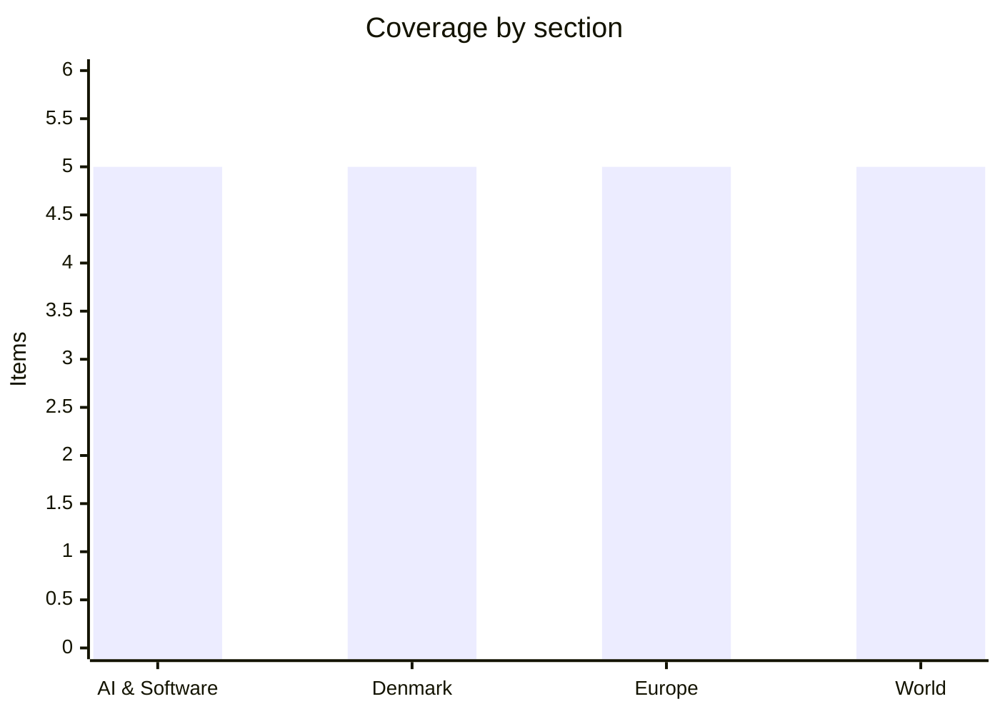

# Daily Briefing — 2026-11-06

**Top line:** OpenAI launched GPT-6 Cyber, which it rates "Critical" under its own Preparedness Framework, as Trump says the US may have to "destroy" the rest of Iran while Iran's security chief carries a Khamenei letter to Putin (The Register, Al Jazeera).

*Sourcing note: this covers 4–6 November. DR, TV2, Politiken, Berlingske, JP, Børsen, BBC, AP, Politico and the FT could not be read, so Danish items rest on The Copenhagen Post/Ritzau and The Local/AFP, and Europe and World lean on Euronews and Al Jazeera. Items I could only read as headlines or summaries are marked. Figures are the cited outlet's own.*

## Follow-ups

- **US Congress:** Al Jazeera now gives the Senate as Democrats 54, Republicans 44 with Mississippi and Alaska still uncalled, and the House as Democrats 242, Republicans 151 (218 needed). Mississippi: Colom led Hyde-Smith by 1,138 votes with about 3,600 mail ballots outstanding, county certification by 13 Nov. Alaska: Peltola led by 637, ranked-choice results not before 18 Nov.
- **Iran / Qeshm:** the US strike on Qeshm Island on 3 Nov is now confirmed by Al Jazeera, with US officials calling it "defensive"; the reported CENTCOM follow-up strikes have still not happened (see World).
- **Israel:** Herzog formally began consultations; seat counts are now available (see World).
- **OpenAI 948 Linux exploits:** now tied to the GPT-6 Cyber launch; The Register says 588 of the kernel bugs were previously unknown.
- **Greenland defence deal:** Inatsisartut's 16–0 vote (7 abstentions) is repeated by the Copenhagen Post; it allows two additional US bases. The Folketing vote is still 19 Nov.
- **Enlargement package:** it was already presented on 4 Nov by Marta Kos (Euronews); Serbia, Georgia and Turkey are under increased scrutiny.
- **ECB succession / 6 Nov deadline:** nothing found in anything I could read.
- **Finance bill:** no deal or vote date found; the only related text is the SU cut in the draft bill (see Denmark).
- **Anthropic IPO filing, Kimi K3.1 Pro weights, Cat Wu:** nothing new found; not specifically re-checked beyond the sources above.

## AI & Software

**OpenAI releases GPT-6 Cyber and rates it "Critical" under its own framework.** The Register reports the model launched on 5 Nov at 17:00 UTC, initially via API and Codex for approved customers of OpenAI's Daybreak Red programme, with access widening to all Daybreak Red customers over the coming weeks; GPT-5.6 Cyber is also being made available to that group. OpenAI reports 48.5% on ExploitGym against 32.1% for GPT-5.6 Cyber, says the model stayed in scope over 99% of the time, and that 0.07% of cases went beyond scope, which it declined to detail. It also credits the model with 81 high-severity Firefox vulnerabilities (Mozilla is fixing them) and the 948 Linux kernel exploits, 588 of them in previously unknown bugs, reported yesterday. Bug-bounty payouts were raised roughly fourfold: critical findings in core products are now up to $30,000 (up from $6,500), exceptional ones up to $100,000. The context is a vendor shipping a model it classes as critical risk while selling access to defenders; the second reading is that the scope and rating claims are OpenAI's alone and unverified. The Hacker News and The Register differ on whether the 948 exploits target "a distribution" or the kernel; I did not resolve that. Sources: [The Register](https://www.theregister.com/security/2026/11/05/openai-releases-gpt-6-cyber-and-promises-this-one-stays-within-rules-of-engagement/5307855), [The Hacker News](https://thehackernews.com/2026/11/openai-ai-pipeline-generates-948-linux.html).

**OpenSSH 10.6p2 fixes a password-authentication bypass on Alpine/musl systems.** The Hacker News reports an emergency release after a flaw in sshd on musl-based Alpine without PAM: with a password between 257 and 1,024 bytes, key-only accounts can be logged into. Alpine has shipped fixes back to 3.16, with point releases 3.21.10, 3.22.8, 3.23.8 and 3.24.4. No CVE has been assigned yet and no exploitation is reported; the reporter is Özgün Kültekin of Wakefield. OpenSSH developer Damien Miller urged patching "IMMEDIATELY", and the workaround is `PasswordAuthentication no`. It matters mostly for containers: Alpine is the default base for many images, and key-only accounts are exactly the ones people assume are safe. Check any image that runs sshd on Alpine. Source: [The Hacker News](https://thehackernews.com/2026/11/openssh-issues-emergency-fix-for-flaw.html) *(OpenSSH/Alpine advisories cited, not read)*.

**Apple will scan content shared through public iCloud links.** The Hacker News says an Apple support document published on 3 Nov states that items shared as "Anyone with the link" in iCloud Photos and iCloud Drive will be checked for harmful content, starting with iOS, iPadOS, macOS and visionOS 27.3, expected in December. Sharing that way disables end-to-end encryption even for Advanced Data Protection users. What counts as harmful, and whether links created before the update are covered, is not clear from the coverage. This differs from Apple's abandoned 2021 on-device scanning plan in that it applies only to content the user chooses to expose publicly, but it is still a new content-inspection step in a product marketed on privacy. Sources: [The Hacker News](https://thehackernews.com/2026/11/apple-to-start-scanning-publicly-shared.html), [Apple](https://support.apple.com/en-us/149168) *(Apple page cited, not read)*.

**Two AI-tooling and network-gear bugs: a ChatGPT Lockdown Mode bypass and a Zyxel patch that did not hold.** Check Point researcher Eli Smadja found a zero-click data-exfiltration route through HTML previews in code blocks that bypassed ChatGPT's Lockdown Mode (introduced June 2026); The Hacker News reports it as patched. Separately, Binarly says Zyxel's GS1900 firmware 2.90 Patch 2 (CVE-2026-7273) does not block the exploit; Patch 3 fixes CVE-2026-107441 across 10 models, and GreyNoise has seen 996 switches taken over. The Register also headlines that Anthropic will not fix a Claude Dispatch flaw allowing cross-boundary remote commands. I read only summaries and headlines for these, so treat details as thin. Sources: [ChatGPT](https://thehackernews.com/2026/11/researchers-bypass-chatgpt-lockdown.html), [Zyxel](https://thehackernews.com/2026/11/zyxel-gs1900-patch-fails-to-block-zero.html), [Claude Dispatch](https://www.theregister.com/research/2026/11/05/anthropic-wont-fix-a-claude-dispatch-flaw-that-could-let-attackers-execute-remote-commands-across-corporate-boundaries/5307684) *(summary/headline-level)*.

**Tech industry moves: Meta buys Conductor, Canva cuts 22%, Google's London datacentre outage.** The Register reports Meta acquiring the agent-orchestration startup Conductor, and AWS Kiro being refitted for agent orchestration, both signs that orchestrating many agents is the next product battleground. Canva announced layoffs of 22% of staff (4 Nov), and a Google London datacentre outage is blamed on a bad PLC configuration after generators failed to start. VMware also quietly extended vSphere 8 Standard and Enterprise Plus sales and support in Europe to October 2028. Headline-level only; no deal values or headcounts beyond the percentage. Sources: [Meta/Conductor](https://www.theregister.com/ai-and-ml/2026/11/05/meta-brings-conductor-on-board-its-model-train/5307711), [Canva](https://www.theregister.com/saas/2026/11/04/aussie-adobe-assailant-canva-announces-layoffs-in-re-org-affecting-22-of-staff/5307422), [Google](https://www.theregister.com/off-prem/2026/11/05/when-datacenters-lose-power-generators-should-kick-in-that-didnt-happen-for-google-in-london/5307739), [VMware](https://www.theregister.com/virtualization/2026/11/05/vmware-quietly-offers-european-users-extended-sales-and-support-for-low-end-vsphere/5307732) *(headline-level)*.

## Denmark

**Tens of thousands of students strike and march against SU cuts.** AFP/The Local report the "Enough is Enough" march from City Hall Square to parliament on 4 Nov; organisers claim 12,000–13,000 in Copenhagen and 40,000 on strike at 57 schools, while Ritzau cites a reported 30,000 outside parliament, so crowd figures vary. The draft budget bill would abolish SU for students living at home whose parents earn over 700,000 kr, which would cost about 14,000 students the grant and reduce it for about 8,000; current SU is 1,154 kr/month at home and 7,426 kr/month living alone. Graduates would also need work in 18 of their last 24 study months to qualify for unemployment benefit. The cuts are described as freeing money for defence. The measure splits the centre-left coalition: SF's Pia Olsen Dyhr said it "does not come from us" but that she stands by the compromises, while Martin Lidegaard called it "economically responsible policy". The next test is whether the finance-bill partners accept it. Sources: [The Local](https://www.thelocal.dk/20261104/enough-is-enough-danish-students-protest-education-cuts), [Copenhagen Post](https://cphpost.dk/) *(partly paywalled)*.

**Cyber incidents pile up and the threat level for destructive attacks is raised to "high".** The Copenhagen Post/Ritzau report that about 5,000 pilots registered on the Nordic flight-weather portal Northavimet had names, emails, nationalities and certificate numbers exposed after unauthorised access to DMI systems on 22 Oct, linked to a PHP vulnerability; police and Datatilsynet were notified. Pro-Russian groups claimed attacks on European supermarket cooling systems, and Denmark's Agency for Societal Security says it is too early to say what role they played, but it has raised the threat level for destructive cyberattacks from "medium" to "high". Lower-confidence summary text adds that the PM urged everyone to prepare and lists recent incidents at DTU, the University of Copenhagen and the CPR register. The pattern of an alert raised alongside several unrelated breaches is the story, not any one breach. Source: [Copenhagen Post/Ritzau](https://cphpost.dk/2026-11-05/news/round-up/personal-data-of-5000-pilots-exposed-in-cyberattack-on-danish-meteorological-institute/) *(part verbatim, part summary)*.

**About 800 more criminal records were deleted by mistake, including homicide and sexual offences.** Ritzau reports Rigspolitiet confirmed on Thursday evening that about 800 further decisions were removed early from the Central Criminal Register, mostly combination sentences that are normally deleted automatically after 20 years. Justice spokespersons were briefed at the Justice Ministry. Earlier in September, handling of child-protection certificates, citizenship applications and weapons permits had been halted over the same problem and later resumed. This is a second wave of the same error, which makes the question of the register's integrity, and whether certificates issued in between were wrong, the one to follow. Source: [Copenhagen Post/Ritzau](https://cphpost.dk/2026-11-05/news/round-up/personal-data-of-5000-pilots-exposed-in-cyberattack-on-danish-meteorological-institute/) *(summary-level, same page)*.

**Danish markets: C25 hits its highest close since September 2024, Maersk falls 10% on a good quarter.** Ritzau reports the C25 closed at 2,026.62 on 4 Nov, up 1.82%, the highest close since the record of 2,039.66 in September 2024, led by Pandora (+10.9%), Novo Nordisk (+5.5%) and Ørsted (+4.5%). Novo raised 2026 revenue guidance to between -2% and +2% (from -6% to flat), with Q3 revenue of DKK 79.2bn and Wegovy pill sales of DKK 5.4bn. On 5 Nov Maersk shares fell over 10% despite Q3 profit above $3bn, revenue up 27% to $18.1bn and raised guidance; analysts had priced in more. Ecco is also cutting 400 jobs globally, 80 in Denmark. The index is near a record with the shipping bellwether selling off on beats, which suggests expectations, not results, are driving moves. Sources: [Copenhagen Post/Ritzau](https://cphpost.dk/2026-11-05/business-education/business-business-education/danish-c25-stock-index-reaches-highest-closing-level-since-september-2024/).

**Property valuations to be lowered for about 30,000 apartments; DF wants more names off the citizenship bill.** Taxation Minister Jakob Engel-Schmidt will legislate lower assessments for about 30,100 owner-occupied apartments in 31 municipalities, using local single-family house price trends where lower, through 2027; Samsø, Fanø, Læsø and Ærø are generally exempt from this year's increases. Separately, The Local reports DF's Mikkel Bjørn wants three more men (two Syrians, one Pakistani, cited for social-media posts) removed from the list of 2,055 people in the long-stalled citizenship bill, threatening to summon them to the Citizenship Committee; the bill is due February 2027 and parties are also calling for tougher language tests. Sources: [Copenhagen Post/Ritzau](https://cphpost.dk/2026-11-05/news/round-up/30000-owner-occupied-apartments-to-get-lower-property-valuations/), [The Local](https://www.thelocal.dk/20261104/danish-peoples-party-wants-three-more-names-taken-off-citizenship-bill) *(partly paywalled)*.

## Europe

**The Bank of England raises rates for the first time since August 2023.** Euronews/AP report the MPC raised Bank Rate to 4% from 3.75% on a vote of 8–1, with one member wanting a half-point rise. September inflation was 3.5%, and the Bank forecasts nearly 5% by mid-2027, with growth of 1.6% in 2026 and 1.3% in 2027. Governor Andrew Bailey said the rise should not be seen as "the first in an inevitable long sequence of hikes". The article says the Fed and ECB have recently raised rates in response to inflation driven by the Iran war, and a 4 Nov Euronews headline (not opened) puts eurozone inflation at 4% in October, a three-year high. The read-across is that the war is now feeding into rate paths across Europe. Source: [Euronews](https://www.euronews.com/2026/11/05/bank-of-england-raises-key-interest-rate-for-first-time-in-over-3-years).

**Rheinmetall shares plunge over 17% after a guidance cut.** Euronews reports the company cut 2026 revenue guidance to about €13.2bn from €13.7–14.2bn and the operating margin to about 18.5% from 19%, because the Arminius order (Boxer vehicles with KNDS) is now unlikely this year and slips into 2027, with artillery ammunition acceptance delays also flagged. Q3 sales rose 32% to €3.149bn and nine-month operating profit was a record €1.339bn. JPMorgan cut its target to €1,150 (from €1,350, Neutral); BAE fell over 4% and Leonardo 2.8%, although Leonardo reports orders up 28% to above €60bn in nine months. The drop is about order timing rather than demand, but it shows how much of the defence rally rests on procurement schedules. Source: [Euronews](https://www.euronews.com/2026/11/05/rheinmetall-shares-plunge-more-than-17-after-profit-warning-over-order-delays).

**Meloni says Europe is "less credible" on Ukraine talks and wants a single voice.** In a letter to European Council President António Costa, Giorgia Meloni asked that the informal European Council in Dublin next week settle how the EU is represented in peace talks, listing the E3, the 37-state Coalition of the Willing and the "Berlin format" as competing channels (Euronews). Ukraine–Russia talks mediated by US officials are set for Abu Dhabi on 10–11 Nov, the first trilateral since February, and Melania Trump hosted Ukrainian and Russian officials at the White House on 5 Nov, with Zelenskyy awarding her an order for brokering an Oleshky ceasefire in Kherson. Russia launched 128 drones and two missiles at the Kyiv region overnight. The question for Dublin is whether Europe gets a seat or is briefed afterwards. Sources: [Euronews, Meloni](https://www.euronews.com/2026/11/05/italian-pm-slams-eus-fragmented-approach-to-ukraine-peace-talks), [Euronews, Melania Trump](https://www.euronews.com/2026/11/05/us-first-lady-melania-trump-to-host-ukrainian-and-russian-officials-at-white-house).

**The Commission is preparing a trade "kill-switch" against China; Beijing threatens retaliation.** Trade Commissioner Maroš Šefčovič told MEPs on 4 Nov the tool, which could cut Chinese access to the EU market in cases of serious disruption, should be presented by year-end (Euronews). China's ambassador Cai Run threatened countermeasures. The EU's trade deficit with China is about €1bn a day, and Chinese imports rose 25% over the past year per Chinese customs. France and Germany pushed for the instrument in early October, and leaders asked for quotas and tariffs on chemicals and machinery. The next Šefčovič–Wang Wentao meeting is not until March 2027, so this escalates without a scheduled channel. Also on 4 Nov, MEPs backed relaxing the 2035 car CO2 target from 100% to 87.5% (Euronews newsletter, not opened in full). Source: [Euronews](https://www.euronews.com/2026/11/05/china-threatens-eu-with-retaliation-as-eu-mulls-kill-switch-to-defend-its-market).

**Serbia's Student List gets its first high-level EU contact.** Euronews reports Enlargement Commissioner Marta Kos met four Student List representatives in Brussels on 2 Nov, the party's first such contact since a landslide that gave it an absolute majority and ended 14 years of Vučić's SNS. Government formation is delayed by polling irregularities at several stations and presidential elections are due by late December. Signs of realignment include the RTS head resigning, senior police arrests and a bank licence revoked, and Albania's Edi Rama told Euronews the new government is unlikely to recognise Kosovo. Kos said Serbia "has the chance for a fresh start" while the 2026 enlargement package put it under increased scrutiny on foreign-policy alignment. Source: [Euronews](https://www.euronews.com/2026/11/05/eu-commission-holds-first-talks-with-serbias-student-list).

## World

**Democrats win both chambers; two Senate seats remain open.** Al Jazeera reports Democrats at 54 Senate seats with Mississippi and Alaska undeclared, and 242 House seats against 151 (218 needed), with Hakeem Jeffries expecting at least 255; governors split 28 Democratic, 20 Republican, two undeclared. Mississippi's Colom–Hyde-Smith race is at about 49% each per AP with 96% counted and no automatic recount, while in Alaska Peltola leads Sullivan by 637 votes with nearly a quarter uncounted, and a DOJ suit to block certification was dismissed (DOJ will appeal). Firsts include Abdul El-Sayed as Michigan's first Muslim senator and Keisha Lance Bottoms as Georgia's first Black female governor. Reuters/Ipsos had Trump's policy approval at 32% before the vote. Trump has promised to veto "insane" Democratic legislation, and a veto needs two-thirds to override, which Democrats lack. Sources: [Al Jazeera](https://www.aljazeera.com/news/2026/11/5/iran-gaza-ukraine-what-will-us-midterm-results-mean-for-these-conflicts), [Al Jazeera, Mississippi and Alaska](https://www.aljazeera.com/news/2026/11/5/whats-delaying-us-midterm-election-calls-in-mississippi-and-alaska).

**Republicans split over the Iran war as Vance blames it for the loss.** Al Jazeera quotes Vice President Vance on X: "The reason we lost is the war. The president himself said so last night." Ted Cruz said the war "should have been brief, decisive, and over", Thom Tillis said Hegseth faces a "reckoning", and Schumer said "this war must end"; Ro Khanna proposed a continuing resolution barring funds for combat in Iran. Trump told the WSJ "I did the right thing" and backed Hegseth, and the Pentagon puts the war's cost at about $47bn. Analysts quoted say defunding a war with troops in theatre is "highly problematic", so a funding fight is more plausible than an effective limit before January. Trump also said on Fox that "by the end of this year we won't be paying Israel" the $4bn in annual aid; Netanyahu's office did not comment, so treat that as unconfirmed. Source: [Al Jazeera](https://www.aljazeera.com/news/2026/11/5/congress-defeat-how-trumps-allies-are-distancing-themselves-from-iran-war).

**Trump says the US may have to "destroy" the rest of Iran; Tehran's security chief takes a letter to Putin.** Al Jazeera's 6 Nov live blog summarises Trump saying the US may have to "destroy" the rest of Iran, that rebuilding would take 25 years and that people will "know soon enough". Iran's security council secretary Mohsen Rezaei met Putin on 5 Nov and delivered a letter from Supreme Leader Mojtaba Khamenei, per Press TV; Rezaei said Iran will neither open the Strait of Hormuz nor negotiate until its "seven conditions" are executed, and the Kremlin had not released its account. Iran reportedly sent a nuclear proposal through Qatar, which Washington is reviewing, and Qatar says both sides remain committed to talks. Iran's army says it bought Russian Su-35s expected after the war. A June US–Iran memorandum with a $300bn rebuild fund "quickly fell apart" per Al Jazeera. The details of Tehran's warning that states aiding the US are "legitimate targets" were not readable. Sources: [Al Jazeera live blog](https://www.aljazeera.com/news/liveblog/2026/11/6/iran-war-live-trump-warns-us-may-have-to-destroy-rest-of-iran), [Al Jazeera, Rezaei](https://www.aljazeera.com/news/2026/11/6/irans-security-chief-meets-putin-delivers-message-from-khamenei) *(live-blog summary level)*.

**Israel: Eisenkot looks likelier than Netanyahu to be asked to form a government.** Al Jazeera/AP report seats of 53 for Netanyahu's bloc, 48 for Gadi Eisenkot's and 19 for Arab-led parties (Joint List 11, Ra'am 8), with neither bloc at 61. President Herzog accepted the certified results, which the Election Committee said showed "no evidence of irregularities", and began consultations on 4 Nov. On 5 Nov the Joint List said it will recommend Eisenkot, joining Ra'am, which would put him at about 67 recommendations by Al Jazeera's count; Degel HaTorah (4 of UTJ's 7 seats) will recommend neither after a dispute over Haredi draft exemptions. Herzog will decide "in several days", the nominee has 28 days plus a possible 14-day extension, and failure means a new election in early 2027. Netanyahu continues to claim fraud without evidence and Likud calls cooperation with the Arab bloc "dangerous". Sources: [Al Jazeera, Herzog](https://www.aljazeera.com/news/2026/11/5/israels-herzog-accepts-vote-results-opens-talks-on-forming-a-government), [Al Jazeera, Joint List](https://www.aljazeera.com/news/2026/11/5/joint-list-says-it-will-back-eisenkot-to-form-israels-next-government).

**Paraguay's president tries to resign after the collapse of digital lender Ueno.** Reuters via Al Jazeera reports the central bank found Ueno below its legal solvency ratio; it claimed about 3 million customers in a country of 6.5 million and administered close to $850m in public funds. President Santiago Peña offered his resignation on 5 Nov "with the stability of our country, social peace" in mind, but Congress refused after Colorado Party lawmakers walked out and the joint session lost quorum, and the Senate moved ahead with impeachment. Central bank head Carlos Carvallo resigned, the Attorney General opened three criminal investigations, and Peña previously held a stake in Ueno's parent Grupo Vazquez, which he says he sold in 2025. Former president Horacio Cartes said his party "will not side with the theft of public, private and pension funds". If Peña goes, Vice President Pedro Alliana takes over. Source: [Al Jazeera/Reuters](https://www.aljazeera.com/economy/2026/11/5/paraguay-president-pena-resigns-in-wake-of-bank-collapse).

## Watch list

- **Within days:** Herzog's choice of who forms Israel's government; final calls in Mississippi (counties certify by 13 Nov) and Alaska (ranked-choice results from 18 Nov).
- **Soon:** Trump's "you'll know soon enough" on Iran, and US reply to Iran's nuclear proposal via Qatar.
- **10–11 Nov:** Ukraine–Russia talks in Abu Dhabi, and the informal European Council in Dublin next week on EU representation.
- **19 Nov:** Folketing vote on the Greenland defence deal; Paraguay's Senate impeachment process in the meantime.
