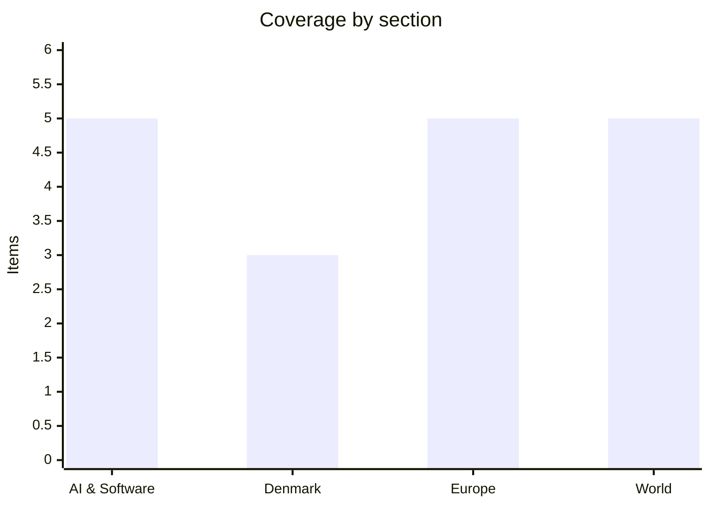

# Daily Briefing — 2026-11-07

**Top line:** Trump named Stephen Miller White House chief of staff (from Monday, replacing Susie Wiles) on the same day Republicans were still arguing over the Iran war and Qatar urged Washington and Tehran not to wait for a "perfect moment" to make a deal (Al Jazeera).

*Sourcing note: this covers 6–7 November. DR, TV2, Politiken, Berlingske, JP, Børsen, BBC, AP, Politico and the FT could not be read (TV2 blocks automated access). Danish items rest on The Local/AFP and The Copenhagen Post; Europe and World lean on Euronews and Al Jazeera; AI items on The Hacker News and The Register. Several pages were read at teaser or summary level and are marked. Nothing dated 7 November surfaced on the AI, Danish or Euronews pages, so Denmark is thin today. Figures are the cited outlet's own.*

## Follow-ups

- **Paraguay:** yesterday's "Peña tries to resign" has moved on. Congress rejected the resignation, the Senate voted 44 to remove him, and Pedro Alliana was sworn in on 6 Nov (see World).
- **OpenSSH / Alpine:** now has a name (SSHole), a CVE and reported in-the-wild attempts (see AI & Software).
- **OpenAI GPT-6 Cyber:** The Hacker News gives out-of-scope avoidance as 99.93% vs 94.49% for GPT-5.6 Cyber, consistent with yesterday's "over 99%". Nothing new on the unresolved 948-exploit "distribution vs kernel" question.
- **Claude Dispatch:** The Hacker News now says Anthropic told researchers on 13 Oct that Dispatch would be retired by end of October, though the help page does not say so. No CVE, no real attacks reported.
- **Criminal records deleted by mistake:** the Copenhagen Post repeats the "about 800" figure on 6 Nov; no new facts.
- **Israel, Mississippi/Alaska, Greenland vote (19 Nov), ECB succession:** no new information found in what I could read. The ECB point is partly answered below: Lagarde's leaving date is 7 Feb 2027.
- **Iran / Qeshm:** IRNA reports two missiles hit Qeshm Island again on 7 Nov (see World).

## AI & Software

**"SSHole": OpenSSH flaw on Alpine is already being probed.** The Hacker News reports CVE-2026-123158 (CVSS 8.1), fixed in OpenSSH 10.6p2, lets an unauthenticated attacker log in to accounts with no usable password by sending a 257–1,024-byte password, on Linux systems running OpenSSH on musl libc with PAM disabled, which includes Alpine's default sshd setup. Researcher Özgün Kültekin found it, and it traces back to a 2016 patch for CVE-2016-6210. Security firm Previdian saw root login attempts on an Alpine honeypot less than nine hours after the CVE was published: eight attempts from one Japan-geolocated IP. Dropbear, glibc distributions, non-Linux systems and PAM-enabled setups are not affected. Alpine is the base image for a large share of containers, so the practical task is finding images that run sshd on Alpine and updating or setting `PasswordAuthentication no`. This upgrades yesterday's "no exploitation reported" to "exploitation attempts seen", though one honeypot is thin evidence of scale. Source: [The Hacker News](https://thehackernews.com/2026/11/hackers-exploited-openssh-sshole-flaw.html).

**WordPress's fix for an actively exploited bug can briefly expose the site while updating.** CVE-2026-119977 affects WordPress 4.7 through 7.1.3 and is fixed in 7.1.4 and matching backports; CISA added it to its Known Exploited Vulnerabilities catalogue earlier this week. Umut Bayram of Picus Security found that the old updater unpacks an installer into a predictable folder under wp-content/upgrade, so the update itself opens a window. The advised mitigation is to block web access to that folder before updating. Wordfence says it saw attacks nine minutes after its firewall rule went live. WordPress's own advisory rates the flaw low while the CVE record scores it 8.1, which is a disagreement about severity, not about whether it works. Source: [The Hacker News](https://thehackernews.com/2026/11/installing-fix-for-exploited-wordpress.html).

**PyTorch 2.15 rebuilds its NCCL backend to handle the "one bad GPU" problem.** The Register reports a rewritten backend with one communicator per process group, aimed at diagnosing faults and recovering in large training runs. It adds a "flight recorder" and makes it easier to replace stragglers. The legacy ProcessGroupNCCL stays as a rollback and is removed in 2.16, planned for early next year, so anyone with custom distributed code has a migration window. Tristan Rice of Meta presented the changes on a livestream. The release totals 3,117 commits from 583 contributors. At the scale of tens of thousands of GPUs, one slow or failing device stalls the whole job, which is why this matters more than a routine point release. Source: [The Register](https://www.theregister.com/devops/2026/11/06/pytorch-215-tackles-the-one-bad-gpu-problem/5308227).

**Cloudflare says AI agents are a "bane" for some site owners; UK and US move on agent oversight.** On its Q3 call, CEO Matthew Prince said agentic traffic could reach 1,000 times human clicks, that containers are "already cooked", and that about 5% of the web has opted into Cloudflare's content protection since 1 July. Revenue was a record $782.5M, up 39%, and the shares rose about 15% after hours (The Register). Separately, a new clause in the UK's Cyber Security and Resilience Bill, added at third reading in the Lords, would let ministers regulate agentic AI deployment and incident reporting by secondary legislation, including inspection, search and seizure powers; foundation-model developers are not automatically in scope (The Register). The US DOJ says its Super Intelligence Task Force is operational under an 13 Oct Trump memo, with Pentagon CTO Emil Michael promising AI regulatory details "later this month". The Register's title for the task-force head, Jay Clayton, looks questionable, so treat that detail with care. Sources: [Cloudflare](https://www.theregister.com/networks/2026/11/06/ai-agents-are-a-bane-for-some-website-operators-says-cloudflare/5308022), [UK](https://www.theregister.com/ai-and-ml/2026/11/06/uk-ministers-seek-powers-to-investigate-when-ai-agents-are-let-off-the-leash/5307889), [DOJ](https://www.theregister.com/ai-and-ml/2026/11/06/dojs-super-intelligence-task-force-up-and-running/5308074).

**Security roundup: Chainalysis breach widens, Barracuda and Control Web Panel bugs, Paint RCE.** The Hacker News reports Chainalysis now says its attack, which it describes as agentic, exposed names, usernames, password hashes and live tokens for all users, not the subset first disclosed; KYT and the login page are offline and every user must reset passwords and rotate API keys. watchTowr detailed a Barracuda Email Security Gateway chain to root without login (CVE-2026-116606 plus CVE-2026-111560, patched Monday). QiAnXin XLab found a "cwpdoor" backdoor in Control Web Panel's cwpsrv 1.15.10 and 1.24.0, and Microsoft Paint has an RCE (CVE-2026-83844, CVSS 8.1) fixed only through the Store in build 11.2609.401.0. Also from The Hacker News, Forever Security showed that a malicious browser extension could drive Claude Dispatch on Claude Desktop (see Follow-ups). I read teasers for the last four, not full articles. Sources: [Chainalysis](https://thehackernews.com/2026/11/chainalysis-breach-exposes-all-users.html), [Barracuda](https://thehackernews.com/2026/11/experts-demonstrate-barracuda-email.html), [cwpdoor](https://thehackernews.com/2026/11/hackers-hide-linux-backdoor-in-control.html), [Paint](https://thehackernews.com/2026/11/microsoft-paint-rce-fix-now-available.html), [Dispatch](https://thehackernews.com/2026/11/malicious-browser-extensions-could-use.html).

## Denmark

**The "hard ghettos" law reaches the Supreme Court.** AFP/The Local report the court heard on 6 Nov a case brought by seven Helsingør families whose leases were ended in 2022 under a 2018 law. That law requires social-housing estates where more than half of residents are "non-Western" to rent at least 60% of homes at market rates by 2030, and the families argue it discriminates by ethnicity. Lower courts sided with the landlord. Lawyer Eddie Khawaja said the question is whether the criteria are "neutral or not". A December 2025 ruling from the EU Court of Justice left the question to Danish courts, and no verdict date is set. Tenants' associations estimate about 11,000 people will have to move by 2030, so the judgement could affect far more than these seven households. Source: [The Local](https://www.thelocal.dk/20261106/denmarks-hard-ghettos-row-reaches-supreme-court).

**Bomb hoaxes hit Danish departures as part of a Europe-wide wave.** The Copenhagen Post reports at least 25 aircraft affected on Thursday and police and the Armed Forces' bomb disposal unit at Copenhagen Airport after two aircraft landed under suspicious circumstances; no explosives were found. Al Jazeera says flights from 16 countries including Denmark were affected, while The Local says threats to Rome and Sofia airports were signed by "fighters of the Male State", a name AFP could not link to the Russian far-right movement of the same name. Nobody has claimed responsibility and authorities have not said who is behind it. The Local and Al Jazeera both report no hard evidence of Russian, Iranian or proxy involvement. The cost per disruption can be up to $250,000 per airline according to Coventry University's Philip Baum, quoted by Al Jazeera. Sources: [Copenhagen Post](https://cphpost.dk/2026-11-05/life-in-denmark/new-bomb-threats-disrupt-flights-across-europe/), [The Local](https://www.thelocal.dk/20261106/who-is-behind-the-bomb-hoaxes-hitting-flights-across-europe), [Al Jazeera](https://www.aljazeera.com/news/2026/11/6/hoax-or-bomb-threats-what-we-know-about-flight-disruptions-across-europe).

**Governing parties want tougher citizenship language tests.** The Copenhagen Post and The Local report that the immigration minister said language requirements will be examined more closely and raised in talks on a new citizenship agreement, while DF wants more names removed from the 2,055-person citizenship bill (covered yesterday). This item is from 4 Nov and I read only the headlines; it is included because it feeds the same talks that yield the February 2027 bill. Denmark otherwise had little new today in what I could read, with no new finance-bill or SU development found. Sources: [Copenhagen Post](https://cphpost.dk/2026-11-04/news/politics/denmarks-governing-parties-say-they-want-to-make-the-language-test-for-citizenship-harder/), [The Local](https://www.thelocal.dk/20261104/danish-parties-call-for-tougher-language-tests-for-citizenship) *(headline-level)*.

## Europe

**Belgium's king refuses De Wever's resignation over the 2027 budget.** Euronews reports PM Bart De Wever resigned on Monday amid a budget crisis, and King Philippe rejected it on Friday, asking him to resume talks and report back on Monday 16 November. De Wever wants €10bn by 2029 to close a deficit gap; measures on the table include spending cuts and a VAT increase that the francophone liberal MR opposes. The Palace says it received a "formal commitment" from the five majority party leaders to make concessions. The practical risk is a government falling while Belgium has to deliver a budget plan to Brussels. Source: [Euronews](https://www.euronews.com/2026/11/06/belgian-king-refuses-pm-bart-de-wevers-resignation-and-asks-him-to-restart-budget-talks).

**The Commission tells TikTok to change its For You feed.** On Friday the Commission said the feed's design is "harmful" and must change or TikTok risks large fines under the Digital Services Act, citing preliminary evidence of a "rabbit holes" effect for children and vulnerable users (Euronews). It says the "not interested" button may not be enough, and recommends giving more weight to stated preferences, dropping viewing time as a signal, easier controls and regular algorithm testing. TikTok called the statements "fundamentally inaccurate". The probe is more than two years old and this is a preliminary finding, not a decision. Source: [Euronews](https://www.euronews.com/2026/11/06/eu-tells-tiktok-to-change-harmful-for-you-feed-over-rabbit-hole-effect).

**EU and UK set to link carbon markets, deal expected 20 November.** A draft seen by Euronews says the two emissions trading systems would be linked with mutual recognition of allowances, and each side's goods exempted from the other's carbon border adjustment (CBAM, in force since January 2026; Britain plans its own from January 2027). It is expected at the EU-UK summit in Brussels on 20 November. British MP David Tufnell told Euronews linking "threatens to push UK carbon prices up even further towards EU levels". This would be one of the first concrete economic reconnections since Brexit, which is why the politics are sensitive. Source: [Euronews](https://www.euronews.com/2026/11/06/eu-and-uk-set-to-link-carbon-markets-in-major-post-brexit-deal).

**Poland warns against deals "over the heads of the east Europeans"; the Dublin summit looms.** Foreign Minister Radosław Sikorski said "The last thing we want is Western Europe dealing with Russia, over the heads of the east Europeans", while Tusk said Putin may have fewer incentives to deal in winter and Energy Minister Miłosz Motyka called a reported US idea to restart Russian gas flows "absurd" (Euronews). Meloni's letter on the "disarray" in negotiating formats was agreed by Costa to be raised at the informal summit in Dublin, with trilateral talks resuming in Abu Dhabi next week. Finland's defence minister said US "political willingness" is needed to start sending Patriot missiles. The split between east and west on how to talk to Russia is now explicit. Sources: [Euronews, Poland](https://www.euronews.com/2026/11/06/poland-warns-allies-dont-negotiate-with-russia-over-eastern-europes-head), [Euronews, Patriots](https://www.euronews.com/2026/11/06/political-willingness-from-the-us-needed-to-start-sending-patriot-missiles-to-ukraine) *(headline-level)*.

**EU prosecutors open a fraud probe into funds for Spain's Madrid–Seville line; Lagarde's exit date set.** The European Public Prosecutor's Office is investigating the use of EU money for the line where a 28 Oct crash near Urda killed 69 people, targeting the rail infrastructure administrator, the safety agency and the Court of Auditors; a similar probe opened in March after a January crash that killed 46. The EU granted €111m from regional funds in 2024, Transport Minister Óscar Puente has resigned, and Spain votes on 29 November (Euronews). Separately, AFP via Malay Mail (29 Oct) reports Christine Lagarde will step down as ECB president on 7 February 2027, months before her term ends in October 2027; Costa says the succession process "will proceed without delay", with no date given. Names such as Joachim Nagel, Klaas Knot and Pablo Hernández de Cos appeared in a May analysis, which is speculation, not a shortlist *(rumored)*. Sources: [Euronews](https://www.euronews.com/2026/11/06/eu-prosecutors-probe-fraud-claims-over-funds-for-spanish-rail-line-hit-by-deadly-crash), [Malay Mail](https://www.malaymail.com/news/money/2026/10/29/ecb-president-christine-lagarde-to-step-down-in-february-2027/241172).

## World

**Trump names Stephen Miller White House chief of staff.** Al Jazeera reports Trump announced on Truth Social on Friday that Miller, "one of my most trusted advisors", takes over on Monday from Susie Wiles, who moves to the Trump Political Operation. Miller was the main architect of Trump's hardline border and deportation policies, and the article says Democrats are widely expected to launch investigations into him when they take control of both chambers in January. The timing, days after a midterm loss that Vice President Vance blamed on the Iran war, is the second reading: it looks like a tightening of the inner circle, but the outlet does not say why Wiles is leaving. Source: [Al Jazeera](https://www.aljazeera.com/news/2026/11/6/trump-says-making-adviser-stephen-miller-white-house-chief-of-staff).

**Iran: Qatar urges a deal as Hormuz attacks continue and Tehran exempts friendly states.** Qatar's prime minister Sheikh Mohammed bin Abdulrahman Al Thani told an Oxford audience the US and Iran cannot wait for a "perfect moment"; IRNA reports two missiles hit Qeshm Island, with no casualties reported (Al Jazeera live blog, thin). On 5 Nov Iranian forces said at least five tankers were damaged, with the IRGC blaming mines, while UKMTO reported a tanker hit by two projectiles north of Qatar; none were claimed. Al Jazeera's explainer says Iran's parliamentary committee deputy chair Amir Hayat Moqaddam said ships from India, China, Qatar and Iraq pass freely, with transit fees from Indian and Chinese ships; Kpler says 42% of October's Gulf crude through the strait went to China, and over 120 commercial ships have been hit since the war began. The 6 Nov live blog headline says Trump told reporters the US is talking to Tehran's representatives; I could not read its body, so yesterday's "destroy the rest of Iran" remark is not re-verified. Sources: [Al Jazeera live blog](https://www.aljazeera.com/news/liveblog/2026/11/7/iran-war-live-qatar-says-us-iran-should-not-wait-to-reach-a-peace-deal), [Al Jazeera, tankers](https://aljazeera.com/news/2026/11/5/iran-says-tankers-struck-in-hormuz-amid-fears-of-new-us-attack), [Al Jazeera, exemptions](https://www.aljazeera.com/news/2026/11/6/why-is-iran-exempting-india-china-qatar-iraq-from-hormuz-restrictions).

**Paraguay's Peña is removed and placed under house arrest; Alliana sworn in.** Al Jazeera/AP report the Senate voted 44 (one abstention, in a 45-seat chamber) to remove Santiago Peña after the Chamber of Deputies voted 78–0 to impeach him; Congress had rejected his resignation offer on Thursday. Vice President Pedro Alliana, 52, was sworn in as the 53rd president on Friday, and prosecutors ordered Peña held under house arrest on suspicion of breach of trust and other crimes. The case follows the collapse of Ueno Bank (about three million members, $355m of state pension funds invested), and at least 27 people face criminal charges, including lead shareholder Miguel Vazquez. Al Jazeera gives $355m in pension funds where yesterday's report cited $850m in public funds administered; the two figures measure different things and I did not reconcile them. Peña wrote he does not want his presence to be "a source of greater division or instability". Source: [Al Jazeera/AP](https://www.aljazeera.com/news/2026/11/7/paraguays-santiago-pena-under-arrest-new-president-pedro-alliana-sworn-in).

**US measles cases hit 5,182, the highest since 1991.** The CDC reports 5,182 confirmed cases in 2026, against 2,289 in all of 2025, with 4,993 outbreak-associated and children and teenagers about 59% of cases (Al Jazeera). Kindergarten vaccination coverage fell from 95.2% in 2019–20 to 92.4% in 2025–26. The CDC counts four deaths this year, while Pennsylvania's health department reports six deaths and 1,487 cases within the state, and Governor Josh Shapiro and HHS Secretary Robert F. Kennedy Jr. dispute how deaths are classified. The CDC says it is working with state epidemiologists on a standard definition, so the death toll itself is a moving number. Source: [Al Jazeera](https://www.aljazeera.com/news/2026/11/7/cdc-reports-more-than-5000-measles-cases-highest-number-in-35-years).

**Ukraine: Russia's gains slow while talks head to Abu Dhabi.** Al Jazeera's 6 Nov analysis reports that Russia's territorial gains in Ukraine are dwindling as its diesel "goes unsold", and Euronews reports a blaze at Russia's Afipsky refinery while strikes on Ukraine killed one and injured three. Ukraine–Russia talks are due in Abu Dhabi on 10–11 Nov (see Europe). I read headlines only, so I cannot give figures for the territorial claim *(headline-level)*. Sources: [Al Jazeera](https://www.aljazeera.com/news/2026/11/6/in-ukraine-russias-territorial-gains-dwindle-as-its-diesel-goes-unsold), [Euronews](https://www.euronews.com/2026/11/06/blaze-reported-at-russias-afipsky-oil-refinery-as-one-killed-and-three-injured-in-strikes-).

## Watch list

- **Mon 9 Nov:** Miller starts as chief of staff; **Mon 16 Nov:** De Wever reports back to the Belgian king.
- **10–11 Nov:** Ukraine–Russia talks in Abu Dhabi; informal European Council in Dublin next week on EU representation.
- **20 Nov:** EU-UK summit in Brussels, where the carbon-market link is expected; 19 Nov Folketing vote on the Greenland defence deal.
- **Any day:** a US reply on Iran via Qatar; the next US–Iran strike or Hormuz incident; DOJ's promised AI regulatory details "later this month".
