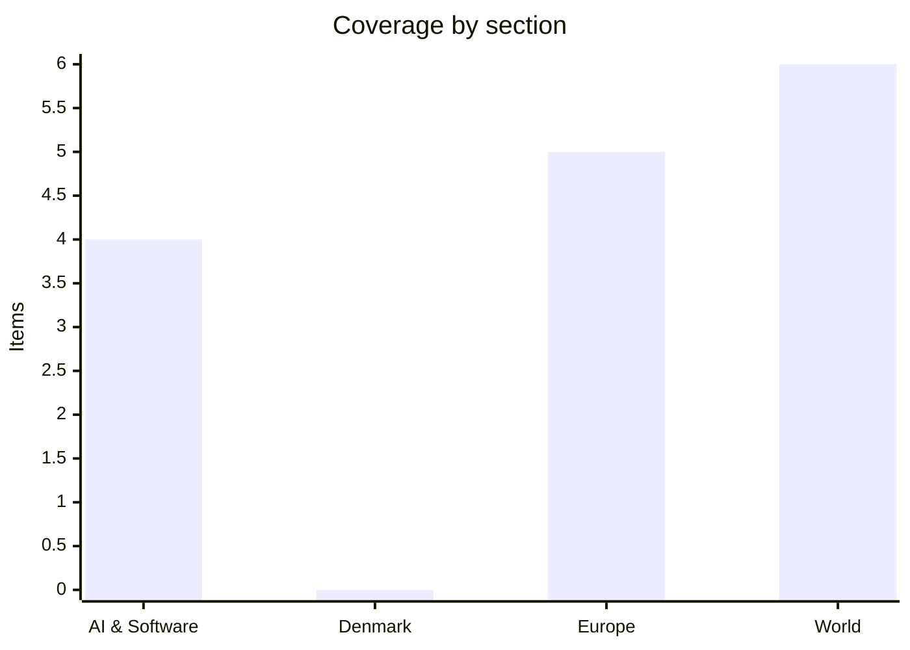

# Daily Briefing — 2026-11-09

**Top line:** European countries, including France, will join the US-brokered Russia–Ukraine talks in Abu Dhabi on 10–11 November, while Trump says the war will "end soon" and that Ukraine will end up in a "little bit different shape" (Euronews, Kyiv Independent).

*Sourcing note: this covers 8–9 November, but the window was thin. DR, TV2, Børsen, Berlingske, Politiken, JP, BBC, Politico, DW, AP, Reuters and The Verge could not be read. Europe rests on Euronews and the Kyiv Independent, World on Al Jazeera (single-source, relaying AFP/Reuters), AI on Hacker News, The Register and TechCrunch listing pages. Several items are headline- or teaser-level and say so. Nothing dated 8–9 November was visible on the Danish pages I could read.*

## Follow-ups

- **Kraków shooting:** death toll now six, suspect named in outline, officials call it terrorism, a far-right fascination is cited as the motive indication (see Europe).
- **Abu Dhabi talks:** Europeans will now take part; Trump has made new claims about a deal (see Europe).
- **Iran task force:** Trump says the land blockade is "in effect"; Tehran threatens to "rain down hell" if attacks resume (see World).
- **Eisenkot:** Herzog's mandate is now formalised with a six-week clock (see World).
- **Greenland defence deal, Dublin summit, Sanjay Shah appeal, COP31 opening, Miller start, GitHub brownout:** no new reporting found in readable sources; dates unchanged (see Watch list).

## AI & Software

**Nvidia probes whether CEO Jensen Huang was targeted by a Chinese spy.** Euronews (9 Nov) reports that Nvidia is investigating whether Huang was targeted by a Chinese spy. TechCrunch (7 Nov) reported that an executive of the Singapore-linked firm Megaspeed was recruited to spy on Huang, citing a US intelligence memo. Al Jazeera's 8 Nov headline instead frames Nvidia's internal probe as being about an alleged affair of Huang's. I only saw headlines and teasers, so the link between the espionage and affair angles, and Nvidia's own statements, are unconfirmed. Context: Nvidia sits at the centre of the US–China chip fight and was down 9% in Thursday's AI sell-off. Sources: [Euronews](https://www.euronews.com/2026/11/09/nvidia-investigates-whether-ceo-jensen-huang-was-targeted-by-chinese-spy-following-alleged), [TechCrunch](https://techcrunch.com/2026/11/07/chinese-exec-was-recruited-to-spy-on-nvidia-ceo-according-to-us-intelligence-memo/), [Al Jazeera](https://www.aljazeera.com/news/2026/11/8/us-chipmaker-nvidia-investigates-ceo-jensen-huang-over-affair).

**OpenAI reportedly raises a further $11bn at a $1.25tn valuation *(reported, unconfirmed)*.** TechCrunch (6 Nov) says OpenAI has reportedly raised an additional $11bn at a $1.25 trillion valuation; I saw only the headline. The date falls just outside the 24-hour window but I found no earlier mention in this briefing series. It lands in a week when AI-linked stocks fell sharply, so the pricing is worth watching against the sell-off. Source: [TechCrunch](https://techcrunch.com/2026/11/06/openai-reportedly-raises-an-additional-11-billion-at-a-1-25-trillion-valuation/).

**Agent infrastructure and security deals: Dropbox buys Tigris Data, Palo Alto in talks for Clutch.** TechCrunch reported on 5 Nov that Dropbox is acquiring Tigris Data for $350m to bolster its AI infrastructure, and that Palo Alto Networks is in talks to buy the AI-agent security startup Clutch for $500m; the Clutch deal is talks only, not announced. Both are outside the window and headline-level, included because the AI/dev feeds had little newer. The pairing shows where money is going: storage for AI workloads and securing autonomous agents. Sources: [Dropbox/Tigris](https://techcrunch.com/2026/11/05/dropbox-acquires-tigris-data-for-350m-to-bolster-its-ai-iinfrastructure/), [Palo Alto/Clutch](https://techcrunch.com/2026/11/05/palo-alto-networks-in-talks-to-buy-ai-agent-security-startup-clutch-for-500m/).

**UK ministers seek powers to investigate rogue AI agents.** The Register (6 Nov) reports the government wants powers under the Cyber Security and Resilience Bill to investigate incidents where AI agents act outside their remit. I read only the standfirst. It is a notable regulatory signal given this week's research on agents leaking secrets. Source: [The Register](https://www.theregister.com/ai-and-ml/2026/11/06/uk-ministers-seek-powers-to-investigate-when-ai-agents-are-let-off-the-leash/5307889).

## Denmark

No Danish story dated 8–9 November was readable today; DR, TV2, Børsen and the major dailies were blocked, and The Copenhagen Post and The Local showed nothing newer than 7 November, all of it covered yesterday.

## Europe

**Europeans will join the Abu Dhabi talks; Trump predicts a deal "that could cover all of Europe".** French foreign minister Jean-Noël Barrot said on 8 Nov that European countries, including France, will take part in the US-mediated Russia–Ukraine talks opening Tuesday 10 Nov and running to 11 Nov, though he would not sit at the table and did not know who would represent France (Euronews). The talks had been planned as US–Russia–Ukraine only; Zelensky wanted allies involved. After meeting Kirill Dmitriev, Trump predicted a "major agreement" covering all of Europe, without details. Barrot said no deal affecting European security can be designed without Europeans. In a 60 Minutes interview reported on 9 Nov, Trump said the war will "end soon" and that Ukraine will end up in a "little bit different shape" (Kyiv Independent, headline only). The phrase fits Kyiv's fear of territorial concessions, though I did not see the full interview. Sources: [Euronews](https://www.euronews.com/2026/11/08/europeans-to-join-russia-ukraine-talks-in-abu-dhabi-says-french-fm-barrot), [Kyiv Independent](https://kyivindependent.com/ukraine-will-likely-end-up-with-a-little-bit-different-shape-after-war-trump-tells-60-minutes/).

**Kraków shooting: six dead, suspect described as fascinated by far-right ideologies.** Euronews (updated 8 Nov) says six people were killed and 16 injured, including two police officers and the suspect, when a masked man in military-style clothing drove onto Main Market Square around 3pm on Saturday and opened fire. He is a 24-year-old Polish citizen from Ostrowiec Świętokrzyski with no prior convictions and a firearms licence; he was wounded and detained. His father, mother and sister were found dead at their home. Prime Minister Tusk called it "terrorism" and prosecutors a "terrorist offence"; Interior Minister Marcin Kierwiński said the gunman had "very radical views" and was "fascinated by far-right ideologies". Defence Minister Kosiniak-Kamysz denied he served in the military. Two days of national mourning began at midnight Sunday. A formal motive has not been confirmed. Source: [Euronews](https://www.euronews.com/2026/11/08/what-we-know-about-the-krakow-shooting-that-left-six-people-dead).

**Russian strikes leave about 850,000 without power; Zaporizhzhia plant briefly loses external power; Kirishi refinery reportedly hit.** Euronews (8 Nov, headline only) reports Russian strikes left around 850,000 Ukrainians without electricity, and the Kyiv Independent says three people including a child died of carbon-monoxide poisoning from an indoor generator in Kyiv Oblast. Per the IAEA, the Zaporizhzhia nuclear plant lost its sole 330 kV external line, ran on emergency diesel and had power restored about 10 hours later (Kyiv Independent, 9 Nov). The same outlet reports a drone strike with large explosions at the Kirishi refinery, Russia's second largest, about 800 km north of Ukraine *(reported, unconfirmed)*. Kyiv Oblast and Zaporizhzhia figures for the daily toll conflict between headline and URL, so I give none. Sources: [Euronews](https://www.euronews.com/2026/11/08/russian-strikes-on-ukraine-leave-850000-without-power-as-zelenskyy-reports-drone-attack-on), [Kyiv Independent, ZNPP](https://kyivindependent.com/power-to-zaporizhzhia-nuclear-power-plant-cut-restored-iaea-says/), [Kyiv Independent, Kirishi](https://kyivindependent.com/ukrainian-forces-reportedly-strike-russias-second-largest-oil-refinery-in-overnight-drone-attack/).

**Rosstat hack data "suggests" over 390,000 Russian deaths; Zelensky promises more SBU dismissals.** Euronews (8 Nov, headline only) says data obtained from a hack of Russia's statistics agency suggests more than 390,000 Russian deaths in the war; the method and who hacked it are not clear to me, so treat it as an unverified claim *(reported, unconfirmed)*. Separately, Zelensky said more personnel decisions are coming at the SBU after senior officials were dismissed over links to criminal gangs (Kyiv Independent, 8 Nov). Sources: [Euronews](https://www.euronews.com/2026/11/08/rosstat-hack-data-obtained-suggests-over-390000-russian-deaths-in-ukraine-war), [Kyiv Independent](https://kyivindependent.com/zelensky-says-more-sbu-personnel-decisions-coming-after-senior-officials-dismissed-over-criminal-gang-involvement/).

**Canary Islands demand action as migrant arrivals surge; Senegal boat disaster.** Euronews (8 Nov) reports the Canary Islands government demanding urgent action from Madrid. Al Jazeera notes Spain declared an emergency on El Hierro on 7 Nov after more than 3,300 arrivals since early November. Off Senegal, a small boat sank near Loumpoul dunes between Dakar and Saint-Louis with at least 21 dead and one rescued, per the Senegalese Interior Ministry's provisional toll; Al Jazeera's landing page said 34, so the figure is disputed. The sinking shows the cost of the Atlantic route feeding the surge. Sources: [Euronews](https://www.euronews.com/2026/11/08/canary-islands-demand-urgent-government-action-amid-surge-in-migrant-arrivals), [Al Jazeera](https://www.aljazeera.com/news/2026/11/8/at-least-21-dead-as-small-boat-sinks-off-senegal).

## World

**Trump says the Iran land blockade is "in effect"; Tehran threatens to "rain down hell".** Al Jazeera's 9 Nov live blog reports Trump saying the US blockade on Iran's land supply routes is in effect, and that renewed strikes are "highly unlikely" if talks on Iran's nuclear programme and reopening the Strait of Hormuz progress. He expects to speak with Xi Jinping and Vladimir Putin at "next week's" summit (the page calls it APEC in the body and "China summit" in the title). Tehran threatens to "rain down hell" if attacks resume, an unverified claim as reported. Explosions at Qeshm were blamed on the US, while Iranian authorities said blasts in Khuzestan were not an attack. Sources: [Al Jazeera live blog](https://www.aljazeera.com/news/liveblog/2026/11/9/iran-war-live-trump-says-land-blockade-in-effect-drone-cuts-power-in-iraq), [Al Jazeera](https://www.aljazeera.com/news/2026/11/8/iran-threatens-to-rain-down-hell-if-us-escalates-war).

**Israel: Herzog formally tasks Eisenkot, six weeks to build a coalition.** President Herzog formally tasked opposition leader Gadi Eisenkot on 8 Nov (Al Jazeera). On its figures from the 27 Oct vote, Eisenkot's four-party alliance has 48 seats and Netanyahu's bloc 53, against a 61 majority, with Arab-led parties at a record 19. Eisenkot rules out Arab-led parties, and said he is open to including Netanyahu and invited Likud and Religious Zionist members to back him; winning UTJ and Shas would give him exactly 61. Netanyahu stays caretaker and is next in line if Eisenkot fails. Herzog warned of uncertainty after the US midterms. Source: [Al Jazeera](https://www.aljazeera.com/news/2026/11/8/israels-president-tasks-eisenkot-to-form-new-coalition-government).

**Gulf spillover: drone halts Iraq's Khor Mor gasfield; Aramco building in Riyadh damaged.** Al Jazeera (9 Nov, headline and deck) says a drone attack suspended production at the Khor Mor gasfield in Iraqi Kurdistan; the drone's origin is not confirmed in what I read. On 8 Nov, Saudi Arabia's Energy Ministry said a Saudi Aramco building in Riyadh was damaged by falling shrapnel in an attempted attack; the article URL points to intercepted Houthi missiles but I did not see that attribution in the text. Sources: [Khor Mor](https://www.aljazeera.com/news/2026/11/9/drone-attack-suspends-production-at-iraqs-khor-mor-gasfield), [Riyadh](https://www.aljazeera.com/news/2026/11/8/saudi-arabia-intercepts-houthi-missiles-targeting-riyadh-eastern-province).

**Jeffries backs Hegseth impeachment as Democrats plan probes.** Al Jazeera (9 Nov, headline and deck) reports Democratic leader Hakeem Jeffries backing the impeachment of Defense Secretary Pete Hegseth as Democrats set a post-midterm agenda of committee investigations of Trump allies. It follows Trump's 7 Nov call for a DOJ probe of Democrats. Democrats take control in January. Source: [Al Jazeera](https://www.aljazeera.com/news/2026/11/9/jeffries-backs-hegseth-impeachment-as-democrats-vow-probes-of-trump-allies).

**Egypt train crash kills at least seven; Gaza floods leave tens of thousands without shelter.** Egypt's Health Ministry says at least seven died and more than 112 were injured when a Giza–Fayoum train hit the back of another train near al-Ayyat, derailing it onto a road (Al Jazeera, 8 Nov; the URL's "four" is outdated). In Gaza, Civil Defence reports five dead including four children and over 1,500 emergency calls as thousands of tents and shelters were destroyed (Al Jazeera, headline and deck). Sources: [Egypt](https://www.aljazeera.com/news/2026/11/8/train-crash-kills-four-injures-dozens-near-egypts-cairo-city), [Gaza](https://www.aljazeera.com/news/2026/11/8/floods-in-gaza-leave-tens-of-thousands-without-shelter).

**South Africa: ANC suffers a setback in local elections.** Al Jazeera (8 Nov, headline and deck) says Ramaphosa's ANC won just over 30 percent nationally in the 4 Nov local elections. I did not read the article body, so seat shifts and coalition implications are unknown to me. Source: [Al Jazeera](https://www.aljazeera.com/news/2026/11/8/south-africas-anc-suffers-setback-in-local-elections).

## Watch list

- **10–11 Nov:** Abu Dhabi Russia–Ukraine–US talks with European participation; Sanjay Shah's appeal opens at the High Court of Eastern Denmark on 10 Nov.
- **12–13 Nov:** Folketing first reading of the Greenland/US deal (vote 19 Nov); informal EU leaders' summit in Dublin on 13 Nov.
- **Next week:** Trump's expected calls with Xi and Putin at the summit; Eisenkot's six-week coalition clock; COP31 in Antalya (coverage not found).
- **Any day:** Formal motive in the Kraków attack; Iran's response to the blockade.
