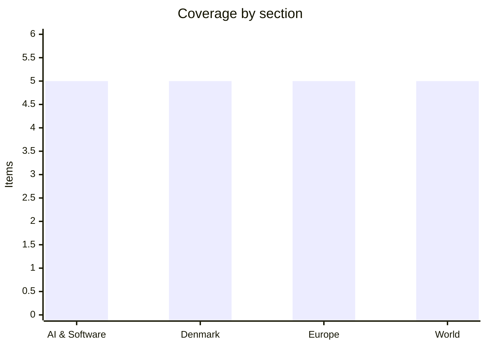

# Daily Briefing — 2026-11-10

**Top line:** Anthropic released Claude Fable 5.2 and Mythos 5.2 on 9 November, and the US, Ukraine and Russia open their first trilateral talks since February in Abu Dhabi today with a joint EU team attending for the first time.

*Sourcing note: DR, TV2 and Børsen could not be read, and search returned mostly stale results. Danish items rest on Ritzau wire copy republished by the Copenhagen Post and The Local; several were seen only as sidebar headlines, so I cite the round-up page where I saw them. AI items come from The Register, TechCrunch and Anthropic's own announcement. Europe and World rest mainly on Euronews and Al Jazeera, with Al Jazeera items a single source. The window is 8–10 November; little dated 10 November was visible yet.*

## Follow-ups

- **Abu Dhabi talks:** confirmed for 10–11 November, with a joint Commission/Council team plus France, Germany and the UK attending (see Europe).
- **Iran:** Trump says the US "won"; Rubio reports no progress; Tehran says mediation is paused after the US midterms (see World).
- **Nvidia/Huang:** the board has now opened an independent investigation, and Huang admitted an affair in a staff memo (see AI & Software).
- **COP31:** opened 9 November in Antalya (see Europe).
- **Kraków attack, Sanjay Shah appeal, Greenland deal reading, Dublin summit, Miller start:** no new reporting found in readable sources; dates unchanged (see Watch list).

## AI & Software

**Anthropic releases Claude Fable 5.2 and Mythos 5.2.** Anthropic's announcement, dated 9 November, says Fable 5.2 and Mythos 5.2 are the same underlying model: Fable carries cyber and biology safeguards and is open to all users, while Mythos is reached through Anthropic's Life Sciences and Cyber Verification Programs. Output is up to 30% faster than Fable 5.1, priced at $8 per million input tokens and $40 per million output tokens, with a fast mode up to 2.5 times faster at $16 and $80. Anthropic's own benchmarks, which are company self-reporting, put Fable 5.2 ahead of Opus 5.5 on FrontierCode 2.0 (49.1% vs 45.5%), SWE v2 (69.9% vs 62.3%), Humanity's Last Exam with tools (74.2% vs 67.7%) and OSWorld 2.1 (89.3% vs 87.2%). It also says Mythos 5.2 found 10.2% more vulnerabilities than Opus 5.5 in an October run against 1,829 CVEs, and that a team of 1,000 agents formalised Fermat's Last Theorem in 30 hours against 11 days for an earlier effort. Anthropic still recommends Opus 5.5 as the daily driver and positions Fable 5.2 for the hardest work. Hacker News showed the announcement at 823 points, and an Artificial Analysis page scoring it 65, "highest so far", but I did not verify that independent figure. Source: [Anthropic](https://www.anthropic.com/claude-fable-and-mythos-5-2).

**Cisco and IBM will build Mythos into security products.** The Register (10 Nov) reports Anthropic is widening access to its bug-finding Mythos model by letting Cisco and IBM embed it in their tools without handing customers the model itself. Cisco's AI Defense red-teaming tools can call Mythos under existing licences at no extra cost, and IBM says it will integrate it into its Concert tool to scan applications for risk. The route matters because Mythos is otherwise gated; vendors become a controlled distribution channel for its vulnerability-finding capability. Source: [The Register](https://www.theregister.com/ai-and-ml/2026/11/10/anthropics-super-bug-finding-mythos-model-is-going-into-cisco-and-ibm-products/5308616).

**Torvalds sees signs the AI-prompted patch flood has peaked.** In the Linux 7.4-rc2 announcement, Linus Torvalds called the "various AI fixes" a notable part of a large release, according to The Register (9 Nov). He quoted Alexei Starovoitov saying eBPF fixes now arrive faster than new bug reports, while most other kernel areas have not reached that point. The Register ties the surge to Mythos, launched in April, and notes Microsoft fixed a record 974 flaws in September and Oracle 1,449 in one month. For maintainers of a codebase of over 40 million lines, the open question is whether the backlog of findable bugs is shrinking or reviewers are simply saturated. Source: [The Register](https://www.theregister.com/security/2026/11/09/linus-torvalds-sees-signs-ai-prompted-patch-flood-has-peaked/5308345).

**Nvidia's board opens an independent investigation into Jensen Huang.** TechCrunch (8 Nov) reports the board announced an independent review run by independent directors with outside counsel, after reports that Huang was targeted by a Chinese spy operation. In a staff memo Huang admitted an affair with Alice Huang, a former executive at Singapore-based Megaspeed; a US intelligence memo circulating among policymakers claims she was recruited by China's Ministry of State Security. The board says it has "no reason to believe" national security or company secrets were compromised, and Euronews reports Trump called Huang an "honorable guy". The espionage claim comes from an intelligence memo and is not independently confirmed. Nvidia is central to the US–China chip fight and was caught in the week's tech sell-off. Sources: [TechCrunch](https://techcrunch.com/2026/11/08/nvidia-says-its-investigating-ceo-jensen-huangs-relationship-with-possible-chinese-spy/), [Euronews](https://www.euronews.com/2026/11/09/trump-calls-nvidia-chief-jensen-huang-an-honorable-guy-amid-spy-allegations).

**Forrester: an AI bubble burst "is not imminent", but the maths is demanding.** The Register (9 Nov) summarises Forrester's report arguing that about nine-tenths of AI infrastructure funding comes from large firms' cash flow, which lowers crash risk. Forrester says the buildout only breaks even if AI lifts US GDP by 5% by 2035, leaving roughly $1.3 trillion that productivity gains of about two points cannot explain. Bain estimates the industry needs $6 trillion in annual revenue by 2031, and Forrester flags Oracle and CoreWeave's reliance on outside investment and prepayments as warning signs. It is an analyst view rather than data, but it frames the week's sell-off. Source: [The Register](https://www.theregister.com/ai-and-ml/2026/11/09/the-ai-bubble-can-wait-but-your-exit-plan-cant/5308415).

## Denmark

**Nordea fined DKK 155m for money-laundering failures, far below the DKK 6.6bn sought.** Copenhagen District Court fined Nordea DKK 155 million for anti-money-laundering violations in 2012–2015, according to a Ritzau item on the Copenhagen Post (9 Nov, seen as a sidebar headline). Prosecutors had sought DKK 6.6 billion. Nordea was acquitted on five of seven counts, including one involving suspicious transactions worth over DKK 24 billion, but the court found gross negligence over money-transfer and currency-exchange clients and noted more than 200,000 transaction alerts had been archived. Nordea had provisioned DKK 700 million for a possible fine. Prosecutors may appeal; I did not find that confirmed. Source: [Copenhagen Post round-up](https://cphpost.dk/2026-11-09/news/round-up/prisons-introduce-video-calls-to-help-inmates-stay-connected-with-children/).

**Wholesale electricity hits its highest weekly level in nearly four years.** Norlys reported average wholesale prices of DKK 1.80/kWh in western Denmark and DKK 2.00/kWh in eastern Denmark for the week, the highest since December 2022 (DKK 2.90) but below the 2022 peak of DKK 4.35. Andel Energi's CEO Marlene Holmgaard Fris warned of a "crisis winter" with bills possibly double last winter's, and the final consumer price on Monday 10 November was expected to reach about DKK 7.5/kWh between 5 and 6 pm. The spike fits the energy shock from the Iran war that Euronews links to EU gas scrambling (see Europe). Source: [Copenhagen Post](https://cphpost.dk/2026-11-09/news/round-up/electricity-prices-reach-highest-weekly-level-in-nearly-four-years/).

**Audit office finds problems with 14 of 27 essential military equipment types.** Rigsrevisionen reported 2025 problems with 14 of 27 essential equipment types, and the Public Accounts Committee called the situation "severely criticizable", the second-highest level on its scale. Some findings were withheld at the Defence Ministry's request. Coming as defence spending is rising, it raises the question of whether money is reaching usable capability. Seen as a sidebar headline. Source: [Copenhagen Post round-up](https://cphpost.dk/2026-11-09/news/round-up/electricity-prices-reach-highest-weekly-level-in-nearly-four-years/).

**Copenhagen apartment prices fall for a third month while Aarhus hits a record.** Boligsiden data show Copenhagen apartment prices fell 1.1% in October, the third straight monthly fall. Aarhus apartments rose 1.5% from September and 23.3% year on year to a record. Nationally, apartment prices fell 0.1% and house prices were flat, with houses down 0.3% in the Capital Region and 2.1% in North Jutland. Sidebar headline only. Source: [Copenhagen Post round-up](https://cphpost.dk/2026-11-09/news/round-up/electricity-prices-reach-highest-weekly-level-in-nearly-four-years/).

**Drone ban over Copenhagen and all of Amager from Monday evening to Thursday morning.** Copenhagen Police banned drone flights over large parts of the city and all of Amager from 7 pm on 9 November to 7 am on 12 November, with no reason given in the item I saw. Smaller aircraft need permission from Copenhagen Airport's tower. Without a stated cause it is worth watching given recent airport bomb threats noted in the same outlet (5–6 Nov), though a link is not established. Source: [Copenhagen Post round-up](https://cphpost.dk/2026-11-09/news/round-up/electricity-prices-reach-highest-weekly-level-in-nearly-four-years/).

## Europe

**Europe joins the Abu Dhabi talks; Trump says Ukraine will end up in a "different shape".** The Commission and European Council are sending a joint team to the US-hosted trilateral talks on 10–11 November, led by von der Leyen's chief of cabinet Bjoern Seibert and Anna-Maria Boura, an adviser to Costa, alongside France, Germany and the UK (Euronews, 9 Nov). These are the first trilateral talks since February; Ukraine is led by Rustem Umerov, Russia by Vladimir Medinsky and the US by Steve Witkoff and Jared Kushner. Direct contact between the Europeans and the Russian delegation, which has never happened, is still uncertain, and Kushner says a multilateral format would follow "if progress is made". Trump told CBS Ukraine would end up with "a little bit different shape" without naming territory; Russia demands withdrawal from four regions it claims to have annexed, and Kyiv wants an immediate ceasefire without ceding land. Sources: [Euronews](https://www.euronews.com/2026/11/09/eu-to-send-joint-team-to-ukraine-russia-peace-talks-in-abu-dhabi), [Euronews](https://www.euronews.com/2026/11/09/trump-says-post-war-ukraine-will-have-a-different-shape-ahead-of-abu-dhabi-talks).

**France brings forward a 1.6% minimum-wage rise to 1 December.** PM Sébastien Lecornu announced at Matignon on 9 November that the minimum wage rises 1.6% from 1 December rather than 1 January, taking it to about €1,502 net a month, up €24 (Euronews). He called it the second-largest increase in twenty years and paired it with tax breaks for firms: income-tax exemption for overtime up to €10,000, an employer-contribution exemption on public-transport costs and tax-free value-sharing bonuses. Unions are unconvinced: the CFDT wanted €100 net extra, the CGT about €150, and the CGT under Sophie Binet is calling a strike and demonstration day on 17 November. Source: [Euronews](https://www.euronews.com/2026/11/09/lecornu-announces-24-monthly-rise-in-minimum-wage-and-tax-breaks-for-firms).

**Madrid pushes Hernández de Cos to succeed Lagarde at the ECB.** Spain's Economy Minister Carlos Cuerpo told Euronews (9 Nov) he backs former Bank of Spain governor Pablo Hernández de Cos for ECB president, citing his expertise and consensus-building. He is competing with former Dutch central bank governor Klaas Knot, and Euronews says Lagarde has said she intends to step down on 7 February 2027. The item is a short video piece, so there is little detail on the other governments' positions. Source: [Euronews](https://www.euronews.com/2026/11/09/spanish-minister-cuerpo-builds-case-for-madrids-candidate-to-replace-lagarde-at-the-ecb).

**COP31 opens in Antalya as Europe scrambles for fossil fuels.** COP31 runs 9–20 November, with Türkiye holding the presidency and Australia steering negotiations under an unprecedented arrangement; Türkiye proposes a "35-by-35" target for electricity to reach 35% of global energy demand by 2035, and there is no official US delegation (Euronews). A companion piece reports that the energy shock from the US–Israeli war on Iran has pushed several EU governments to short-term oil and gas deals even though all 27 endorsed the EU's COP31 position: Hungary is discussing gas from Romania's Neptun Deep and seeking Croatian and Greek LNG access. A senior Commission official calls progress "politically difficult". Sources: [Euronews](https://www.euronews.com/2026/11/09/we-will-not-lower-our-ambition-everything-you-need-to-know-on-day-one-of-the-cop31-climate), [Euronews](https://www.euronews.com/2026/11/09/europe-talks-green-at-cop31-but-scrambles-for-more-fossil-fuels).

**Moldova opens a 400 kV power line to Romania.** Al Jazeera (9 Nov) reports Moldova inaugurated the Vulcanesti–Chisinau line on 8 November, linking its grid to Romania and the European market. President Maia Sandu said two more lines to Romania are coming and that Moldova now buys no Russian gas; the line reduces reliance on the Cuciurgan plant in Transnistria. EU Energy Commissioner Marta Kos attended. The project arrived two years later than first promised. Source: [Al Jazeera](https://www.aljazeera.com/news/2026/11/9/moldova-launches-new-power-line-to-romania-to-cut-reliance-on-russia).

## World

**Trump says the US "won" in Iran; Rubio reports no progress.** Euronews (9 Nov) quotes Trump saying "We won in Iran" and calling renewed fighting "highly unlikely", even as US forces struck Qeshm Island. Rubio said Iran's demands were "overblown, ridiculous and really unrealistic" and that talks are not at a breakthrough. Iran's spokesman Esmaeil Baqaei says Washington must end sanctions, the naval blockade and the war before negotiations, and Foreign Minister Araghchi says the Democratic midterm win paused mediation, though Al Jazeera also reports he floated a two-day proposal to reopen the Strait of Hormuz if US conditions are met. Euronews cites a Pentagon count of 23 US service members killed since the war began in late February; Iranian claims are as reported. Sources: [Euronews](https://www.euronews.com/2026/11/09/trump-says-us-has-won-iran-war-as-rubio-reports-no-progress-in-talks), [Al Jazeera](https://www.aljazeera.com/news/2026/11/9/rubio-says-war-on-iran-unpopular-but-necessary-to-stop-nuclear-threat).

**Trump eyes meetings with Putin and Xi at APEC in Shenzhen, 18–19 November.** Trump said on 8 November he might meet both leaders in China to discuss "denuclearisation" and ending the Iran war, and the Kremlin acknowledged a trilateral idea on 21 October (Euronews). The Wall Street Journal reports Putin wants the talks to broker a Ukraine deal favourable to Moscow. Analysts quoted by Euronews expect little substance, and a US–China trade truce expires in January, so a third Trump–Xi meeting this year has its own stakes. Source: [Euronews](https://www.euronews.com/2026/11/09/donald-trump-plans-to-meet-vladimir-putin-and-xi-jinping-in-china-to-discuss-ending-iran-w).

**Drone strike halts Khor Mor gasfield and blacks out most of Iraqi Kurdistan.** A drone attack on the night of 8 November started a fire at Khor Mor, and more than 70% of the Kurdish region lost power, with 2,500–2,800 MW knocked off the grid, a KRG electricity spokesman says (Al Jazeera). Gas supply to plants in Erbil, Sulaimaniyah, Bazian, Chamchamal and Duhok was suspended. Iraqi PM Ali al-Zaidi reported no casualties and ordered a joint investigation; no group has claimed it, and the same facility was hit in November 2025. Source: [Al Jazeera](https://www.aljazeera.com/news/2026/11/9/drone-attack-suspends-production-at-iraqs-khor-mor-gasfield).

**Jeffries backs Hegseth impeachment as Democrats plan investigations.** House Minority Leader Hakeem Jeffries said on 8 November he is a "hard yes" on an impeachment resolution against Defense Secretary Pete Hegseth, led by outgoing Rep. Thomas Massie (Al Jazeera). Democrats flipped the House and Senate in the 3 November midterms and Jeffries promised to move "aggressively" in the first 100 days; Rep. Robert Garcia wants to lead House Oversight and investigate Stephen Miller. Trump's camp says Democrats could face DOJ scrutiny, and conviction would need a two-thirds Senate vote, so removal is not a realistic near-term outcome. Source: [Al Jazeera](https://www.aljazeera.com/news/2026/11/9/jeffries-backs-hegseth-impeachment-as-democrats-vow-probes-of-trump-allies).

**Asian markets rebound after the tech rout; Mexico arrests alleged CJNG cell leader.** Taiwan's Taiex closed up 4.94% on Monday and Japan's Nikkei 225 rose 2.33%, following Thursday's Wall Street sell-off that Al Jazeera puts at $2.5 trillion; the Nikkei and KOSPI had plunged about 6% and 9% on Friday. Separately, Mexican authorities arrested Rafael Alvarez, "R2", on 8 November in Zapopan, using DEA intelligence per the Mexican Navy; he is suspected of heading the "Los Rs" CJNG cell and is linked to at least 19 killings, including the 2025 murder of Uruapan mayor Carlos Manzo. Sources: [Al Jazeera](https://www.aljazeera.com/economy/2026/11/9/asian-stock-markets-climb-after-earlier-tech-rout), [Al Jazeera](https://www.aljazeera.com/news/2026/11/9/mexico-arrests-major-leader-of-jalisco-cartel).

## Watch list

- **10–11 Nov:** Abu Dhabi talks and whether Europeans meet the Russian delegation; Sanjay Shah appeal at the High Court of Eastern Denmark (10 Nov, no new reporting found).
- **13 Nov:** informal EU leaders' summit in Dublin; Folketing Greenland/US deal first reading and 19 Nov vote (not re-verified).
- **17–19 Nov:** CGT strike day in France (17 Nov); Trump's possible Putin/Xi meetings at APEC, Shenzhen (18–19 Nov).
- **Any day:** Nvidia board review outcome; Iran response on blockade and Hormuz; COP31 negotiating text (to 20 Nov).
