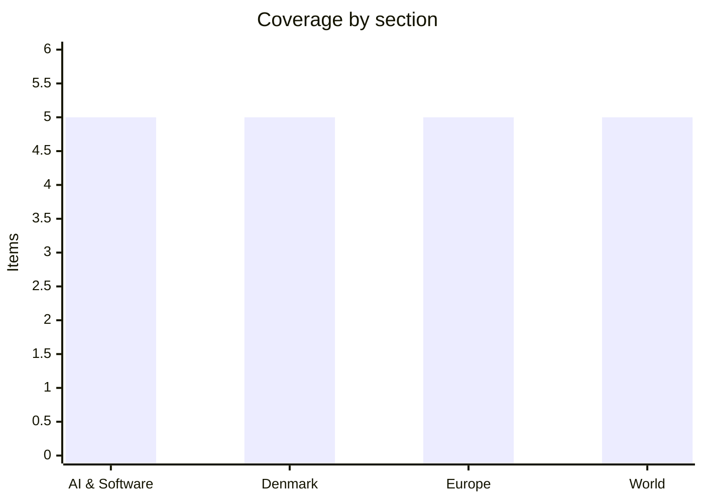

# Daily Briefing — 2026-11-11

**Top line:** Anthropic filed an updated IPO range of $70–78 per share on 10 November, implying a valuation of up to $1.404 trillion with Nasdaq trading expected around 19 November, while the first US–Russia–Ukraine round since February is under way in Abu Dhabi with Europeans in the room.

*Sourcing note: DR and TV2 could not be read, so Danish items rest on Ritzau wire copy republished by the Copenhagen Post and The Local. Several items (flagged below) were read only from headlines or short summaries. Euronews and Al Jazeera carry most of Europe and World, and Al Jazeera items are largely single-source. The window is 9–11 November; no outcome of the Abu Dhabi talks was visible in any page read.*

## Follow-ups

- **Abu Dhabi talks:** opened 10 November with Ukrainian, US and European representatives; no outcome reported yet (see Europe).
- **Iran:** Trump now says Iran is "effectively over" militarily; Tehran denies any planned talks (see World).
- **Hegseth impeachment:** Jeffries-backed push stalled in the House, 211–204 (see World).
- **Nvidia/Huang:** Trump says Huang knew nothing about the alleged Chinese spy (Euronews headline only; no further detail read).
- **Sanjay Shah:** his appeal against the DKK 9bn dividend-tax fraud conviction opened at the Eastern High Court on 10 November (CPH Post headline).
- **Dublin summit:** still due 13 November; Costa will face Meloni's complaint about "disarray" (see Europe).
- **Mythos in Cisco/IBM products:** already covered yesterday; no new development read.

## AI & Software

**Anthropic sets an IPO range of $70–78 per share.** TechCrunch (10 Nov) reports an updated filing offering 825 million Class A shares, which would raise $57.75–64.35 billion and imply a fully diluted valuation of $1.404 trillion at the top of the range, against $965 billion in a May fundraise. Google and Nvidia are each putting $10 billion into a $26 billion private sale of non-voting Class N stock at the IPO price, alongside AMD, Broadcom, Micron, Microsoft and TSMC. The filing, as TechCrunch reports it, shows run-rate revenue of $81 billion at the end of October, Q3 revenue of $17 billion and a nine-month net loss of $104 billion. Trading is expected on Nasdaq around 19 November under "ANT", with up to 20% allocated to retail, and Goldman Sachs and Morgan Stanley underwrite. Founders hold a Class F share with 50.1% of the vote and the Long-Term Benefit Trust elects a board majority; seven co-founders sell about 3.4 million shares each, roughly $250 million apiece at the $74 midpoint. TechCrunch notes the valuation is below the roughly $2 trillion the company reportedly targeted a couple of months ago. The Neuron's digest cites "$69.3 billion IPO plans" facing a correction, a figure that does not match TechCrunch's offering size and which I could not reconcile. Source: [TechCrunch](https://techcrunch.com/2026/11/10/anthropic-sets-ipo-price-range-of-70-to-78-per-share-to-reach-an-implied-valuation-of-1-404-trillion/).

**Chrome patches its eighth exploited zero-day of 2026.** The Register (10 Nov) reports Google's Monday advisory for CVE-2026-125350, a high-severity use-after-free in Chrome's XML component, reported anonymously on 6 November. The fix ships in Chrome 157.0.8103.50/.51 on Windows and macOS and 157.0.8103.50 on Linux, alongside eight other security fixes. Google confirms an exploit exists in the wild but gives no attacker or target details and is withholding technical specifics until more users update. Eight exploited zero-days already equals the whole of 2025 with about two months left, according to The Register. A second XML use-after-free, CVE-2026-125346, was reported by Arni Hardarson of Neonix Security, with no sign of exploitation. Source: [The Register](https://www.theregister.com/security/2026/11/10/chrome-zero-day-whack-a-mole-continues-as-2026-tally-hits-8/5308732).

**Fireworks AI's breach widens after a second compromise.** The Register (10 Nov) reports that a third-party cloud provider hosting Fireworks' R&D machines was compromised on 23 October, and the attacker used that access the next day to reach development systems and run an unauthorised workload. This follows an incident Fireworks disclosed on 9 October after spotting misuse of internal credentials on 6 October; Bloomberg reported the second hack on 9 November. Fireworks suspects financially motivated "LLMJacking" actors. Exposed data covers resource metadata and billing information (addresses, invoices, balances, but no card numbers) and, for some customers, a subset of incomplete model weights and datasets. CEO Lin Qiao says the attackers were "not after weights". Notion warned that some Notion AI chat transcripts may have been exposed, affecting under 1% of workspaces, and customers including Cursor and Harvey are reportedly assessing impact. Fireworks has not said how many customers are affected. Source: [The Register](https://www.theregister.com/cyber-crime/2026/11/10/fireworks-ai-gets-burned-twice-as-customer-data-exposure-widens/5308722).

**N-able pulls its remote access service offline after a researcher dumps 30-plus zero-days.** TechCrunch (10 Nov) reports that security researcher Ben Bales published the bundle, which he calls "Able2Shell", on GitHub on 8 November. The bugs can steal credentials, create admin accounts and gain root. N-able took its cloud-hosted N-Central offline and told self-hosted customers to take their own servers down, fearing attacks. Bales says he went public because N-able allegedly failed to patch flaws he reported in a different product. N-able says it has no evidence of successful exploitation but did not say whether it can verify that from its logs. Remote management tools are a favoured route into many customer networks at once, so the outage is also a supply-chain risk story. Source: [TechCrunch](https://techcrunch.com/2026/11/10/n-able-takes-its-remote-access-service-offline-after-researcher-publishes-dozens-of-zero-day-bugs/).

**Policy and platform moves, seen as headlines only.** TechCrunch reports that New York's AI safety law has taken effect, bringing new oversight for OpenAI and Anthropic, but I did not read the body and have no specifics. The Register reports that Trump has tapped Palantir's Michael LoSapio to lead the US cyber defence agency, which the dek says is depleted and politically fraught. The Register also reports Microsoft will give Anthropic's Claude access to UK Copilot tenants by default, with admins having until 9 December to review. Two 11 November Register headlines, "OpenAI builds a kill switch for its research models" and "Australia may make knowingly selling unsafe AI a crime", were not opened. Sources: [TechCrunch](https://techcrunch.com/2026/11/10/openai-anthropic-face-new-oversight-as-new-yorks-ai-safety-law-takes-effect/), [The Register](https://www.theregister.com/security/2026/11/10/trump-taps-palantir-security-chief-to-run-battered-us-cyber-defense-agency/5308763), [The Register](https://www.theregister.com/ai-and-ml/2026/11/10/microsoft-is-giving-claude-the-keys-to-uk-copilot-tenants-by-default/5308693).

## Denmark

**Zelenskyy visits Copenhagen and is due to address the Folketing.** CPH Post (Ritzau, 10 Nov) reports a surprise two-day visit that began Tuesday, with talks with the government, a conversation with PM Mette Frederiksen at the University of Copenhagen and a Nordic working dinner at Marienborg. He is scheduled to speak in the main chamber at 11:35 today, which would make him the first foreign head of state to do so. Danish People's Party leader and deputy speaker Morten Messerschmidt objected that the Presidium decision was not unanimous, and Speaker Henrik Frandsen said it is a one-off for this visit. Separately, independent MP Jacob Harris met Russian ambassador Vladimir Barbin, which Foreign Minister Lars Løkke Rasmussen criticised as a "useful idiot" risk. Euronews headlines Denmark pledging €643 million in military aid during the Nordic meeting and the CPH Post says Ukraine and Denmark are discussing a Copenhagen office for European missile defence; I saw both only as headlines. The article body beyond the lede is paywalled. Source: [CPH Post](https://cphpost.dk/2026-11-10/news/politics/zelenskyy-in-denmark-for-talks-with-frederiksen-and-nordic-leaders/), [Euronews](https://www.euronews.com/2026/11/10/denmark-pledges-643-million-in-military-aid-as-zelenskyy-meets-nordic-leaders).

**Electricity prices hit a near four-year high, with a "crisis winter" warning.** CPH Post (Ritzau, 10 Nov) reports average prices at their highest in almost four years, with the final consumer price on Monday expected to reach about DKK 7.5 per kWh between 17:00 and 18:00 and a spread of about DKK 5 between the day's highest and lowest hours. Andel Energi CEO Marlene Holmgaard Fris warned that bills could be about twice last winter's level; October prices were roughly double October 2025, and prices have been high since March. She cited geopolitical tension, weather and heating-season demand, and noted prices are still below the 2022 crisis record. For households and for Danish industry this is the main cost-of-living story of the coming months. Source: [CPH Post](https://cphpost.dk/2026-11-10/news/round-up/danish-electricity-prices-reach-highest-level-in-nearly-four-years-as-energy-company-warns-of-costly-winter/).

**Nordea fined DKK 155 million in the money-laundering case.** The Copenhagen District Court announced the ruling on 9 November, per CPH Post (Ritzau). Prosecutors had sought a record DKK 6.6 billion, but Nordea was acquitted on five of seven counts, including the largest, failing to report suspicious activity worth over DKK 24 billion across 25 customers. The court still found gross negligence in dealings with money-transfer and currency-exchange firms involving €85 million in 200- and 500-euro notes, and more than 200,000 transaction alerts had been archived. The panel unanimously cited the long police and prosecution processing time in setting the fine. Nordea had provisioned DKK 700 million, and its general counsel said the bank was satisfied with the acquittals. The case began in 2016 with a Finanstilsynet report and ran for 60 hearings from May 2025; whether prosecutors appeal is the open question. Source: [CPH Post](https://cphpost.dk/2026-11-09/news/round-up/nordea-fined-155-million-kroner-in-danish-money-laundering-case/).

**SAS says 350,164 people were affected by an Amadeus data breach.** The Local (10 Nov), citing SVT and SAS, reports the exposed data is mainly booking references, dates, passenger headcounts and flight details, mostly for older bookings and completed trips. SAS has reported the incident to Sweden's IMY privacy authority but has not notified passengers individually, and says that could change. Finnair says about 116,000 of its reservations may be affected, and NRK reported that unauthorised access may stretch back three years and include Norwegian Air passengers. I read The Local's roundup, not the full article. Source: [The Local](https://www.thelocal.dk/20261110/350000-sas-passengers-may-have-had-details-leaked-in-major-data-breach).

**Denmark buys two mobile emergency hospitals for DKK 100 million.** CPH Post (Ritzau, 10 Nov) reports five regions bought the units through the Capital Region and Central Denmark Region. Each is a set of connected truck-delivered containers that can be set up in 20 minutes, with a full reception centre ready within 12 hours. They are funded by a 2026 healthcare emergency-preparedness package, with delivery expected late 2026 to early 2027. Health Minister Ida Auken said they could treat injured soldiers and civilians in a military crisis, and the Capital Region's Lars Gaardhøj linked them to NATO obligations. Roskilde University's Rasmus Dahlberg noted Norway and Sweden already have similar facilities. Source: [CPH Post](https://cphpost.dk/2026-11-10/news/round-up/denmark-buys-two-mobile-emergency-hospitals-for-100-million-kroner-to-prepare-for-war-and-major-crises/).

## Europe

**Abu Dhabi talks open with a joint EU team; no outcome yet.** Euronews (10 Nov) reports the first trilateral round since February opened with Ukrainian, US and European representatives; Ukraine's Umerov said the UK, France, Germany, Italy, NATO and the European Commission attended, alongside Witkoff and Kushner. A senior US official told US media Ukraine and Russia show "a little bit of flexibility" on territory, without details; Moscow demands recognition of Russian control of Crimea and four regions plus Ukrainian withdrawal from all four, which Kyiv rejects. Euronews (9 Nov) says the EU team is led by Bjoern Seibert and Anna-Maria Boura with national security advisers from France, Germany and the UK, and the EU has signalled willingness to engage the Russian delegation directly for the first time, though it is unclear whether that happens. Reported options include NATO Article 4/5-style guarantees, reviving the NATO-Russia Council and a sanctions "snapback". Meloni has written to Costa complaining of "disarray" and demanding a special envoy, which Costa will face at the Dublin informal summit. Sources: [Euronews](https://www.euronews.com/2026/11/10/ukraine-and-russia-reportedly-show-a-little-bit-of-flexibility-on-territory-as-abu-dhabi-t), [Euronews](https://www.euronews.com/2026/11/09/eu-to-send-joint-team-to-ukraine-russia-peace-talks-in-abu-dhabi).

**Merz ties the next EU budget to Ukraine funding beyond 2027.** Euronews (10 Nov) reports Merz threatens to block the next long-term budget unless every member state commits to financing Ukraine, writing of a "collective commitment that all of us, without exception, will contribute fairly". Ukraine faces an estimated €70 billion shortfall next year, and the EU intends to cover about €45 billion on top of the €90 billion Ukraine Support Loan for 2026–27. Hungary, Slovakia and Czechia opted out of that loan, and Bulgaria has signalled no further contribution. Dombrovskis said proposals must be backed by all 27 states, not 24. Euronews also carries a headline that four countries are defying Merz, but I could not read the body. Source: [Euronews](https://www.euronews.com/2026/11/10/merzs-budget-gamble-no-ukraine-funding-no-eu-budget).

**The race to succeed Lagarde at the ECB takes shape.** Euronews (9 Nov) reports Spanish Economy Minister Carlos Cuerpo is backing ex-Bank of Spain governor Pablo Hernández de Cos, who competes with Dutch former central bank governor Klaas Knot. Cuerpo said "what we are presenting is a Spanish candidate, not a governmental candidate". Lagarde intends to step down on 7 February, and the chief economist and an executive board seat are also up for grabs. Eurogroup President Kyriakos Pierrakakis wants a leaders' decision by year end. This summary rests on a short video page and newsletter text. Source: [Euronews](https://www.euronews.com/video/2026/11/09/spanish-minister-cuerpo-builds-case-for-madrids-candidate-to-replace-lagarde-at-the-ecb).

**Five EU states demand the UK pay for electricity-market access.** Euronews (10 Nov) reports Belgium, Germany, Denmark, Luxembourg and the Netherlands want the UK to contribute to EU regional development funds as a condition of joining the EU electricity market. The letter, signed by De Wever, Merz, Frederiksen, Frieden and Jetten, asks for "a path towards the conclusion of these negotiations" at the 20 November EU–UK summit, and a draft joint statement suggests leaders broadly back the principle. UK minister Martin McCluskey said no amount is agreed and any payment must deliver value for money. Norway's roughly €391 million a year in cohesion grants is cited as a model. Source: [Euronews](https://www.euronews.com/2026/11/10/five-eu-countries-demand-uk-pays-for-electricity-market-access).

**Harry and Meghan back the EU Kids Act; a Digital Fairness Act draft leaks.** Euronews (10 Nov) reports Prince Harry told the European Parliament that social media's effect is "brainwashing on an extraordinary scale" and praised the proposed EU Kids Act, which would delay children's access to social media, add age verification and restrict addictive features. Meghan did not deliver a planned speech, as her father was arrested in the US over alleged child sexual abuse material. The Commission warned TikTok last week to change its "For You" feed or face fines. Separately, a leaked draft of the Commission's Digital Fairness Act would ban ten manipulative design "traps" such as fake notifications and free trials that quietly turn into paid subscriptions *(reported, unconfirmed; leak, article not opened)*. Sources: [Euronews](https://www.euronews.com/2026/11/10/prince-harry-and-meghan-back-eu-campaign-against-online-bullying), [Euronews](https://www.euronews.com/2026/11/09/eu-to-blacklist-ten-manipulative-online-design-traps-leaked-draft-shows).

## World

**The House blocks the Hegseth impeachment, 211–204.** Al Jazeera's live page (11 Nov) reports the House voted to send Rep. Thomas Massie's resolution against Defense Secretary Pete Hegseth to committee, effectively halting it. Eleven Democrats were absent, including Rep. Jonathan Jackson, who blamed a traffic delay. Massie's eight articles include alleged War Powers Resolution violations, civilian casualties, and operations in Yemen and Venezuela, and he accuses Hegseth of waging military action against Iran for more than 90 days without authorisation. Hegseth called the effort "sabotage" and Trump said he would back him. Source: [Al Jazeera](https://www.aljazeera.com/news/liveblog/2026/11/11/iran-war-live-hegseth-survives-impeachment-bid-iran-denies-us-talks).

**Trump says Iran is "effectively over"; Tehran denies talks.** Euronews (10 Nov) reports Trump, after meeting Qatar's prime minister, said Iran is "militarily, effectively over" and further strikes are "quite unlikely", while describing the "largest naval blockade in history" and a CENTCOM "Iron Gate" land-border task force. Iran's Mohsen Rezaei told Washington to stop "manufacturing fake news about imaginary talks", and Foreign Minister Araghchi denied any meeting was planned; Tehran says it will not talk until its seven conditions are met. Iranian state TV says strikes hit Qeshm Island overnight. Brent fell to $92 a barrel on Monday. Al Jazeera also headlines Trump saying Israel and Gulf allies must repay the cost of the war, which I did not open. Source: [Euronews](https://www.euronews.com/2026/11/10/trump-says-iran-war-effectively-over-as-tehran-denies-planned-talks).

**US charges three alleged Iranian-backed men over a plot against RAF Fairford.** Al Jazeera (11 Nov) reports the Justice Department announced terrorism-related charges on 10 November against Mohammad Baqer Saad Dawood al-Saadi (32, held in New York since May), Mohsen Mohajeri (48) and Mohammad Ali al-Hassani (35). Prosecutors link them to nearly 20 attacks and attempted attacks across the US and Europe and say they acted for the IRGC and Kataib Hezbollah. Al Jazeera notes the US had withdrawn B-1 bombers from Fairford and flight data showed at least a dozen aircraft leaving RAF Mildenhall. Iran strongly denies involvement. The case brings the Iran war's reach into UK territory. Source: [Al Jazeera](https://www.aljazeera.com/news/2026/11/11/us-charges-3-iranian-backed-men-over-alleged-plot-at-uk-fairford-air-base).

**Saudi Arabia intercepts missiles fired at Riyadh after a pipeline strike.** Al Jazeera (10 Nov) reports the Saudi-led coalition downed two missiles aimed at Riyadh and a third aimed at the south, and spokesman Maj-Gen Turki al-Maliki blamed the Iran-backed Houthis. Residents received shelter alerts and explosions were heard in the capital, with no injuries reported. It followed Monday's strike on the East-West pipeline in Medina, which a Saudi energy ministry official says caused a "limited fire" without affecting operations. Houthi-run Saba reports coalition strikes on Sanaa, including the al-Mufazir gas facility. Source: [Al Jazeera](https://www.aljazeera.com/news/2026/11/10/saudi-arabia-downs-missiles-fired-at-riyadh-after-houthi-attack-on-pipeline).

**Pope Leo XIV draws huge crowds in Argentina; California voters reject a billionaire tax.** Euronews (10 Nov) estimates about 650,000 at the Mass in Córdoba, the first papal visit there in nearly 40 years, after about 2.5 million in Buenos Aires on 9 November. Al Jazeera reports the Pope challenged President Milei's government on inclusive economics, unions and cuts to disability and poverty funding, and his final Mass is in Luján today before Peru. Separately, Euronews says US media project California voters rejected a one-off 5% wealth tax on billionaires, which critics argued would drive the rich out of the state; I read only the teaser. Sources: [Euronews](https://www.euronews.com/2026/11/10/pope-leo-xiv-draws-huge-crowds-in-cordoba-after-record-buenos-aires-mass), [Euronews](https://www.euronews.com/2026/11/10/california-voters-reject-one-off-billionaire-wealth-tax-us-media-predicts).

## Watch list

- **11 Nov:** outcome of the Abu Dhabi talks and whether Europeans meet the Russian delegation; Zelenskyy's Folketing address (scheduled 11:35).
- **13 Nov:** informal EU leaders' summit in Dublin, with Meloni's envoy complaint and Merz's budget-Ukraine linkage on the table.
- **~19 Nov:** expected Nasdaq debut of Anthropic ("ANT"); 20 Nov EU–UK summit on electricity-market payments; 18–19 Nov Trump's possible Putin/Xi meetings at APEC.
- **Any day:** N-able's restoration of N-Central; Nvidia board review; Nordea appeal decision.
