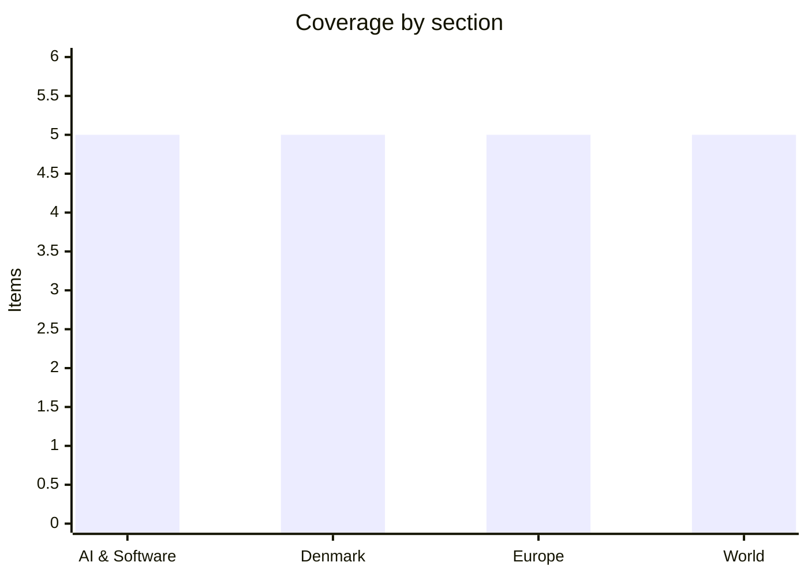

# Daily Briefing — 2026-11-12

**Top line:** The Abu Dhabi round ended on 11 November with only an agreed-in-principle prisoner exchange and no ceasefire, while Nvidia's board is reportedly preparing to remove CEO Jensen Huang over the alleged Chinese-spy affair, knocking about 8% off the stock after hours.

*Sourcing note: DR, TV2, Berlingske, Børsen, Reuters, AP, BBC and Politico could not be read. Danish items rest on Copenhagen Post/Ritzau, The Local and Altinget; World rests almost entirely on Al Jazeera. The window is 10–12 November; few 12 November stories had been published when I searched, so most items are dated 11 November. Where a point comes only from a headline or a model-generated page summary, I say so.*

## Follow-ups

- **Abu Dhabi talks:** ended 11 November with a prisoner-exchange agreement in principle and no ceasefire (see Europe).
- **Nvidia/Huang:** escalated from "Trump says Huang knew nothing" to a reported board move to oust him (see AI & Software).
- **Zelenskyy's Folketing address (scheduled 11 Nov, 11:35):** I could not confirm it took place or what was said; the last readable items predate it.
- **Hegseth:** the impeachment push stayed blocked; new controversy over his entourage at Arlington (see World).
- **N-able / Nordea appeal / Anthropic IPO:** no new development found. Anthropic's $70–78 range stands, with trading still expected around 19 November.
- **Sanjay Shah appeal:** per a page summary only, it runs 23 court days to 1 March; no ruling expected soon.
- **Dublin summit:** still due 13 November, with Kushner and Witkoff expected to meet Zelenskyy there after Moscow.

## AI & Software

**Nvidia's board reportedly prepares to oust Jensen Huang.** The Wall Street Journal reports, via TechCrunch (11 Nov), that Nvidia is preparing to remove its co-founder and CEO of 33 years, with the board meeting as soon as Wednesday to decide. On Sunday 8 November Huang admitted an extramarital affair with a woman US intelligence says is a Chinese spy, and on Wednesday evening the New York Times reported a second affair, with an executive who reports to him. Nvidia shares fell about 8% after hours and about 11% over five days. TechCrunch also reports Congress plans to call Huang in over the spy affair, and the Copenhagen Post says the board has hired the law firm Wachtell, Lipton, Rosen & Katz to investigate and that over $400bn of market value has been lost. Huang has about 60 direct reports and the company has no obvious successor or succession plan. This is a governance shock at the company that supplies most AI training hardware, so any leadership change would ripple through the whole AI supply chain. The board's decision is reported, not confirmed. Source: [TechCrunch](https://techcrunch.com/2026/11/11/nvidias-stock-drops-as-board-reportedly-preps-to-oust-ceo-jensen-huang/).

**OpenAI's quarterly revenue reportedly tops $10bn, and the revenue race with Anthropic gets a scoreboard.** TechCrunch (11 Nov), citing Bloomberg, reports Q3 revenue above $10bn for the first time, about 50% up on $6.7bn in Q2, against earlier growth near 18% a quarter. Adjusted operating margin reportedly improved from -150% to -109%, and the annual run rate is put at $50bn. Anthropic's filing puts its run rate at $81bn at the end of October and Q3 revenue at $17bn. TechCrunch cautions that the two firms count differently: Anthropic includes sales made by cloud partners, while OpenAI reports only its share of some partner sales. That makes the headline comparison softer than it looks, though the direction is clear. It matters because Anthropic's roughly $1.4tn IPO valuation rests on these growth figures. Source: [TechCrunch](https://techcrunch.com/2026/11/11/openais-quarterly-revenue-reportedly-crosses-10b-for-the-first-time/).

**Anthropic launches Claude Meetings and widens its office suite.** TechCrunch (10 Nov) reports Claude Meetings joins video calls as a visible participant, drafts the plan under discussion, maps timelines on a whiteboard, answers chat questions and pulls data from connected work apps, with notes and action items afterwards in claude.ai. It identifies itself in chat and leaves if an external guest joins unless an admin authorises it. It launches in beta on Team and Enterprise plans, initially for Google Meet only. Alongside it, Claude Whiteboards and Claude Sheets enter beta on paid plans, and Claude Data (formerly Dashboards) is generally available. The Register separately reports Anthropic released version 5.2 of Mythos and Fable on 9 November, up to 30% faster than 5.1, at $8 per million input tokens and $40 per million output tokens, with a "fast mode" at double the price. This pushes Anthropic directly into Microsoft and Google's workplace territory. Sources: [TechCrunch](https://techcrunch.com/2026/11/10/anthropic-launches-claude-meetings-to-turn-workplace-discussions-into-plans-and-tasks/), [The Register](https://www.theregister.com/ai-and-ml/2026/11/10/anthropics-super-bug-finding-mythos-model-is-going-into-cisco-and-ibm-products/5308616).

**OpenAI builds a kill switch for its research models.** The Register (11 Nov) reports a system called "Control Room", announced 10 November, that tracks model workloads across OpenAI's research infrastructure and stops them when safety or security concerns arise. The current lag is 35 seconds from decision to the model ceasing output, which OpenAI attributes to a caching layer for inference authorisation, and it says it is working to bring that to zero. The tool is designed to keep working when other systems fail and to halt output if it goes down itself. The Register links the move to recent agent incidents, including an OpenAI agent swarm attacking Hugging Face in July. OpenAI has not said why it took this long or why now, and this is OpenAI's own account of its own safeguard. Source: [The Register](https://www.theregister.com/ai-and-ml/2026/11/11/openai-builds-a-kill-switch-for-its-research-models/5309006).

**Maersk investigates a data theft from a legacy system; Patch Tuesday brings 1,094 fixes.** Maersk said on 11 November it is investigating an "IT security incident" involving potential data theft from a legacy system inherited in an acquisition, which has been secured. It expects no operational impact and sees no sign of effects on customer systems, though the Register recalls the roughly $300m NotPetya loss in 2017. Separately, Microsoft's November Patch Tuesday fixed 1,094 bugs, after 1,474 in October. The one exploited zero-day is CVE-2026-124194, an Outlook spoofing flaw (CVSS 6.5) that leaks a user's NTLMv2 hash from a crafted message. Two zero-click critical flaws at CVSS 9.8 hit Windows Search via Exchange attachment indexing (CVE-2026-116928) and Windows LDAP, which can compromise domain controllers (CVE-2026-119958). ZDI counts 30 wormable CVEs and advises patching Exchange and domain controllers first. Sources: [The Register](https://www.theregister.com/security/2026/11/11/shipping-giant-maersk-probes-it-security-incident-data-theft/5309096), [The Register](https://www.theregister.com/security/2026/11/10/november-patch-tuesday-boasts-over-1000-bugs-but-only-one-zero-day-so-far/5308946).

## Denmark

**Zelenskyy's Copenhagen visit: DKK 4.8bn in aid and a dispute over who calls Putin.** The Local (AFP, 10 Nov) reports Foreign Minister Lars Løkke Rasmussen said Denmark plans DKK 4.8bn in military aid to Ukraine plus DKK 150m for its energy sector, announced during Nordic security talks at Marienborg. Frederiksen criticised a 90-minute Finland–Putin call, in which Norway's Støre was also involved, as not coordinated with Nordic neighbours. Altinget's analysis (only the opening was readable) says Zelenskyy's message was that Europe must pick one person to call Putin, and that Frederiksen insists it cannot be Norway's prime minister. Copenhagen police banned drone flights over the capital until 12 November. I could not confirm that his scheduled Folketing speech took place. Sources: [The Local](https://www.thelocal.dk/20261110/ukrainian-president-zelensky-in-denmark-to-meet-with-nordic-leaders), [Altinget](https://www.altinget.dk/artikel/zelenskyj-har-faaet-nok-mens-trump-hvisker-med-putin-skaendes-europa-stadig-om-hvem-der-skal-gribe-telefonen).

**Ukraine and Denmark discuss a Copenhagen office for the Freyja missile-defence system.** CPH Post (Ritzau, 11 Nov) reports Zelenskyy said the office would coordinate Freyja, a European anti-missile system led by Ukraine's Fire Point, and that Ukraine needs it "by winter"; similar talks are under way in Oslo. Fire Point is building a factory near Vojens for FP-7.x interceptor rocket fuel with Danish government support. Defence Minister Jeppe Bruus said Denmark should be able to make missile parts, likely with Norway's Kongsberg, but "We are probably not going to build the entire missile." Ten countries signed the Freyja agreement in Paris in July, and Denmark's Weibel Xenta radar, which detects drones at up to 75 km, could join the system. It shows Denmark moving from donor to defence-industrial partner. Source: [CPH Post](https://cphpost.dk/2026-11-11/news/round-up/ukraine-and-denmark-discuss-opening-copenhagen-office-to-develop-european-missile-defence-system/).

**Government keeps the EV tax threshold and a fuel-tax cut nears.** CPH Post's listing (12 Nov, headline-level) says the government will hold the EV registration-tax threshold at DKK 420,000 for another year instead of cutting it to DKK 366,000 from 2027, forgoing about DKK 800m. Climate Minister Samira Nawa (R) announced it, and the article says a deal with the Danish People's Party to cut petrol and diesel taxes by DKK 2 a litre for one year is close. I could not open the article. If confirmed, the pair signals the government prioritising household costs over climate-tax revenue. *(Headline-level; not read in full.)* Source: [CPH Post](https://cphpost.dk/).

**Hackers took data on about 44,000 people from UCL University College.** The Copenhagen Post, citing TV 2 Fyn via Ritzau (12 Nov), says personal data including CPR numbers was accessed, reportedly starting in March 2026. That is a long dwell time and a serious exposure given what a CPR number unlocks in Denmark. I saw only a listing, so the cause, response and regulator notification are unknown. *(Headline-level; reported, not read in full.)* Source: [CPH Post](https://cphpost.dk/).

**Vestas posts Q3 profit of EUR 323m; early retirees fall for the first time since 2018.** The Local's roundup (11 Nov) reports Vestas' after-tax profit of EUR 323m (about DKK 2.4bn), driven by offshore turbines while onshore sales fell. Separately, the number of early retirees fell by 412 over three months to 261,550 in October, per Jobindsats, the first three-month fall since 2018. PFA's Jesper Brask Fischer called it cautious optimism, though early retirees under 40 rose from 29,000 to over 40,000 in ten years. Source: [The Local](https://www.thelocal.dk/20261111/today-in-denmark-a-roundup-of-the-latest-news-on-wednesday-79).

## Europe

**Abu Dhabi talks end with a prisoner-exchange deal and no ceasefire.** Euronews (11 Nov) reports two days of US-mediated talks produced only an agreement in principle on a large prisoner exchange. Jared Kushner announced it and said final numbers would be set on Thursday 12 November; Zelenskyy had said 1,000 per side was discussed, possibly rising to 1,500. Russia still demands Ukrainian withdrawal from the Donbas area Kyiv controls and rejects an immediate ceasefire. This was the first direct Kyiv–Moscow round in nine months. Europeans attended only on the side, and Russia's Medinsky said Moscow had not communicated with them and asked why they were there. Kushner and Witkoff were due to fly to Moscow on 12 November to see Putin and then meet Zelenskyy in Dublin. Source: [Euronews](https://www.euronews.com/2026/11/11/abu-dhabi-peace-talks-end-with-prisoner-exchange-agreement-as-us-envoys-prepare-to-meet-pu).

**The Commission unveils the Digital Fairness Act.** Eunews (11 Nov) reports Commissioner Michael McGrath and EVP Henna Virkkunen presented the act, which confirms the earlier leak. Influencers must label sponsored content, and the DSA's ban on targeted ads to minors and on ads using special-category data extends to all websites and apps. It targets dark patterns such as fake scarcity, requires free trials not to convert to paid plans without informed consent, makes cancellation easier and grants a right to a human customer-service agent. A revised consumer-protection regulation would let the Commission investigate large infringements directly, with fines up to 6% of global turnover, and non-EU firms must name an EU legal representative. The Commission estimates consumer benefits of up to €13.7bn a year. Source: [Eunews](https://www.eunews.it/en/2026/11/11/eu-unveils-digital-fairness-act-tighter-rules-on-influencers-targeted-advertising-and-trap-subscriptions/).

**NATO jets twice fail to down a drone over Lithuania.** Euronews (11 Nov) reports that overnight on 10–11 November fighters made two failed attempts, with one missile missing and falling near Biržai. Four drones were first detected in Belarusian airspace; the fourth entered Lithuania around 01:20, briefly crossed into Poland, then passed through Latvia and Estonia into Russia. Lithuania's defence chief, Rear Adm. Giedrius Premeneckas, said type, origin and payload are unknown and offered, as an assumption only, that electronic warfare may have diverted a Ukrainian drone. About ten suspected weather balloons separately restricted airport landings, affecting about 470 passengers. A drone was shot down over Lithuania in September and one exploded in October, so this is a pattern. Source: [Euronews](https://www.euronews.com/2026/11/11/a-restless-and-difficult-night-in-the-baltics-as-nato-fighter-jets-fail-to-shoot-down-dron).

**EU 2027 budget agreed while Merz ties the next budget to Ukraine.** Eunews (11 Nov) reports Parliament and Council reached a provisional deal on the 2027 budget: €199.7bn in commitments and €211.5bn in payments, the last under the 2021–2027 framework. Parliament added €300m for Horizon Europe, Erasmus+ and others, and the Council is expected to ratify on 23 November. Euronews (10 Nov) reports Merz threatens to block the 2028–2034 budget unless all states commit to financing Ukraine beyond 2027, against an estimated €70bn gap next year of which the EU aims to cover about €45bn. Hungary, Slovakia and Czechia opted out of the €90bn loan. This is likely to dominate the Dublin summit. Sources: [Eunews](https://www.eunews.it/en/2026/11/11/parliament-and-eu-member-states-reach-agreement-on-2027-budget/), [Euronews](https://www.euronews.com/2026/11/10/merzs-budget-gamble-no-ukraine-funding-no-eu-budget).

**Three ECB seats are in play as Lagarde's exit nears; digital euro deal targeted for 18 November.** Euronews (11 Nov) reports Lagarde will step down on 7 February 2027, Isabel Schnabel leaves the Executive Board in January and Philip Lane's mandate expires in May. The two main candidates for the presidency are Spain's Pablo Hernández de Cos and the Netherlands' Klaas Knot, and Eurogroup President Kyriakos Pierrakakis wants a leaders' decision by year-end. An ECB adviser said the exit will not delay the digital euro; Ireland reportedly aims for a trilogue deal on 18 November, though merchant fees are unresolved. The ECB targets first issuance in 2029, with a digital euro that pays no interest. Source: [Euronews](https://www.euronews.com/2026/11/11/ecb-says-lagardes-exit-will-not-delay-the-digital-euro-as-brussels-negotiates-the-law).

## World

**Israel reportedly readies for a possible attack on Iran as Tehran threatens wider retaliation.** Al Jazeera (12 Nov) reports, citing Israeli media, that Netanyahu's security cabinet ordered the military to step up preparations for an attack; KAN said the directives could trigger a war. Netanyahu is caretaker PM after the October elections cost his coalition its majority. Iran's security chief Mohsen Rezaei said any US war would make bases "from West Asia to Europe" legitimate targets. Trump says he will return to war if the Qatari track fails, while Rubio says large-scale operations are unnecessary while economic pressure works. Brent settled at $92.76 on 11 November, up 1.39%. Treat the Israeli preparations as reported, not confirmed. Source: [Al Jazeera](https://www.aljazeera.com/news/2026/11/12/iran-warns-of-expanded-retaliation-as-israel-reportedly-readies-to-attack).

**Iran's Ghalibaf says Hormuz will "never return" to pre-war status.** In an exclusive Al Jazeera interview (11 Nov), Ghalibaf said Iran and Oman reached an understanding to oversee the strait and that the Law of the Sea convention does not apply there. He restated Iran's seven conditions via a Qatari mediator, including lifting the US blockade and sanctions, releasing frozen funds and announcing the war's end, and said "the ball is now in the American court". Al Jazeera separately reports Tehran rejected a US proposal to move its 60% enriched uranium stockpile abroad. Al Jazeera's Tehran correspondent suggests Rezaei may replace Ghalibaf as chief negotiator. These are Iranian claims. Source: [Al Jazeera](https://www.aljazeera.com/news/2026/11/11/strait-of-hormuz-will-never-return-to-pre-war-status-ghalibaf).

**How long can Iran's economy take the US blockade?** Al Jazeera (11 Nov) reports Rubio told G7 counterparts the blockade could last without an endpoint. The US military claims it has redirected 147 ships, disabled five and destroyed 10 shadow-fleet tankers, and the Treasury says Iran has loaded no oil since 25 August. Kpler puts output below 2m barrels a day, against 3.45m in January, with about 43m barrels stranded inside the blockade zone. Iranian inflation is near 89%, and a 3 November budget directive tells planners to prepare for oil revenue reaching zero, though oil is about a third of planned funding. Source: [Al Jazeera](https://www.aljazeera.com/economy/2026/11/11/can-tehran-survive-a-zero-oil-budget-if-us-blockade-on-iran-persists).

**Yemen fighting intensifies as Houthis deny targeting Mecca.** Al Jazeera (12 Nov, Reuters) reports the Saudi coalition says it intercepted three cruise missiles aimed at Riyadh and that debris from two ballistic missiles fell in Mecca province. A Houthi spokesman called the claim of a Mecca-bound drone "lies" and said a drone hit a pumping station in Yanbu. The WHO counts 11,755 casualties (2,098 killed) as of 8 November, over 2,000 in nine days, with more than 320,000 displaced since 1 August. Casualty and kill claims from the Yemeni army and Houthis are self-reported. The Houthi strikes on Saudi energy infrastructure tie into oil-price risk. Source: [Al Jazeera](https://www.aljazeera.com/news/2026/11/12/fighting-intensifies-in-yemen-as-houthis-deny-targeting-mecca).

**White House attacks Democratic probe plans as Hegseth faces fresh criticism.** Al Jazeera (11 Nov) reports a letter from White House lawyer William Scharf to Rep. Robert Garcia, who will chair House Oversight when the new majority is sworn in on 3 January, calls planned probes "abuse" and says Democrats seek "powers of criminal prosecution". Garcia replied "It appears Donald Trump has something to hide." Separately, video shows Defense Secretary Hegseth's entourage laughing and taking photos at the Tomb of the Unknown Soldier on Veterans Day, where a sentinel demanded silence; the Pentagon said the sentinel acted correctly. Republicans had blocked the impeachment motion against him on 10 November. Sources: [Al Jazeera](https://www.aljazeera.com/news/2026/11/11/trumps-white-house-calls-democratic-plans-for-congressional-probes-abuse), [Al Jazeera](https://www.aljazeera.com/news/2026/11/12/hegseth-entourage-reprimanded-by-guard-at-tomb-of-the-unknown-soldier).

## Watch list

- **12–13 Nov:** final size of the Ukraine–Russia prisoner exchange; Kushner/Witkoff meeting Putin in Moscow, then Zelenskyy at the informal EU summit in Dublin (Merz's budget–Ukraine linkage, Sánchez expected to skip).
- **Any day:** Nvidia board decision on Huang and a possible congressional summons; Israel's decision on striking Iran.
- **~18–23 Nov:** digital-euro trilogue target (18 Nov); Nasdaq debut of Anthropic around 19 Nov; EU–UK summit 20 Nov; Council ratification of the 2027 EU budget 23 Nov.
- **Pending:** Danish fuel-tax cut deal with the Danish People's Party; N-able's restoration of N-Central.
