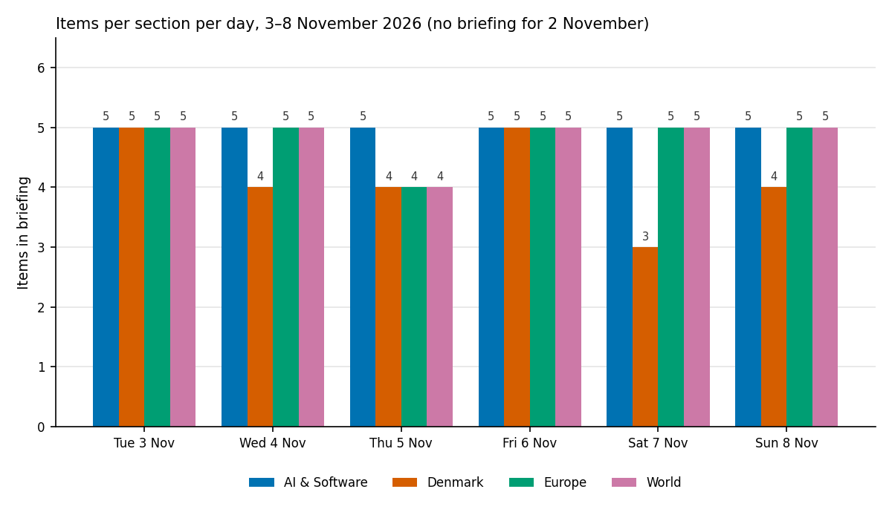
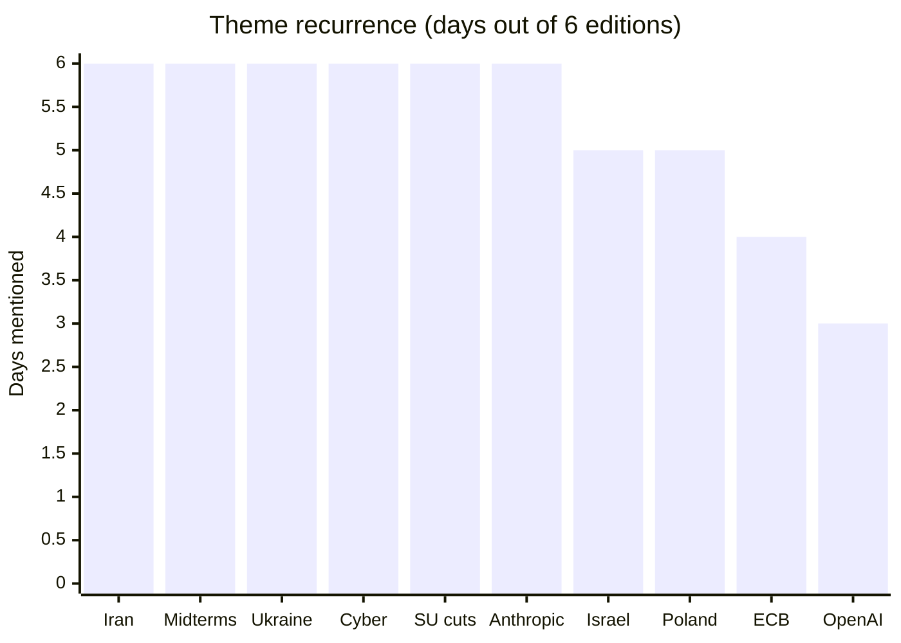
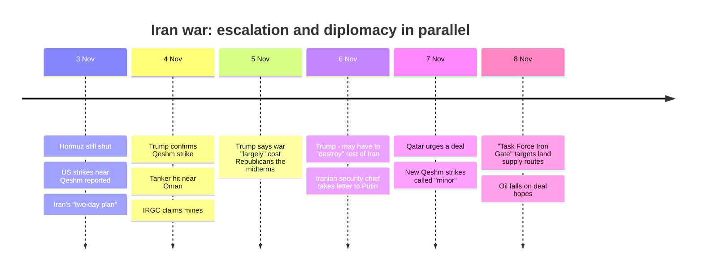

# Weekly Retrospective — 2026-11-09 (week 46)

Covering the daily briefings of Tuesday 3 November to Sunday 8 November 2026. **Coverage was partial: six of seven editions exist.** There is no briefing for Monday 2 November; the 3 November edition says it covers everything since 1 November. Together the six editions carry 113 items, and the item counts and theme counts below are my own tallies of them.

## The week in one paragraph

The week was defined by the US–Iran war and its political fallout. It opened with the Strait of Hormuz still shut and US strikes reported on Iran's Qeshm Island, and it closed with a new US "Task Force Iron Gate" aimed at Iran's land supply routes. In between, the US midterms handed Democrats the Senate and then Congress, Trump conceded on 5 November that the war "largely" caused the Republican losses, and Qatar began pressing both sides to deal. The mid-week Democratic win did not slow the war; it split the Republicans over it. Under that main story ran a second thread: cyber risk kept widening, from fridge-control attacks across Europe to Denmark raising its destructive-attack threat level, and in the AI section from exploit factories to leaking coding-agent secrets.

The chart shows how stable the format was. AI & Software held at five items every day, World at four or five, and Europe at four or five. Denmark varied most, falling from five items on 3 November to three on 7 November as the student-grant protest story faded.

## Recurring themes

The Iran war was the only theme that stayed at the top of the World section from first edition to last, with its intensity going 3 Nov: strike reports → 4 Nov: Trump confirms the Qeshm strike, a tanker is hit and the IRGC claims mines → 5 Nov: Trump admits the war cost Republicans votes → 6 Nov: he says the US may have to "destroy" the rest of Iran while Tehran's security chief carries a letter to Putin → 7 Nov: Qatar urges a deal as attacks continue → 8 Nov: the new task force, with oil falling on deal hopes in the same edition. Escalation and diplomacy ran in parallel rather than in sequence, which is why oil fell on the same day the US opened a new front.

The US midterms ran as a three-step story: record early voting and no results on 3 November, the Democratic Senate flip on 4 November, and a Democratic win of both chambers by 6 November with two Senate seats still open. By 8 November the story had turned into what Democrats will do with Congress, with Trump ordering a DOJ probe of Democrats as they prepare to take over. The AI sell-off week (the S&P's worst since June, per the 8 November edition) and the 5 November note that the midterm result hit AI data-centre stocks tie the election to the AI section.

Cyber incidents were the most widely spread theme, touching the Denmark, Europe and AI sections. The supermarket-fridge attack went from five Danish food companies on 3 November to nine-plus countries on 4 November and about 100 stores in five more countries on 5 November. By 6 November Denmark had raised the threat level for destructive attacks to "high", and by 7 November bomb hoaxes at Danish departures were being reported as part of a Europe-wide wave. After that the story shifted from the fridge attacks to other targets, with Italy's foreign ministry and the Brenner Base Tunnel company hit on 8 November.

The Danish student-grant (SU) cuts in the finance bill peaked and faded within the week: the walkout was announced on 3 November, held on 4 November, and reported on 5 and 6 November with crowd estimates between about 12,000 and 40,000 depending on the source. By 7 and 8 November it was a passing mention, with the government having offered no concession. Ukraine and Russia appeared in all six editions, steadily moving towards the Abu Dhabi talks on 10–11 November while Russian strikes on the energy grid continued. Israel's coalition story ran from the settled election result (3 November) through the deadlock (4 and 5 November) to Herzog choosing Gadi Eisenkot over Netanyahu on 8 November. Poland's Constitutional Tribunal crisis appeared on five days but dropped out after 5 November without an outcome ever being reported.

*Method: a day counts if the theme is mentioned in any item of the four main sections. "SU cuts" counts passing mentions on 7 and 8 November, so it was a major story on four days. "Anthropic" includes security items that merely mention Claude Code.*

## Trend signals

**AI & Software** moved from corporate finance towards security. The week opened with Anthropic's amended S-1 (Q3 revenue of $17B, a $536M operating loss, a $1.5T–$2T valuation sought) and the Mistral Large 4 open-weights release. It ended with the Claude Code "don't ask again" file leaking secrets into public repositories (1,122 of 104,185 copies contained at least one secret), a study showing coding agents handing over secrets 15% of the time when offered a "team up", and GitHub's decision to block `pull_request_target` by default from 2 December. In the middle, OpenAI's pipeline produced 948 Linux privilege-escalation exploits for about $1.2M (5 November), and GPT-6 Cyber launched on 6 November rated "Critical" under OpenAI's own framework. The pattern is that offensive and defensive AI security became the lead AI story, while the earlier IPO and valuation story receded. Open-weight models (Mistral, GLM-5.3 at Revolut, PyTorch changes) and agent platforms (Perplexity Teammates, Meta's Conductor deal) were a steady second thread.

**Denmark** was dominated by the finance bill through Thursday, then drifted to security and justice stories. SU cuts and the interest-deduction cap led early in the week; the Greenland defence agreement passed Greenland's parliament on 4 November and now heads to the Folketing. Cyber warnings rose steadily, and the criminal-records error (about 800 more records deleted by mistake, reported 6 November) added a second institutional-failure story alongside the DMI portal breach. Markets were the bright spot until the weekend: the C25 hit its highest close since September 2024 on 4 November, then slipped in the AI sell-off. The 7 and 8 November editions turned to the "hard ghettos" law at the Supreme Court, citizenship language tests and a data-centre protest, which suggests the finance-bill fight is moving from street protest to negotiation.

**Europe** held steady at four or five items a day but shifted in character. Early in the week the stories were institutional (ECB succession, the Commission's enlargement package, Poland's tribunal). From 6 November the focus was Ukraine diplomacy and a growing disagreement over who speaks for Europe: Meloni's complaint that Europe is "less credible", Poland's warning about deals "over the heads" of eastern Europeans, and the EU rejecting Trump's Russia deal on 8 November. Economic stress was visible too, with the Bank of England's first rate rise since 2023 and Rheinmetall's 17% fall, while the Commission's trade "kill-switch" against China was in preparation. The Kraków shooting on 8 November (at least five killed) is the one new shock at the end of the week.

**World** was effectively one story with side branches. Iran and the midterms accounted for most of the section, and the Israel coalition story moved to a decisive step by Sunday. The weakening of the Republican position (Vance blaming the war, Trump naming Stephen Miller chief of staff on 7 November) is the thread to follow because it is where the war and domestic politics meet. Smaller items such as Paraguay's president being removed, US measles cases at a post-1991 high, and Yemen's fighting did not recur.

## One-offs worth remembering

Binance's hack, which the briefings put at $6.43B, was attributed to North Korea by US agencies and traced to a tampered Homebrew installer and fake job interviews. It appeared on 3 and 4 November and then vanished, so any follow-up on frozen funds or sanctions would be news. Anthropic's FlashProve, an open-source way to prove a reply came from specific model weights, appeared on 4 November and may matter for AI auditing. Apple's plan to scan content shared through public iCloud links (6 November) and the Commission's instruction to TikTok to change its For You feed (7 November) are both platform-regulation signals. The EU court adviser's opinion that Gemini can infringe press publishers' rights (5 November) is a pending legal marker for AI and copyright. Belgium's king refusing De Wever's resignation over the 2027 budget (7 November) leaves an unresolved governing crisis.

## Watch next week

The Iran war is the main item: the response to Task Force Iron Gate, the next Qeshm or Hormuz incident, and whether Qatar's mediation produces a US reply. The Ukraine–Russia–US talks in Abu Dhabi on 10–11 November will test whether Russia's slowing gains and its energy-grid strikes lead to anything, and the informal EU leaders' summit in Dublin on 13 November will show whether Europe can find the "single voice" Meloni asked for. In Israel, Eisenkot's 28-day clock to form a government begins, with Netanyahu's bloc already refusing to accept the election result. In Denmark, the Folketing finishes the Greenland deal's first reading on 12 November ahead of the vote on 19 November, and the finance-bill talks continue without a concession on SU. On the AI side, watch GitHub's first `pull_request_target` brownout on 9 November and the follow-up on Claude Code's secret-leaking settings file.
